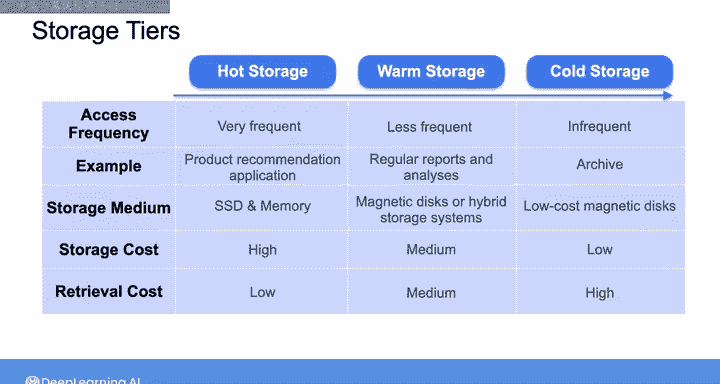
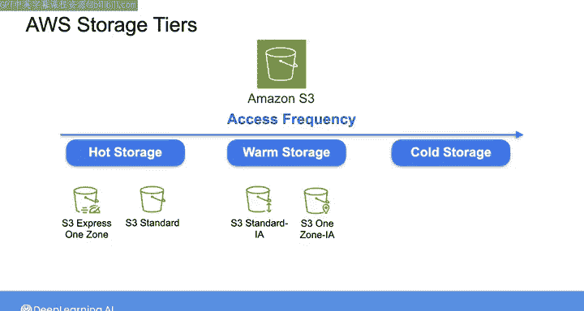

# 吴恩达《数据工程（导论，源系统、数据摄取和管道，数据存储和查询｜1-2-3课）｜DeepLearning.AI Data Engineering》 - P143：5_存储层级：热数据、温数据、冷数据.zh_en - GPT中英字幕课程资源 - BV1wTtWeeEH5

Most cloud data storage services offer different storage tiers you can choose from depending on your cost access speed。

 access frequency and compliance requirements when choosing a storage ti。

 I recommend you consider the hot warm and cold data classification method that's based on how frequently data is access and used on one end of the spectrum you have hot data which is data that's access frequently and requires fast retrieval times for example。

 in a product recommendation application you need to frequently access the product catalog and the purchase history of your users you might also want to store the results of frequently run queries in a cache so that you can quickly serve customers with product recommendations to serve fast read access you typically want to store hot data and systems that utilize highperance storage mediums like SSD and memory so the storage cost for hot data is typically more expensive but the retrieval time and compute resources required to access the data is relatively low because you store data in a way that optimizes for fast。

。Warm data is accessed less frequently than hot data。

 but still needs to be readily available for example。

 this could be data that's used for regular reports and analysis that don't need to be updated in real time You typically want to store warm data in lower cost storage systems that utilize slower magnetic disks or hybrid storage systems。

Compared to hot data， the storage cost for warm data is lower。

 but it typically takes more time and compute resources to retrieve the data then on the other end of the spectrum you have cold data this is data that's rarely accessed and is often archived for example you might decide to archive project documentation or keep old emails for compliance purposes you want to store cold data and the most costeffect storage tier that's built on lowcos magnetic disks so the storage cost for cold data is the most inexpensive but compared to warm data it will take you longer and require more compute resources to retrieve this data in general the storage price goes down as you move from highper storage with fast access to lower performing storage with slower access if you store all of your data in hot storage you'll be able to access your data very quickly but at a tremendous storage price and if you store all your data in cold storage then you'll save on storage costs but it'll be at the expensive long retrieval times and high compute required for data access。

So you'll typically want to choose a combination of storage tiers for your various storage needs as an example。

 when storing data in Amazon S3 you might store your frequently accessed hot data for realtime transactions in what's called the S3 Express Onezone or the S3 standard tiers you might storear warm data that needs to be accessed say weekly or monthly for fine tuning product recommendation system and the S3 standard infrequ access or S31zone infrequ access tiers and finally you want to archive historical cold data in one of the S3 glacier tiers when designing your storage solutions aside from access frequency you also want to consider things like the scalability and durability of your storage solutions。

In the next video， we'll dive deeper into distributed storage systems and discuss the trade offs associated with that architecture。

 I'll see you there。