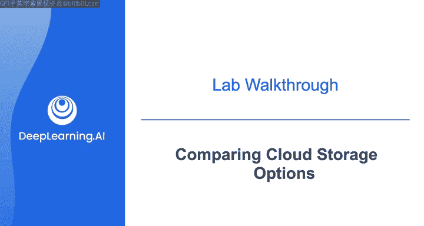
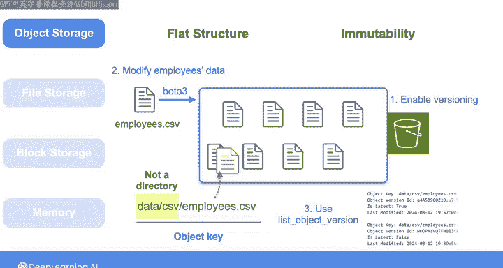
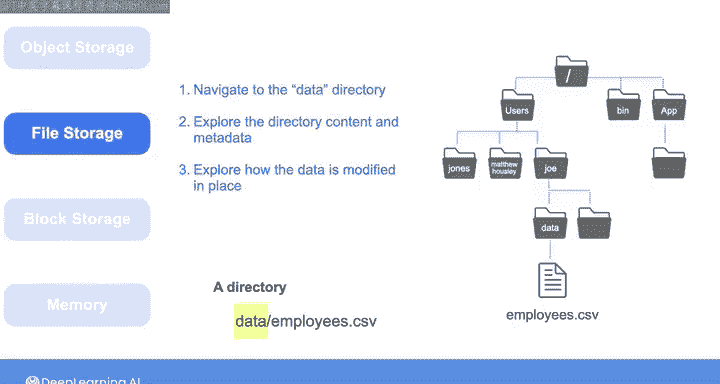
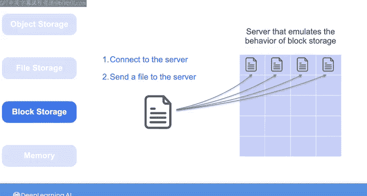
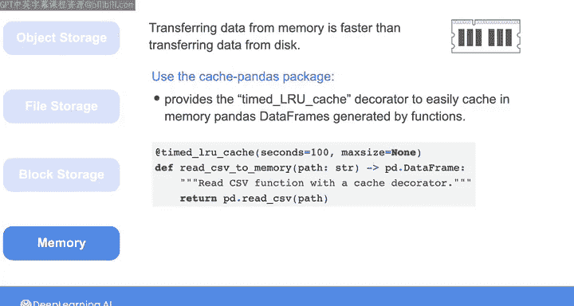
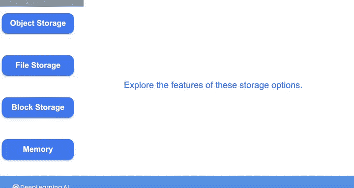

# 吴恩达《数据工程（导论，源系统、数据摄取和管道，数据存储和查询｜1-2-3课）｜DeepLearning.AI Data Engineering》 - P145：7_实验演练：比较云存储选项.zh_en - GPT中英字幕课程资源 - BV1wTtWeeEH5

In the first lab of this week， youll explore some features of cloud object storage。

 file storage and block storage through a set of exercises。

 You will also interact with a RAM of the server that's hosting the lab to understand how inmemory storage features like caching can significantly enhance data retrieval performance over diskbase storage systems before you jump into this demonstrative lab Let's quickly go through the exercises you'll see with object storage。

 you will explore the flat structure of the storage option and the immutability of its object you will use Bodo3 to upload a csv file containing some employee information to an S3 bucket when you upload the file to the bucket you will choose the key data s csv employee csv as the identifier for the created object the prefixed data csv is just part of the object key and does not represent an actual directory in the lab you will complete a function that will show you that the prefix data csv does not represent an actual object in the S3 bucket while data csv s employee cv。

😊，DoesRe an object you can create different objects that share the same prefix。 For instance。

 if you want to organize your sales data by year， you can specify the year in the object key and use it as a prefix to represent all the data object that correspond to the sales of that particular year This helps you organize your data and more quickly retrieve the object from the right bucket since objects are immutable you can't modify them in place so if you upload an object using the same key of an object that already exists in your bucket。

 then the old object will be replaced with the new object or as you've seen in the previous course you can enable object versioning so that when you upload an object using the existing key。

 the old version is kept and a new version of the object is created in this lab。

 you'll again experiment with a feature and enable versioning and the provided bucket you'll modify the employee data and then upload it again using the same key you will then use the Bo3 list object version method to verify that a new version of the object is created This method returns the metadata of the old。

New versions of the object like you see here after you complete the exercises with object storage youll explore the hierarchical structure of file storage systems So in a file system。

 you might see a path like data employees csv here data refers to a directory which you can think of as a special file that contains information that allows you to access other files So in this lab you will use the command line to navigate the data directory then explore its contents and metadata you will also explore how the data is modified in place in the type of storage file systems are generally built on top of block storage which is in general abstracted from you so to explore some of the block storage features in the lab you will be provided with a server that emulates the behavior of block storage you'll connect that server and send a file to it the server will then mimic how block storage stores data by decomposing the file into blocks and finally you'll interact with the RamM of the server that's running the lab environment Earl this week you learn that transferring data from memory is faster than transferring。

Data from disk and that certain databases allow you to cache the query results in memory so you can quickly access them you'll test this feature using the cache pandas package。

 This package provides the timed LRU cache decorator that you can use to easily cache in memory pandas data frames that are generated by functions so that the next time you run the scripts itll return the cache data frame rather than running the function again you'll use the decorator with a function that reads a cv file into a pandas data frame you will compare the time it takes to read the file for the first time with the time it takes to read the same data stored in memory but since memory has limited storage capacity whenever you load data into memory。

 you need to make sure that you have enough space to monitor your memory storage capacity itll use the command Htop which provides you with a real-time overview of your system's CPU usage memory and running processes as shown here at the top。

 the bars represent the usage of the system resources including CPUs and memory each line below corresponds to a process and contains。

CPU and memory usage so now it's your turn to go through these exercises and explore the features of these storage options after you've had a chance to try out the lab I'll see you in the next lesson where we'll explore how databases store data and look at different types of databases。

