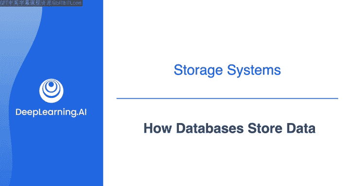
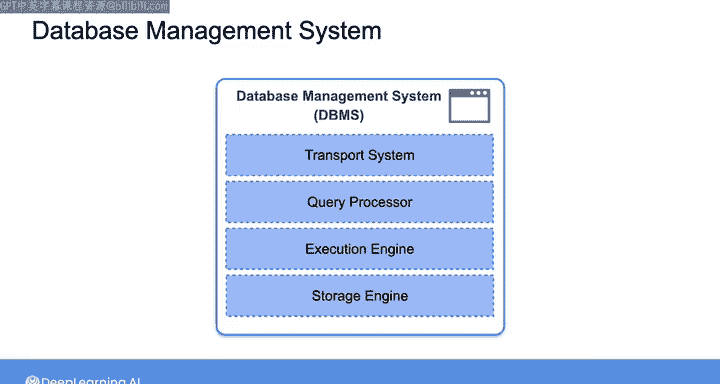
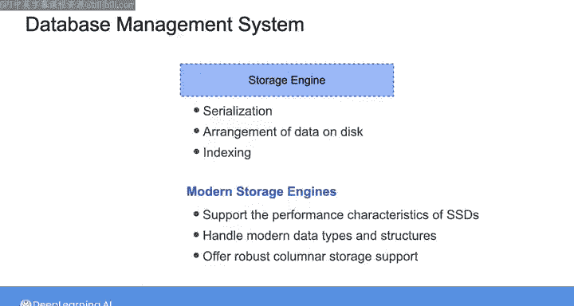
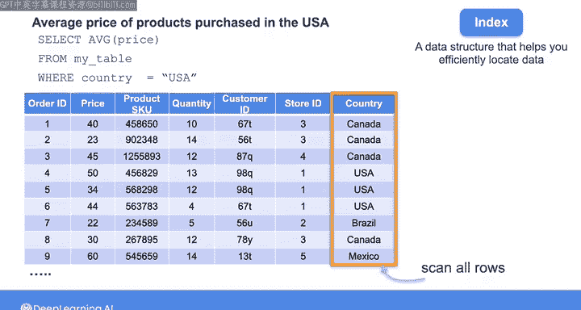
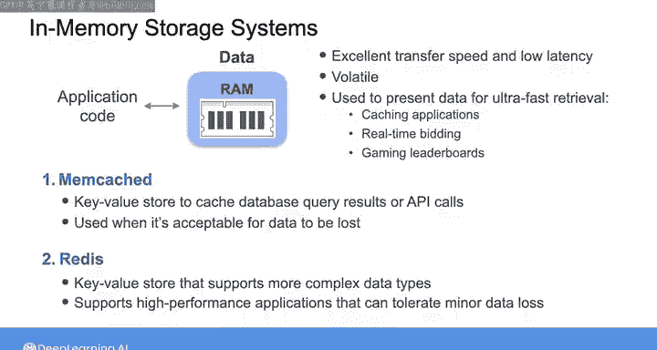

# 吴恩达《数据工程（导论，源系统、数据摄取和管道，数据存储和查询｜1-2-3课）｜DeepLearning.AI Data Engineering》 - P146：8_数据库如何存储数据.zh_en - GPT中英字幕课程资源 - BV1wTtWeeEH5

Like I mentioned in the previous courses， one of the most common types of source systems you'll interact with are databases。

 specifically relational databases， and you'll use databases throughout all the stages of the data engineering lifecycle So in this video let's dive deeper into how databases store data databases typically come with a software layer known as the database management system or DBMS that facilitates your interactions with the database This is true for the relational databases you saw in course 2 and for non-relational databases such as graph and vector databases that you'll explore in more detail later in this lesson。

 a DBMS consists of a transport system， query processor， execution engine and storage engine。

You'll learn how all these components work together to process a query in the last week of this course。

 but for now let's focus on the storage engine。

The database storage engine does the heavy lifting for you when it comes to physically storing data on disk。

 including serialization， arrangement of data and indexing。

 you will likely work with modern storage engines that are optimized to support the performance characteristics of SSDs and can handle modern data types and structures like variable length strings。

 arrays and nested data as organizations started to apply analytics on large scale data。

 modern storage engines have also evolved to offer robust column storage support for analytical applications when you want to retrieve data from a database by writing a query。

 speed is typically very important， supposeuppose youre query a very large relational table with millions or even billions of rows and you're particularly interested in the rows related to certain countries say you want to find the average price of products purchased in the USA you can write a SQL query to select the average value of the price column from my table and filter the results where the country column equals USA。

Note that I'm using a SQL query here because I want to query a relational database and the lab at the end of this lesson itll use a different query language to query a graph database。

NowBack to this example to execute the query， the query processor would have to scan the entire table each time to find the record satisfying this filter condition。

 It turns out that you can speed up data retrieval by using a special data structure called an index you can think of indexing as a way to keep some metadata on the side to help you locate the data you want more efficiently in most relational database management systems indexes are typically used for primary table keys in foreign keys。

 but you can also apply indexes to other columns to serve the needs of specific applications In this example where you can create a separate index table that consists of two columns one that includes the country values sorted in alphabetical order and the other that consists of the memory addresses referencing the corresponding rows in the original table then when you execute a query to find the average price of products purchased in the US the query processor can use binary search on this du indexd table to locate the rows that have a country code of USA This is much faster than scanning all the rows in a linear。

Fashion to look for a specific country code If you're familiar with computer science。

 you'll see that you're effectively reducing the time complexity of the retrieval operation from ON to O log N。

 If you're not familiar with this notation。 Don't worry about it It's most important that you understand how locating a specific country code from a sorted list is faster than scanning all rows。

 So this is one example of indexes， and there are many other types of index structures depending on the database type and your use case Now I want to quickly mention in memoryory databases that use Ram as a primary storage layer although RamM offers excellent transfer speeds and low latency。

 it's also extremely volatile。So in memorymory databases are generally used in applications that require ultra fast data retrieval such as caching applications。

 real time bidding， and gaming leaderboards。But these databases should not be used for retention or persistent storage purposes For instance。

 you might use a key value store like MeMCash to cache database query results or API calls where it's acceptable for data to be lost if the machine is restarted you might also encounter a popular memorybased storage system called Redis which is a key value store that supports more complex data types Redis has several built in persistence mechanisms including snapshoting and journaling you can use this key value store for extremely high performance applications that can tolerate a small amount of data loss。

Now that you've seen how database engines store data and optimize the retrieval of data within databases。

 let's take a closer look at two common approaches for storing structured and semistructured data in databases。

 join me in the next video to compare the storage patterns and query performances of row storage and column storage。

