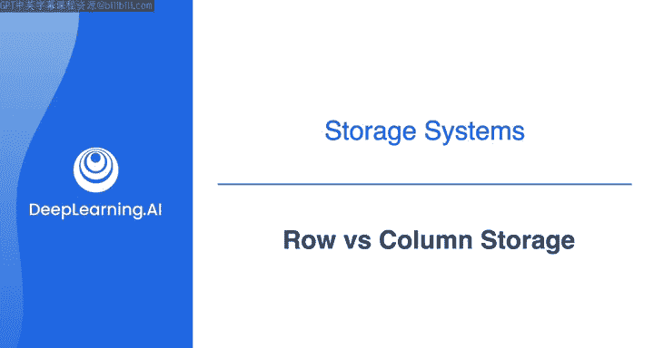
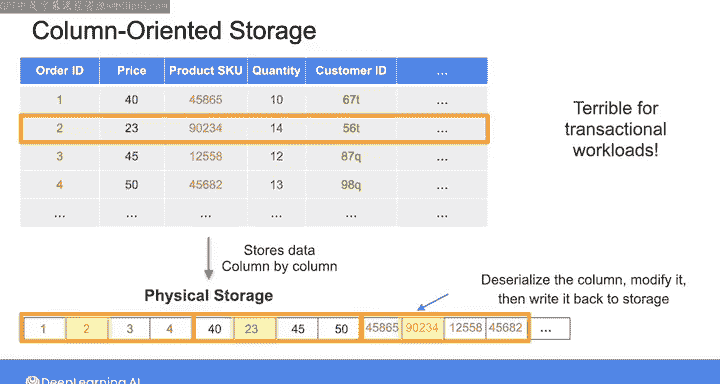

# 吴恩达《数据工程（导论，源系统、数据摄取和管道，数据存储和查询｜1-2-3课）｜DeepLearning.AI Data Engineering》 - P147：9_行存储vs列存储.zh_en - GPT中英字幕课程资源 - BV1wTtWeeEH5

There are many types of databases you use to sort the kinds of data you'll be working with as a data engineer in previous courses you've already seen how relational databases keyvalue stores and document databases store data and later this week you'll learn how data is stored in other types of databases like graph and vector databases In this video I want to focus on two common ways to store structured tabular data and semistructured data that's commonly used in data engineering first you can sort this data in a roworiented storage system or second you can sort in a columnoriented storage system as a data engineer you'll choose between these two storage patterns based on your data access pattern。

 which is to say how the users and the system access your data Tra relational database management systems use roworiented storage to store data row by row reachach row represents a complete record。

If you zoom in on the physical storage medium you'll find that each row or in the case of semistructure data。

 each object is stored as a consecutive sequence of bytes on disk This way of storing related data next to each other makes row storage perfect for oilTP systems that need to perform read and write operations with low latency say you want to query the data to locate a particular record based on the ID column since all the data for that record is stored together once you have located that specific ID you can efficiently read and update that data but what if you want to perform an analytical query that requires you to operate on the values of an entire column analytical queries focus on summarizing or aggregating columns to answer questions like what was the total revenue which product was sold most frequently or what was the average quantity let's take a look at how these queries perform on row storage let's say a row storage contains data with 1 million rows 30 columns or each entry is 100 bytes。

Suppose that the second column represents price and you want to find the sum of all these prices。

 so I'll write a query that selects the sum of the price column from a table called my table to execute this query you need to first transfer all the rows1 by one from the persistent disk storage to RAM then these rows will be sent to the CPU for processing where the price from each row will be extracted and added together so the total data size you need to transfer to RAM is 1 million rows times 30 entries per row times 100 Btes per entry which is 3 gigabtes if the disk you're using has a data transfer speed of 200 mebytes per second。

 how long would it take to read all the data to memory。Well that would take 3 gigs。

 which is 3000 mebytes divided by 200 MBtes per second。

 which is 15 seconds to read all the data from disk to Ramm that's not too bad。

 so the row storage pattern works fine for performing analytical queries on small datasets in the short term but it's not scalable imagine that instead of 1 million rows you actually had 1 billion rows of data so your data size would be 3000 gigs at the same transfer speed that would take you just over four hours to transfer all the rows with all their columns from disk to Ram so to accommodate such largescale data transfers。

 engineers designed another storage pattern the columnoriented storage or columnoriented database which is a type of NosQL database when you store data in column storage the data from each column is stored together on disk。

So all the data from the first column is stored together。

 then the data from the second column is stored together and so on。

 And so this allows you to read full columns of data all at once rather than having to scan each row for the data in a single column Let's take a look at the analytical query performance of column storage using the same example as before say you want to again find the sum of all the values in the price column of a large data set containing 1 billion rows 30 columns where each entry is 100 bytes Since column storage stores the data from each column together to execute this query。

 you'll only have to transfer the data from the second column from disk to RAM that means the size of the data you need to transfer is the 1 billion entries from the second column times 100 bytes per entry which is 100 gigabtes supposeupp we have the same data transfer speed as before 200 mebytes per second and how long would the transfer take Well it will take 100 gigabytes。

 which is 100，000 mebytes divided by 200te。second， which is just over eight minutes。

Comparing this to the four hours it would have taken with row storage you can see that column storage is much more efficient when it comes to analytical queries on large datas。

 That's why columnoriented database are more suitable for OLAP systems I focus on applying analytical activities on data however。

 for exactly the opposite reason column storage is terrible for transactional workloads because you can't easily access the individual data rows If you want to read a particular record you have to reconstruct the row by reading data from several columns and if you want to update one field in a particular record you need to desialize the columns。

 modify them then write it back the storage As a data engineer it's important that you understand the difference in how row storage and column storage work so that you can choose the right approach for your use case namely using row storage for transactional workloads like the production database for your sales platform and using column storage for analytical processing in the next two optional reading items you can learn more about the parquet format that combines both row。

and columnoriented storage approaches followed by a reading on wide column databases while Parquet is a popular and common format in data engineering today。

 wide column databases are less common but can be well suited for transactional workloads in the video after that we'll take a look at graph databases that have gained attention alongside the growth of machine learning and generative AI applications I'll see you there。

