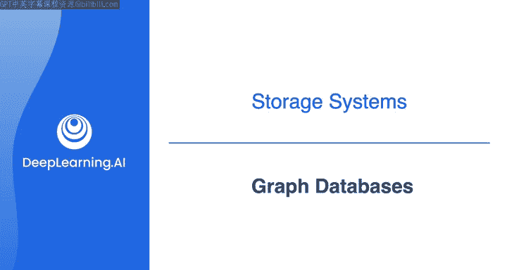
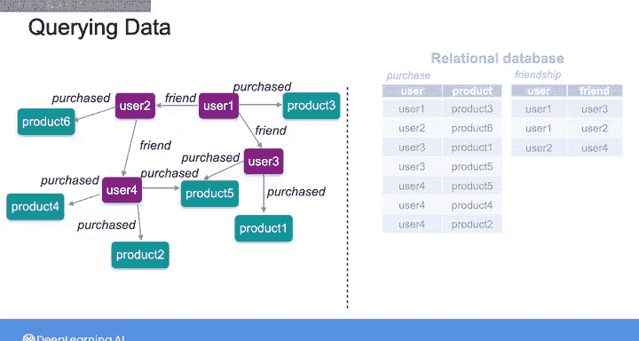
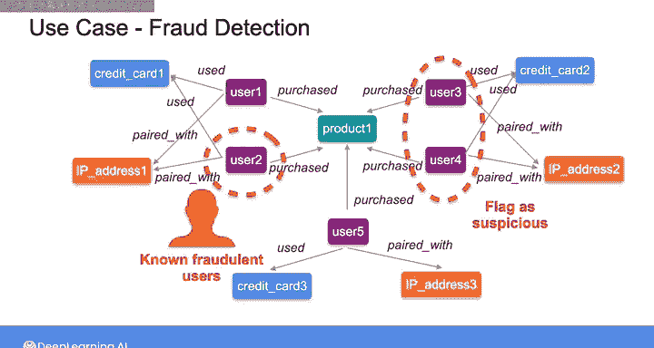
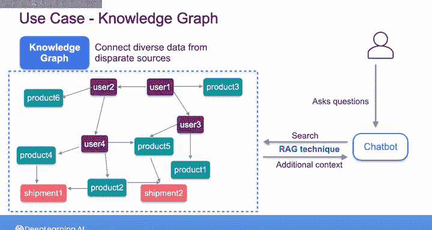
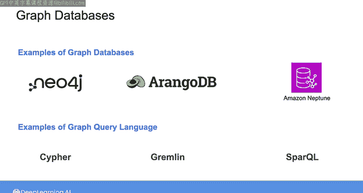

# 吴恩达《数据工程（导论，源系统、数据摄取和管道，数据存储和查询｜1-2-3课）｜DeepLearning.AI Data Engineering》 - P148：10_图数据库.zh_en - GPT中英字幕课程资源 - BV1wTtWeeEH5

Graph databases store data within a mathematical graph structure using nodes and edges nodes represent your data items which are typically entities such as people products or locations among other things。

 and edges represent the relationship or connection between these data items with modern applications you might encounter graph databases if you're building a data system for a use case that involves complex connections between data entities for instance。

 if you work at an ecommerce-commerce company you might use a graph database like this one to store data about the relationships between users and products you could of course store this data in a relational database like this one on the right。

Gra databases treat relationships as firstclass citizens so you can very easily see the relationships between entities using a graph database compared to using a relational database when you want to query the data in a graph database。

 meaning you want to query the relationships between nodes and edges。

You can traverse the graph structure For example， let's say you want to recommend to a user the products that were purchased by the friends starting with user one。

 you can traverse the graph by following the edges labeled friend to identify all the friends of this user then for each friend you can follow the edges labeled purchased to create a list of the products that these friends have bought in the past and that you want to recommend to user one if the same data was stored in a relational database like a have here on the right。

 then to create the list of recommendations for user one you would join the friendship table with a purchase table or the friend and friendship matches with the user in the purchase so that the joined results contain rows of users along with a friends and products purchased by their friends then you would filter this queries that you would only get information for user one。

 then you could select the distinct products to get a list of the products that you should recommend to user one Now you can imagine that if you wanted to recommend even more products to a user。

 say by considering the products that were purchased by the friends of their friends。

Then querying a relational database like this would require even more joins。

 and that can get out of hand very quickly。Aside from product recommendation applications。

 there are many other use cases for graph databases， including modeling social networks。

 representing network and IT operations， simulating supply chain logistics and tracing data lineage。

Another not so obvious use case is in fraud detection， say， in E-commerce transactions。

 you can build a graph to model the relationship between entities such as customers。

 the products that they purchased， the credit card used for the purchases， and their IP addresses。

Then you can identify suspicious activity by comparing these relationships with no fraudulent ones。

 For example， suppose that you know that many fraudulent transactions include a credit card number that's already associated with one being used by a new user at a new IP address。

 then by analyzing the relationships between users， credit cards and IP addresses in this graph。

 you can flag all users who are using a credit card that's already associated with another user but now from a new IP address as being suspicious。

You can also use graph databases to create knowledge graphs to connect data from disparate sources for a variety of use cases like to enhance the accuracy and reliability of chatbots So for example。

 here you could create a knowledge graph to connect product customer and shipping data across an ecommerce-commerce company when a user chats with a chatbot you can starts to knowledge graph for relevant information to provide additional context to the underlying large language model through a technique called retrieval。

 augmented generation or RAG this technique gives the LLM access to fresh data that's relevant and specific to the e-commerce company itself。

 improving the query results。

We won't be getting into specific generative AI topics in these courses。

 but it's a very exciting time for generative AI and as a data engineer。

 I would encourage you to learn more about these topics by checking out the links to additional resources at the end of this week and so with all these potential use cases for graph databases you need to develop some experience working with them nowadays you can choose from many different graph databases including Neo4j Arrongodb and Amazon Neptune with these databases you'll use specialized languages like Cypher Gremlin and Sparle to query data in the lab at the end of this lesson。

 you'll get to play around with Neo4j and the Cypher queryry language aside from being a graph database Neo4j also has integrated vector search capabilities commonly found in vector databases so before you jump into the Neo4j lab in the next video I'll show you a bit more about vector databases and how vector search works I'll see you there。

