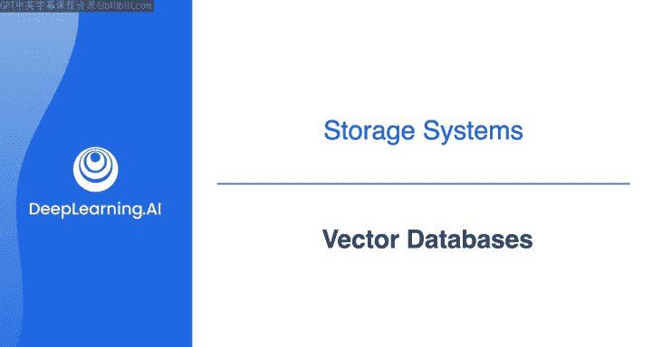
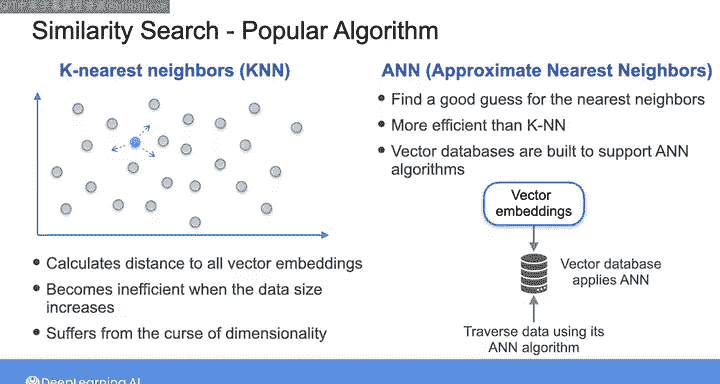

# 吴恩达《数据工程（导论，源系统、数据摄取和管道，数据存储和查询｜1-2-3课）｜DeepLearning.AI Data Engineering》 - P149：11_向量数据库.zh_en - GPT中英字幕课程资源 - BV1wTtWeeEH5

Another type of database that's gained popularity with the rise of machine learning applications is the vector database Ve databases enable you to efficiently query data based on semantic similarities This is called similarity search and it has applications from recommendation systems to anomaly detection to text generation For example。

 if you wanted to recommend a product to a customer。

 you might query a vector database to identify products that are similar to those that the customer has purchased in the past or you can query a vector database to identify transactions that are dissimilar to the transactions in order to detect anomalies and potential fraudulent activities。

These databases are optimized for storing and processing vector data。

 which consists of numerical values arranged in an array so you could use a vector database for storing any kind of data that is in the form of numbers in an array。

 for example， an array of numbers representing the amount of rainfall recorded each day over the course of a year or you could sort numerical data that could be rearranged into a vector like image data。

 where you can unroll the RGB dimensions of the image into an array of numbers。However。

 the importance of vector databases today is really about storage and retrieval of what are called vector embeddings。

 The core idea with vector embeddings is to take an item like a text document or an image and capture its semantic content using a vector the way this works is that you pass the original data say a piece of text through a machine learning model that has been trained to convert text to vector embeddings you can then convert an entire database of documents or other text content into such embeddings and store them in a vector database the advantage of storing vector embedding representations of other types of content is that it's much easier and much faster to find and retrieve similar items based on their vector representation then it would be to compare across the original database items。

 So for example， suppose you have an item like a piece of text and you want to find items in your vector database that are similar to that text than to query the database you first need to compute the embeddings for the query item then the database can measure the similarity between any two vectors and return those that are most similar vectors that。

Similarar to one another sematically will be closer to one another in the high- dimensionmensional vector space the vectors are represented in and by closer。

 I don't only mean closer to one another in terms of the Euclidean distance you see here。

 which measures the length of the line segment between the endpoints of two vectors。

 you can also determine the closeness of two vectors by using other types of distance measures like the cosine distance which determines the closeness based on the angle between the two vectors or by Manhattan distance which is based on the distance between the vectors measured along their axes as well as other metrics and so there are many algorithms available to you for performing a similarity search over a database of vector embeddings。

Let's take a closer look at one of the more popular algorithms， K nearest numbers or canN and search。

 say you want to find the K most similar items to a given item。

The KNN algorithm will do an exhaustive search over all the vector embeddings of all items to compute the distance between those items and the given one。

 You can imagine that as the size of the vector database increases。

 this algorithm becomes less efficient。 This also the challenge of what's called the curseive dimensionality。

 which is to say because the high dimensional vector space may be sparse。

 distance measures might not reflect the accurate distance between them。

To overcome these challenges you can use a different set of algorithms known as ANN which stands for approximate nearest neighbors These algorithms rely on finding a good guess for the nearest neighbors to a given item rather than calculating the exact distance from all the items so even though they may result in slightly less accurate results they are a lot more efficient In fact。

 vector databases are built to support ANN algorithms to enable you to perform efficient similarity search when storing a vector embeddings in the vector database the database applies an anNN algorithm to represent your data in a data structure that enables faster search then when you  query the vector database to perform a similarity search based in the given item the database uses a specific ANN algorithm to traverse the data structure to return the items that are approximately the closest I included an optional reading item about a popular ANN algorithm known as hierarchical navigable small world or HNSW after this video feel free to read more about the algorithm if you're interested to learn。

Then in the next video， I'll walk you through how to use the Cypher query language to query data in a Neo4J graph database to get you set up for the lab。

