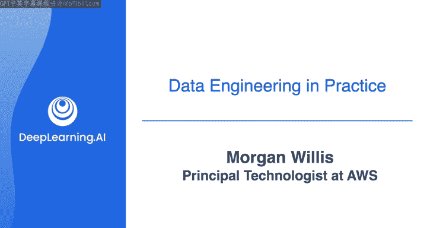

# 吴恩达《数据工程（导论，源系统、数据摄取和管道，数据存储和查询｜1-2-3课）｜DeepLearning.AI Data Engineering》 - P14：13_认识Morgan Willis.zh_en - GPT中英字幕课程资源 - BV1wTtWeeEH5

It's my pleasure to introduce to Morgan Willis， principal cloud technologist at AWS。

 You might even recognize Morgan from one of the other courses she has taught on the Coursera platform like the AWS cloud practitioner and cloud technicalchnly essentials courses it's great to have you with us Morgan Glad to be here Joe So before we get started do you want to give a little bit more of an introduction to yourself and your background and he you came to be teaching the world about how to build cool stuff on AWS Yeah absolutely so I started with a degree in computer science and I worked as a software developer for some time and I really did love coding。

 but I also realized that I loved teaching so I transitioned to start a career as an instructor at a software development bootc and then I landed at AWS as a trainer and now I teach our online courses for platforms like Coursera and I love this job it's definitely a dream job for me helping people realize their potential in the cloud That's awesome。

Com to building a solid foundation in the world of data engineering part of that foundation is what you might call a conceptual and theoretical。

 for instance， like some of the things we've talked about this week。

 things like requirements gathering visualizing a data engineering project from end to end is a series of phases and how you can start thinking like a data engineering the other big part of developing a solid foundation and data engineering is to get practice actually building data engineering solutions and that's what you'll be doing in the labs throughout these courses when you first get started building on the AWS cloud。

 it can seem overwhelming you've got concepts like regions and availability zones。

 virtual private clouds subnets。On and on and on That's right you have different options for compute and databases as well as storage options。

 networking and security configurations and that's really just the beginning In fact。

 there's so much to know about data engineering on the AWS cloud that we offer a certification exam so you can become an AWS certified data engineer associate and demonstrate to employers that you know your way around the tools and resources on AWS this certification validate skills and knowledge in core data related AWS services around tasks like the ability to ingest and transform data knowledge of how to orchestrate data pipelines while applying programming concepts designing data models。

 managing data lifecycls and ensuring data quality Through these courses you'll be learning about a lot of the key concepts and technologies that are covered in that certification exam and if you're interested I'd encourage you to keep studying and pursue the certification after you finish the program so what I'd like。

Do this week is start with the basics and get you up to speed with some of the terminology and concepts that you'll be encountering throughout these courses There are no cloud knowledge prerequisites for these courses and as Joe said when it comes to the technical knowledge required to complete the labs we'll be giving you just enough and just in time for you to be successful in those exercises with that being said there's a lot more to the AWS cloud than we have time to cover in detail in these courses and if you're looking for a bit more depth。

 I'd recommend the two courses Joe mentioned at the beginning of this video The AWS cloud practitioner and cloud technical essentials courses on Coursera and beyond that will be providing you additional resources each week to dive deeper if you like well then with that should we get started sounds great take it away Morgan Okay great I'll see you in the next video to get started with the basics of cloud computing on AWS。

