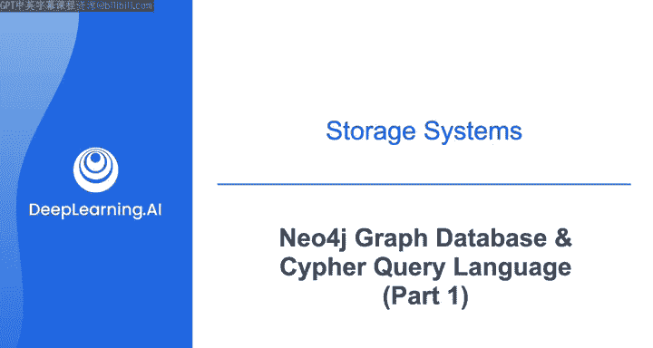
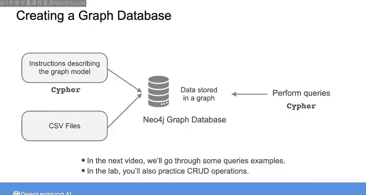
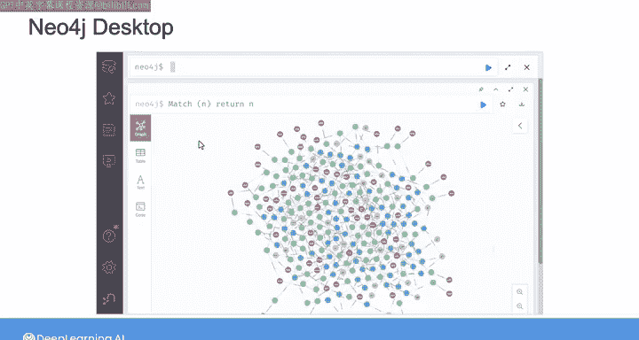

# 吴恩达《数据工程（导论，源系统、数据摄取和管道，数据存储和查询｜1-2-3课）｜DeepLearning.AI Data Engineering》 - P150：12_Neo4j和Cypher查询语言（第1部分）.zh_en - GPT中英字幕课程资源 - BV1wTtWeeEH5

Graph databases such as Neo4j allow you to model your data as a graph and interact with bit similar to how you would interact with relational databases in the upcoming lab。

 you'll explore Neo4j and so here I'd like to show you a particular graph model called property graph model which you can implement in Neo4j you'll also learn how to interact with such a graph using Stypher queryry language in relational databases you can represent your data with a relational model like this that describes a tables。

 the column names in each table and how the tables are related to each other Similarlyly in Neo4j。

 you can model your graph data using the property graph model as shown here note that the diagram describes at a high level the graph structure but it doesn't show the actual data。

 the model describes what types of node exist in the graph and how these are linked together in this example the model consists of five types of nodes customer。

Order， supplier， product and category。The type of node is referred to as the node label。 So。

 for example， if a node represents a category of products， it should have category as its label。

 The edges between each node are called relationships and each relationship has a type。

 which is shown in the text here next to each arrow。

 Each relationship type has a source node and a target node。 So for example。

 the supply relationship has the supplier node as its source node and the product node as its target node。

 Here's an example of some actual data that follows this graph model。

 You can see five customer nodes shown in pink， for each customer。

 you can see the orders they purchased。 what products each order contains to which category each product belongs and who supplies each product。

 You can also see additional information associated with each node such as the I for the order node。

 the customer Id for the customer node and the name of the product for the product node。

 This information is known as the node。You can associate more than one property with each node to further describe the entity it represents specifying the node properties as part of describing a complete graph model。

 hence the name property graph model。 So in this example。

 each customer is associated with this set of properties， including their address， contact name。

 customer I and so on。 Heres an example showing the values for those properties for the customer。

Q U E D， E。And here are the properties associated with the other node labels。

You can specify the properties not only for nodes， but also for each relationship。So， for example。

 each relationship of type orders， which maps in order to a particular product has this set of properties。

 discount， quantity and unit price。 Here's an example showing the values for the properties of this orders relationship。

 There are several ways you can create a graph database in Neo4j。

 One way is to write a set of instructions to Neo4j specifying the details of the graph model such as the nodes。

 their labels and properties， as well as a relationships between the nodes。

 their types and properties and where to find the data for the nodes and their relationships which could be in some cv files。

 Neo4j will create the actual graph with the given data。

 Then you can perform queries to interact with the graph and visualize the query results。

 you'll need to use a cipher query language to create a graph database or to interact with the data in neoo4j。

 So in the next video we'll go through some examples of how you can read information from a graph database using the cipher query language。

 Then in the lab， you will practice with more cru operations to create and。

Nots from a graph databaseIn the lab， you will follow the instructions to open the Neo4j desktop browser that looks something like this I've also created a database following the graph model example you saw at the beginning of this video to learn more about how you can create the graph database and the reading item that follows this video。

 I included a link to the CSV files that I use as well as the cipher instructions that you can use to create the same graph you see here Now that you've seen what a property graph model looks like join me in the next video to go over the cipher query statements you'll use to interact with the graph data in the lab。

