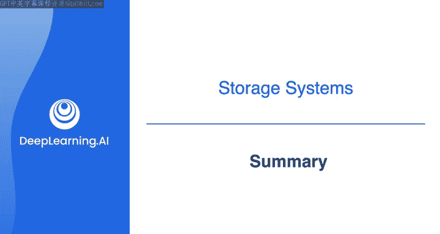
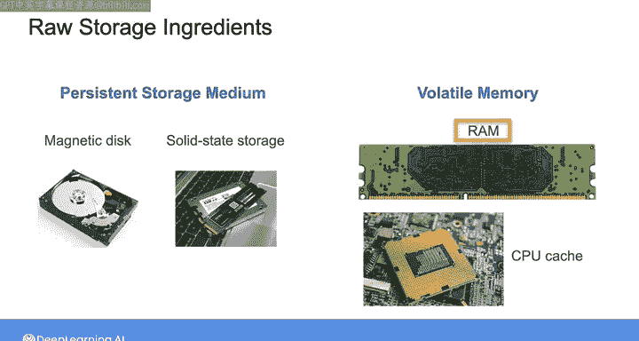
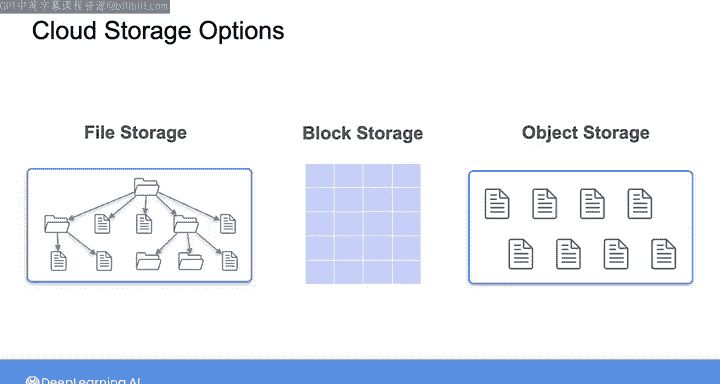
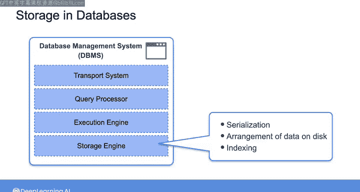
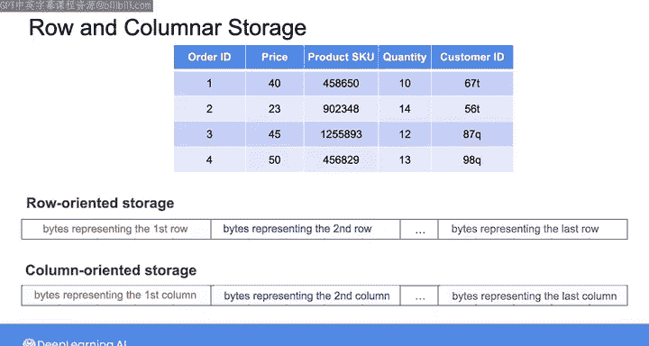
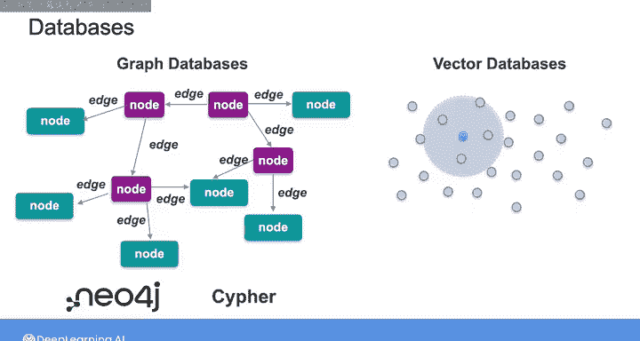

# 吴恩达《数据工程（导论，源系统、数据摄取和管道，数据存储和查询｜1-2-3课）｜DeepLearning.AI Data Engineering》 - P153：15_第1周总结.zh_en - GPT中英字幕课程资源 - BV1wTtWeeEH5

Great job making it to the end of this week's content。

 We covered lots of details in the first two layers of the storage hierarchy。

 the raw storage ingredients and the storage systems that build on top of them。

 we compared the cost and performance of various raw storage ingredients。

 including magnetic disks SSDs and RAM and you considered each of the role in a variety of storage solutions then you build on top of your previous knowledge of object storage and distributed storage systems and explore the differences between file block and object storage in a practical lab。

 even though object storage is probably the most important mechanism for file storage and retrieval in your works of data engineer today。

 you need to be ready to evaluate the performance of each cloud storage option so you can choose the best one for your organization's use case in the second lesson of this week Our focus was on databases you saw that database storage engines are responsible for physically storing and organizing data on disk and through exploring various examples。

 you learned how indexing can be used to improve query performance。 we also。😊。

ve into the details of row versus cameter storage， and you saw different data engineering use cases for each type of format。

 Finally， we surveyed some databases that have gained popularity with a rise of generative AI。

 youll learned how graph and vector databases store and retrieve data and then you got a chance to practice the Neo4j graph database along with the Cypher queryry language next week will move up the storage hierarchy and discuss storage abstractions you'll see how the storage architectures and frameworks evolved with the emergence of data warehouses then data lakes and then data lake houses and you'll explore the details of each architecture。

 I'll see you there。

