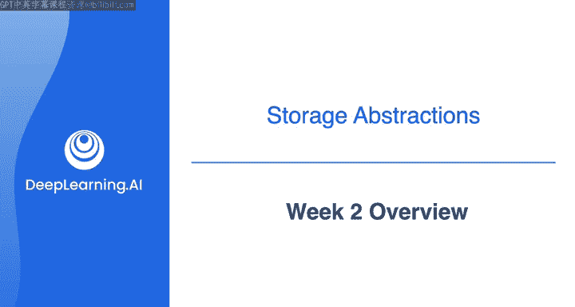
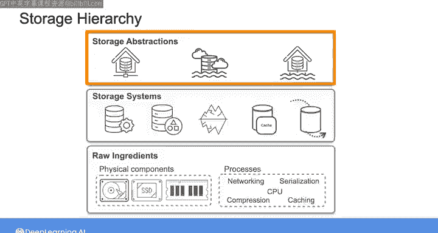
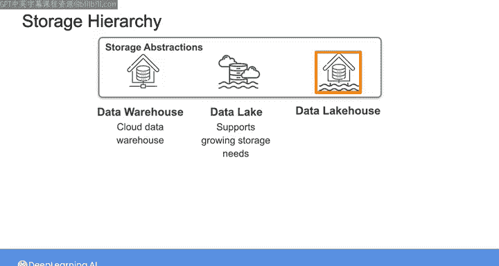
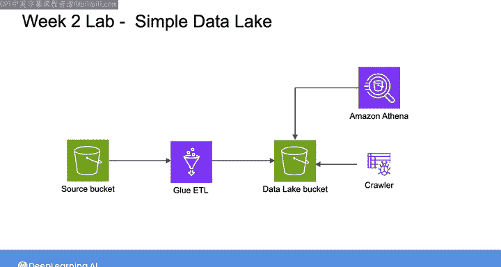
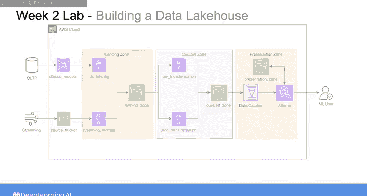
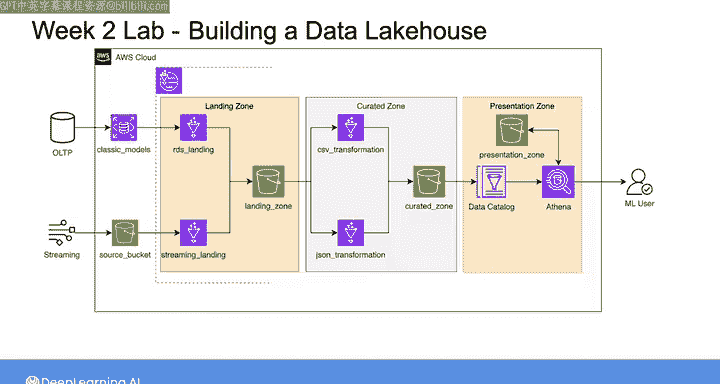

# 吴恩达《数据工程（导论，源系统、数据摄取和管道，数据存储和查询｜1-2-3课）｜DeepLearning.AI Data Engineering》 - P154：16_第2周概览.zh_en - GPT中英字幕课程资源 - BV1wTtWeeEH5

Last week we looked at the details of the raw ingredients of storage。

 you saw how as a data engineer understanding the characteristics。

 performance and cost of the different storage mediums and processes can help you better evaluate tradeoffs in your storage solution decisions。

Then we explored different storage systems including object storage and common types of databases this week we'll move up in the storage hierarchy and explore different storage abstractions we'll start by looking at the data warehouse architecture and the transformative shift towards modern cloud data warehouses。

We'll then dive into the rise of data lakes as a response to the growing storage needs in terms of data volume。

 data types， and use cases， we'll also examine the challenges associated with this architecture。

And finally， we'll look at the data lakehouse architecture。

 which aims to combine the advantages of both data warehouses and data lakes I've set up this week as a sort of journey through the history of data storage abstractions as we move through each paradigm you will consider the pros。

 cons and possible use cases for each one the goal here is to give you enough of an understanding behind each architecture so you can choose the most appropriate storage solution based on your use case and this week's lab exercises you'll use AWS glue and Athena for efficient data retrieval in a data lake then you'll get a chance to experiment with creating a data lakehouse with something called a medallion architecture using AWS Lake formation and Apache iceberg tables before we get into the details of each of the storage abstraction paradigm I want to give you the opportunity to hear from Bill Inman who is widely recognized as the father of the data warehouse and one of those knowledgeable people in the field of data the next video is optional and if you'd rather jump right into the details of data warehouse architecture you can。

Free to skip ahead， but otherwise enjoy the upcoming conversation with Bill Iman。

 I'll see you after that to dive deeper into data warehouses。

