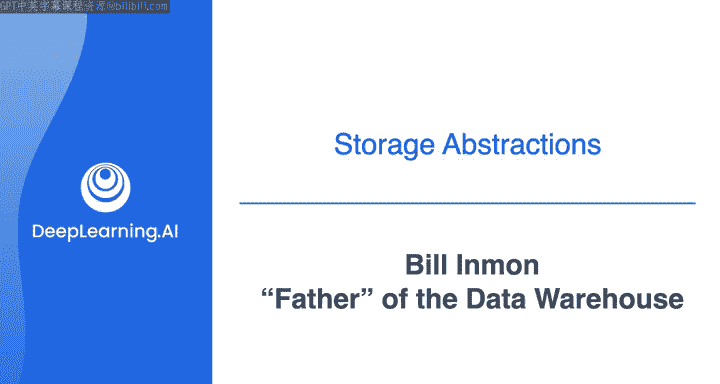

# 吴恩达《数据工程（导论，源系统、数据摄取和管道，数据存储和查询｜1-2-3课）｜DeepLearning.AI Data Engineering》 - P155：17_可选：与Bill Inmon的对话.zh_en - GPT中英字幕课程资源 - BV1wTtWeeEH5

Hey Bill， how you doing Hey Joe Hey so here today with my good friend Bill Inman。

 the creator of the data warehouse and I could argue creator of the modern data industry as well but for people who want to I guess learn more about you want to give quick intro Sure。

 mine name's Bill Inman， I've been around longer than most of you probably were born I wrote my first program in 1965 working as a student at a place called White Sands missileile range in New Mexico I shall never forget that occasionally we would all at the evening time。

 we would all go out on the veranda and watch the missiles being shot from a place in Utah to White Sands missileile range and but I wrote my first program in 1965 I don't know what I would have done if I hadn't had the computer profession。

Because I'm not capable of being a doctor， I didn't want to be a lawyer。

 so I'm not sure what life had in touch me， but I wrote my first computer program and I fell in love with computing。

And then you came up with the data warehousehouse， which we'll talk about。So yeah。

 what is a data warehouse？A data warehouse in a simple one sentence version。

 a data warehouse is nothing more than corporate data data that represents all of the aspects of the corporation。

 I think in order to understand data warehouse a good starting point is to understand the world before data warehousing。

 The world before data warehousing was a world in which we had application。

 And each application designer built the application for the person using the application。

 which seemed to make sense。 The problem is， is that over the years。

 we started to have lots and lots of application。 And each application was separate and different。

 And so what happened was it turns out that there's more than just the application user that needed to use the application data。

 There were people in the corporation that needed to。Look across the corporation。 we had marketing。

 we had sales， we had finance， we had management， all of these organizations needed to have what's called a corporate view of information。

 the problem is is that you can't really get a corporate view of data from the application that each application was specific and customized And so when the people in accounting and marketing wanted to look across all of the data in the corporation。

 they couldn't。 So a simple definition of the word data warehouse is corporate data。

 Its data that looks across the corporation， when you talk about a data warehouse。

 you typically talk about transformation， transformation of data from the application foundation to the corporate foundation and。

Tically today this transformation is done through technology called ETL extract transform load technology and ETL tech technology has been around a long time I believe you were one of the originators of ETL can you give maybe give us a history of ETL and how that came about and maybe some best practices around it Sure Yes。

 indeed I also had my hand in the origins of ETL one day in the early days of data warehouse we were sitting around talking about how do people get data into a data warehouse the way they did it in the early days was to write programs manually write a PL1 or a cobal or a similarr fortran whatever language they wrote it in they would write these programs to go in find the data。

Transform the data and put it into a data warehouse。And very shortly。

 we discovered that building these programs was a very onerous thing to do。

 It was something that was time consuming and drudgery work。 And further。

 we discovered that it was the same logic over and over again。 the intellectual thrill of writing E。

 T L is gone in the first 30 seconds that you do it。

 because your writing the same program repeatedly。 So that's when myself and a few founders at a place called prison solutions。

 said， Je， what we really need is automated technology that can go into。😊，The world。

Of data find the data that's necessary， transform it and bring it into a data warehouse and that's where ETL came from so Bill you've been in the industry a very long time I could maybe say you created it I'm sure you have some interesting stories and anecdotes anything you want to share with the students。

I can talk about the early days of data warehouse and I think that'd be interesting。

 I think that's something nobody would hear about otherwise。

 Well now I have to warn you that I'm going to get involved with a vendor because there was another vendor that was very involved that did everything they did to squash data warehouse and that vendor was IBM corporation So if you want to have a clean presentation。

 you may not want to use this material but I'm going to tell you the truth that in the beginning of data warehouse。

 IBM was the dominant vendor。 this is actually just as Microsoft was making its inroads into the world So at the time anything that was technology was IBM and an IBM had a position in the corporation of being both an advisor and a salesperson which is dangerous to corporations So what happened was when data warehouse。

Came along。 IBM fought data warehouse tooth and nail。 And in that day and age。

 it was difficult to be a naysayer to IBM。s that's like David and Goliath。 and I。

 I certainly wasn't the Goliath。 So anyway， we started to build data warehouse。

 I happened to be a journalist in a magazine called Comp world at the time。

 And I started to write articles。 I'll tell you the article that got IBM's goat was the and you're going to find this。

 this is funny today。 but it wasn't funny at the time。

 I made the suggestion that data could be used for something other than transaction processing。

 And this set。IBM and their cronies off， like you can't imagine that they had this peculiar notion that data should only be used for transaction processing。

 and to say anything other than that was heresy。 All I had was my platform to the world was my article that I did in computer world。

 and you should have seen some of the replies and letters to the editor that we got。 I remember them。

 one of them was this man is an anarchist。 He said in our industry back 25 years。

 another one said I should not be allowed to talk in public ever again。 well， and then I got。

 I'm not going to mention the ones that had foul language in it。 but I got a lot of those as well。

 I mean， for whatever reason， it caused a visceral reaction in the world。

Of academia and IBMIt's kind of interesting that in the early days the technicians of the world were not at all in favor of of data warehousing。

 the people that we sold data warehouse too it was the marketing organization God bless the marketing organization had it not been for marketeers data warehouse wouldn't exist today。

 I guess kind of closing out。What's kept you going all these years in data。

 what's your what's your true north Sometimes when I get up in the morning。

 I ask myself that same question。When I see something that I think is fundamentally not right that causes me to take an action。

 one of the things that I saw that wasn't right was that text wasn't being used in the corporation and so that's what prompted me to build technology called textexual ETL another thing that I saw that wasn't right。

 one day I was at a conference with a bunch of other computer professionals and I mentioned that Ed Jordanden had died and to my surprise not one person at the table even knew who Ed Yorden was and and I'm amazed because Ed Yorden and three or four other people had this amazing impact on our industry。

 our industry would not be the same industry as it was today。

 and yet our industry forget all of these people You want to maybe give the students an idea of who yet Edton。

Sure， but once upon a time in the very early days， now I'm really showing my age。

When you were a programmer。The result soul saying we need to build a new system。

 bring your coding pads。 And and and no design work。 No。

 nothing just the end user thinks they want something， Let's start coding today。 in that day and age。

 coding was like the wild West。 you started just writing code， man。

 Ed Yorden came along and saw this。 And Ed Joorden said， Oh my gosh。

 we need to have a much more methodical way of organizing our profession。

 the way we do code the way we do design。 And Ed Joorden started something called structured design and analysis。

 And what structured design and analysis said in a simplified version is we need to have an organized。

 methodical， well thought out way in which we lay out these programs。 And today， we do that。

 But in the early days， we didn't。😊，ThatAnd Ed Yton， in terms of the way development is done。

 in terms of the way applications are designed， all have Ed Yoren to think and yet in this conference that I was at。

 nobody even knew his name Awe。Well， thanks for your time， Bill。

 it's definitely a pleasure to talk with you as always。

 and I'm sure the students will get a lot out of our conversation。 So thank you very much。

 Sounds good。 Thank you。😊。