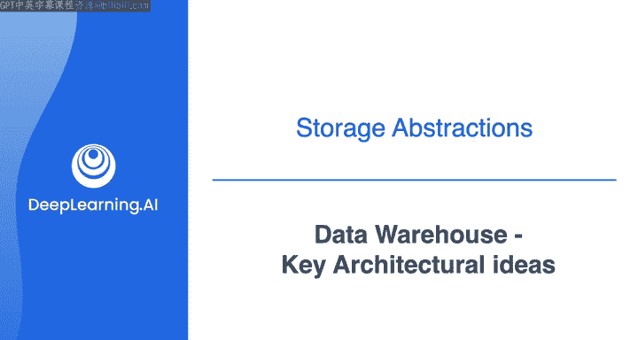
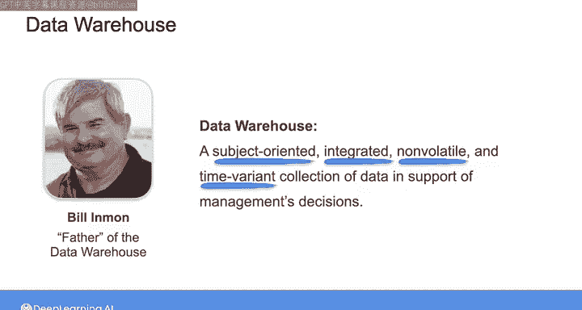
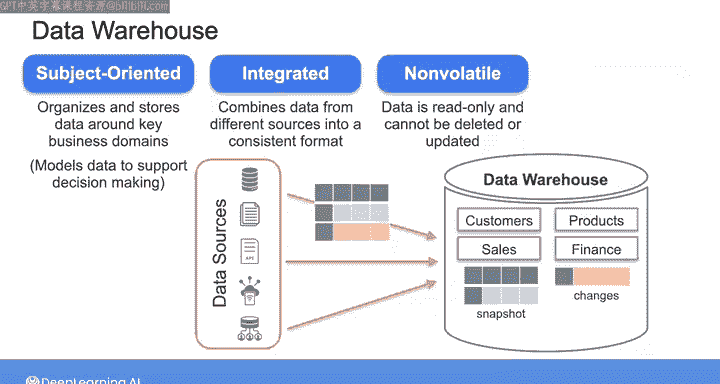
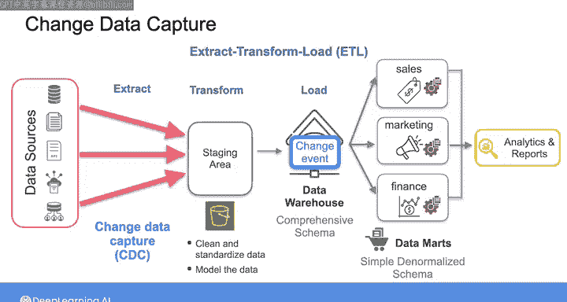
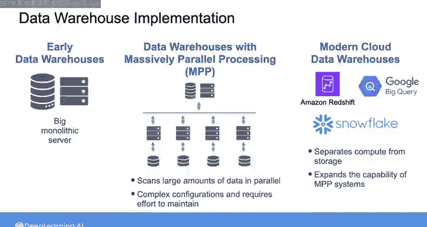

# 吴恩达《数据工程（导论，源系统、数据摄取和管道，数据存储和查询｜1-2-3课）｜DeepLearning.AI Data Engineering》 - P156：18_数据仓库关键架构理念.zh_en - GPT中英字幕课程资源 - BV1wTtWeeEH5

In your work as a data engineer， you will find yourself ingesting data from many different source systems。

 one very common source you'll ingest from will be a database that's part of an oilTP system where the data is structured in a way that's optimized for transactional workloads。

OLTP systems have been around for decades and in the early days of data analytics。

 it wasn't uncommon for teams to be running analytical queries directly on a production OLTP database。

As I've already mentioned a couple times， running analytical queries on your production databases can be a recipe for disaster。

And beyond that， attempting to do analytics directly on row based transactional data can be very inefficient and costly Back in the late 1980s。

 Bill Inman came up with a notion of a data warehouse to solve this problem。

He described a data warehouse as a subjectoriented， integrated。

 nonvolat and time variant collection of data in support of management's decisions。

 this foundational definition underscores the role of the data warehouse as a central data repository designed to facilitate reporting and analysis。

Let's break down this definition Subjectoriented means that a data warehouse organizes and stores data around key subjects or domains of the business such as customers。

 products， sales or finance with a data warehouse， your focus on modeling the data to support decision making rather than on transaction processing and recording integratedrated means that a data warehouse brings together data from different sources and ensures that it' storeded in a consistent way with a predefined schema Nonvolatile means that the data in a data warehouse is read only and cannot be deleted or updated in the general sense。

This is useful for historical data analysis where the principle of non-volattility requires the data warehouse to preserve historical records when initially loading data from source systems into a data warehouse the data is captured and loaded as a snapshot when subsequent changes in the source systems occur。

 either a new snapshot of the data is loaded into the data warehouse or just a changes are loaded By way the existing snapshot of data is not deleted or changed it's kept in the data warehouse This leads to the time variant characteristic。

 meaning that a data warehouse stores current and historical data data users can look at this historical data to observe trends across multiple subjects to support their business decisions This is something you can't do with the OLTP source systems which typically don't support preserving historical data or historical data analysis Although technical aspects of the data warehouse have evolved significantly。

 this original definition still holds true today Traitionally you'll load data into a data warehouse from various sources by using an ETL pipeline。

Wwhich is the extract transform and load ingestion pattern you saw previously the typical process here would be that you first move the extracted data into a staging area outside the data warehouse which could be S3 object storage。

 for example， there you would apply transformations to the data to clean it and standardize it This is also where you structured the data according to a particular model to make the data useful for downstream users will get into data modeling in detail in the next course Next you load the transform data into the data warehouse and data warehouses are designed to serve the broader organization but you can also serve a narrow set of users by loading the data into what are called data Mars you can think of each datamart as a more refined subset of the data warehouse that's designed to serve the specific needs of a single department or business function like sales marketing or finance unlike the comprehensive schema of a data warehouse the data and a datamart often follows a simpler deormalized schema that provides a more focus view of only the subset of data that's specific。

To a department with datamars， you can also perform an additional stage of transformation beyond that provided by the initial ETL pipeline。

 which can improve performance for analytical queries that require a complex joins and aggregations the CTTL process is commonly used a keep data in your data warehouse in sync with your production databases as these source databases are continuously updated when you extract data from production databases instead of extracting all the data。

 you can use a change data capture or CDC process to identify and capture only change events like insertions updates or deletions and deliver those changes to your data warehouse by only extracting incremental changes you can minimize your impact on the performance of the source systems and so data warehouses were a departure from traditional OLTP systems。

By extracting data from production databases， modeling it to support analytical workloads and then loading it into a separate data warehouse。

 you can direct the load away from the production systems and provide a better end user experience with improved analytical query performance this made data warehouses a standard for online analytical processing or OLAP data architecture the earliest implementations of data warehouses were based on a single monolithic server that limited their performance。

As the amount of data grew steadily throughout the 1990s。

 traditional data warehouses couldn't keep up， then the emergence of massively parallel processing or MPP systems enabled data warehouses to scale data warehouses that implemented MPP were able to scan large amounts of data in parallel achieving high performance analytical queries。

But these systems were complex and figure and required effort and time to maintain in the early 2010s。

 modern cloud data warehouses like Amazon Redshift。

 Google BigQury and Snowflake emerged and represented a significant evolution from the on-pres data warehouse architecture of the past。

 the modern cloud data warehouse architecture separates compute from storage and expands the capability of MPP systems。

This allows for scalable and efficient processing of large data sets and makes data analytics more accessible and cost effective to smaller organizations。

In the next video， we'll take a closer look at the characteristics of modern cloud data warehouses。

 I'll see you there。