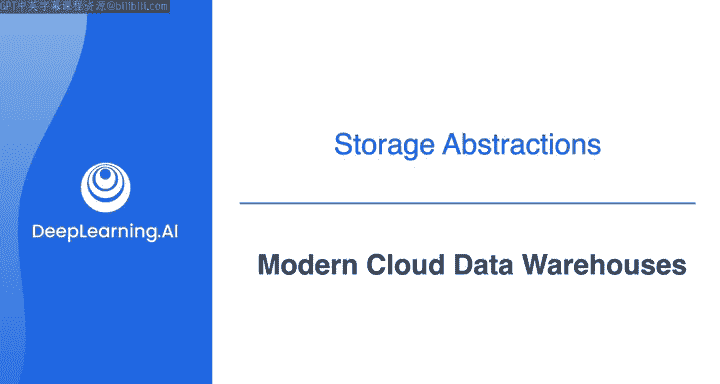
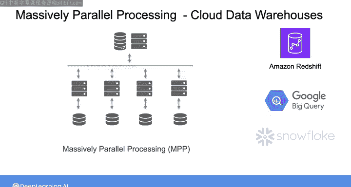
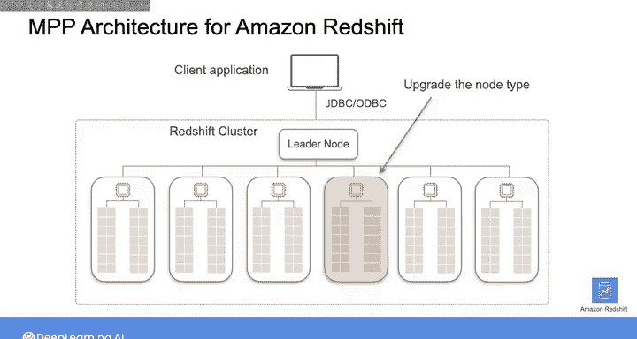
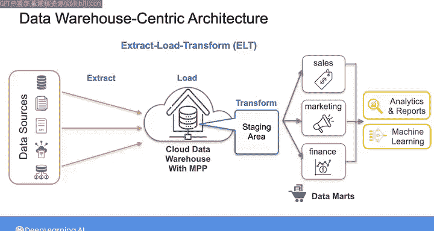
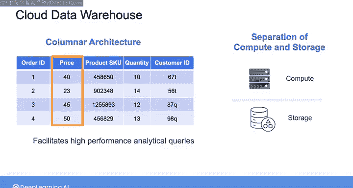
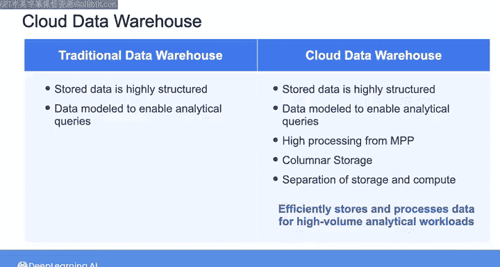

# 吴恩达《数据工程（导论，源系统、数据摄取和管道，数据存储和查询｜1-2-3课）｜DeepLearning.AI Data Engineering》 - P157：19_现代云数据仓库.zh_en - GPT中英字幕课程资源 - BV1wTtWeeEH5

As a data engineer， youll likely work with cloud data warehouses。In this video。

 we'll take a closer look at the factors that give cloud data warehouses greater processing power than traditional on premises data warehouses。

Understanding these factors will help you design more efficient data warehouses and better manageded scaling performance in costs Like I mentioned in the previous video。

 data warehouses typically implement massively parallel processing or MPP which uses multiple processors to crunch large amounts of data with cloud data warehouses instead of needing to appropriately size in MPP system and spend millions of dollars upfront to set up the system you can just spin up compute clusters on demand scaling it up over time as data and analytics demand grows or delete the clusters when they're no longer needed let's take a moment to look at the specific MPP architecture for Amazon Redshift other cloud data warehouses like Google BigQury and Snowflake use a similar structure but different implementation details in redshift a collection of computing resources is called a cluster Each cluster is composed of one or more compute nodes that are managed by a leader node these nodes have their own CPU memory and disk space a compute node is further partition into node slices。

where each size contains a share of the node CPU memory and disk space when you load data into redshift。

 the leader node manages how the data is distributed across the node slices then when a client application sends a query request to the data warehouse the leader node parses a request into a series of steps and forms an execution plan then based on the plan。

 the leader node compiles the code and distributes it to the appropriate compute node slices that contain data that's relevant to the query the slices work in parallel to complete the workload then the compute node sends the intermediate results back to the leader node finally the leader node aggregates the results and sends a final result back to the client application as your workload increases you can spin up more compute nodes or upgrade the node type to one with higher computing capacity。

So in this sense cloud data warehouses expand the capabilities of MPP systems and allow you to easily scale your data infrastructure to handle even petabytes of data in a single query with the increase in processing power that comes with MPP cloud data warehouses can also support the ELT or extract load and transform ingestion pattern After extract data from store systems rather than transforming and modeling the data outside the data warehouse。

 you can load the raw unprocessed data directly into a staging area within the data warehouse then you can leverage the massive computational power of the cloud data warehouse to transform the data This results in faster ingestion so you can quickly provide your downstream stakeholders with data Another change we've seen with cloud data warehouses is a shift from rowb to columnar architecture As you saw last week column storage along with data compression facilitates higher performance of large scale analytical queries Finally in many cloud data warehouses。

 data is stored in object storage allowing virtually limitless storage This means that you can separate compute。

And storage allowing you to manage and scale these resources independently to optimize for both cost and performance Now cloud data warehouses still have all the attributes of traditional data warehouses。

 namely that the data you store can be highly structured and modeled to enable analytical queries combining these attributes with the high processing power that comes with MPP column storage and the separation of compute and storage is what makes cloud data warehouses highly efficient at storing and processing data for highvole analytical workloads Now what if your company wants to store inquiry query unstructured data like text。

 images， audio files or videos。

Modern data applications are no longer limited to analytics and reporting they will often involve machine learning or exploratory analysis use cases that require direct access to a variety of unstructured data。

 not just data that's accessed by running SQL queries that's where the data lake storage architecture comes into play so join me the next lesson to dive into the data lake paradigm。

