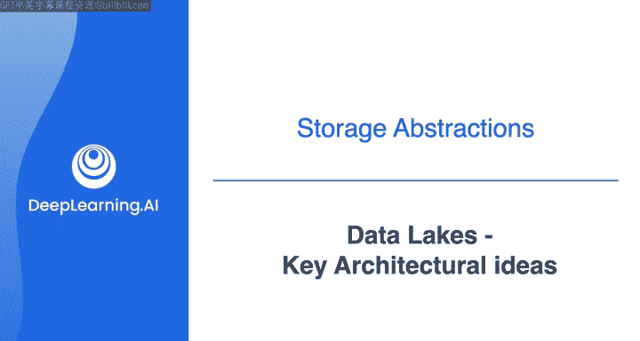
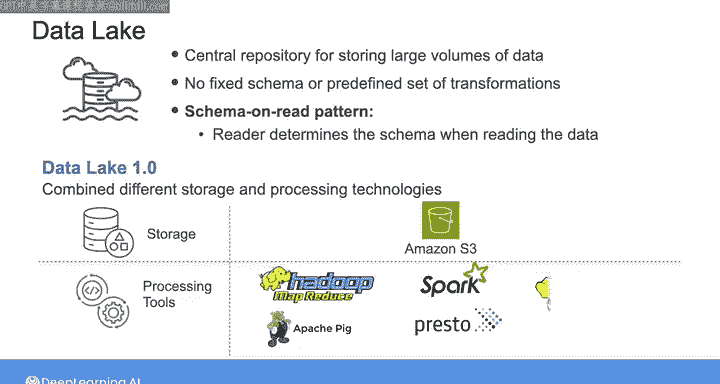
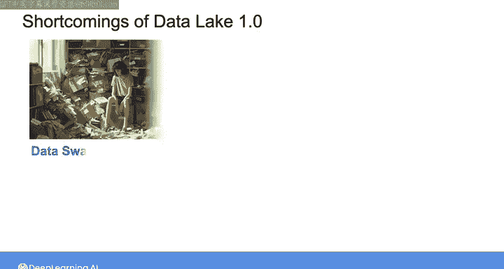
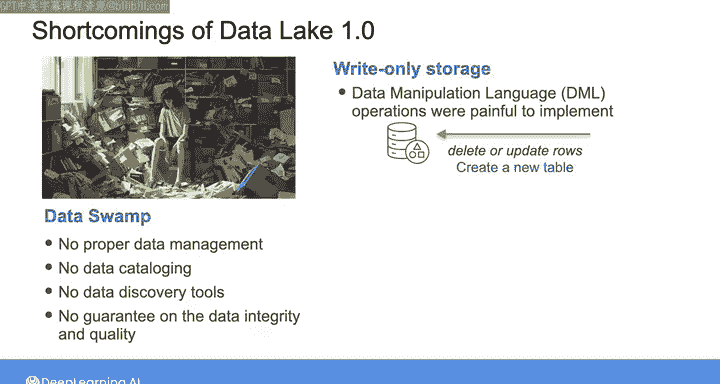

# 吴恩达《数据工程（导论，源系统、数据摄取和管道，数据存储和查询｜1-2-3课）｜DeepLearning.AI Data Engineering》 - P158：20_数据湖关键架构理念.zh_en - GPT中英字幕课程资源 - BV1wTtWeeEH5

Imagine you're a data engineer at an e-commerce company where you're tasked with bringing together structured data from a sales order database。

 semistructured customer records from a CRM， and customer reviews sort as text， video。

 and audio files。You start with a data warehouse， but then you quickly realize that the semistructured data and unstructured data don't fit into a fixed schema and the data is coming at you at very large volumes So instead of imposing tight structural limitations on your data why not simply route all of your data structured and unstructured into a central repository This is exactly the concept of a data lake that emerged in the 2000s up to the early 2010s The name data lake itself came a little later but the idea of a central repository for storing large volumes of structured and unstructured data was a motivation for this new paradigm unlike data warehouses。

 data lakes don't require you to decide on a fixed schema or predefined set of transformations ahead of time instead data lakes follow away schema on read pattern where the reader determines the schema when reading the data the first generation of data lakes which I like to call data lake 1。

0 made solid contributions towards this promise by combining different storage and processing technologies for storage data lake 1。

0 started with。HDFS or Hadoop distributed file system， but as a cloud grew popularity。

 it became more common to see data lakes built on top of cloudbased object storage like Amazon S3 this extremely cheap and virtually limitless storage capacity allows you to store massive amounts of data of any size and any type creating a central source of truth for all the data in an organization in terms of processing when you need to transform or query the data。

 you could pick from many different technologies including mapreduce Apache pig， Spark。

 Presto and hive among others despite the promise and hype， data lake 1。

0 had many serious shortcomings the biggest downside was that data lakes in the 1。

0 era commonly became data swamps a place for organizations to dump their data with no proper data management without things like data cataloging and data discovery tools users would struggle to find the data they needed and had trouble understanding how one piece of data related to another even if you could locate the data。

Need there was no guarantee on the data integrity or data quality that is。

 you couldn't tell if the data was up to date or accurate on top of that。

 the original data lake concept was essentially right only。

Simple data manipulation language or DML operations you commonly use in SQL like deleting or updating rows were painful to implement and generally required users to create an entirely new table this made it very difficult for organizations to comply with data regulations such as GDPR which required them to be able to delete user records when requested to do so without schema management and careful data modeling。

 it was also very challenging to process the data that was stored in data lakes the data was not optimized for querying in the same way that structured data in a data warehouse was For example。

 common data operations like joins were a huge headache to code as Mareduce jobs。

 but even with all these shortcomings of data Lake 1。

0 many organizations especially tech companies like Netflix and Facebook which is now known as Me。

That are heavily data focused they found significant value in data lakes these companies had the resources to build successful data practices and create their own custom tools for processing the data。

 but for many organizations Data Lake 1。0 was an expensive disappointment the good news is that in recent years many tools and practices have emerged to help businesses better organize and query the data stored in a data lake。

So join me in the next video to explore the characteristics of next generation data lakes。

