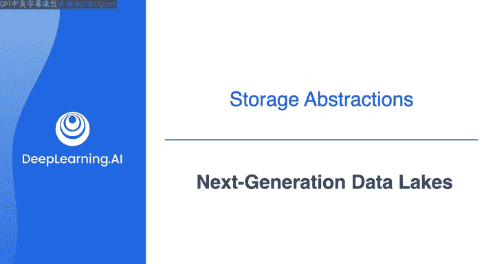
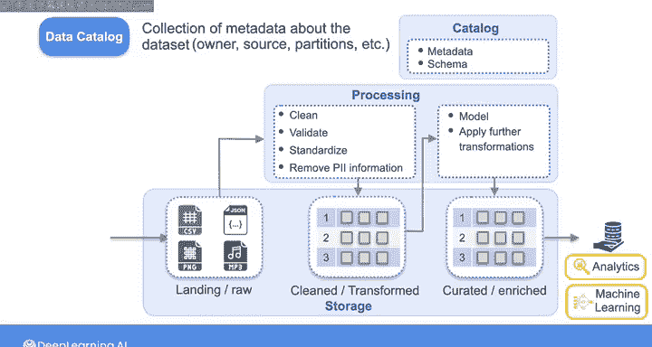
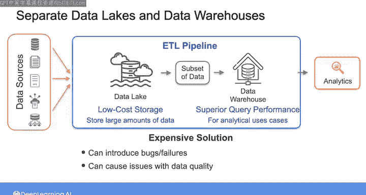

# 吴恩达《数据工程（导论，源系统、数据摄取和管道，数据存储和查询｜1-2-3课）｜DeepLearning.AI Data Engineering》 - P159：21_下一代数据湖.zh_en - GPT中英字幕课程资源 - BV1wTtWeeEH5

In response to the shortcomings of the original data lake 1。0 that I described in the previous video。

 engineers developed approaches to more efficiently manage and find data stored in their data lakes in this video we'll take a look at some of these approaches。

 specifically data zones partitioning and data catalogs to better manage data stored in a data lake you can organize it into different zones where each zone houses data that has been processed to varying degrees although there are no set rules for the number of zones or the naming of these zones。

 a common design pattern is to have three zones the first zone is usually known as the landing or raw zone。

 when you load raw data into a data lake it lands in the zone so that you can have a permanent record of the raw data ingested from So systems then after you apply transformations a clean validate and standardized data as well as remove or mask any PII information a copy of this transform data will be written to a second zone commonly known as the cleaned or transform zone Next you model the data by imposing business。

ic and applying further transformations to it then you write the transform data to a third zone known as a curated or enriched zone data in the zone should abide by the organization's standards and is ready for consumption you typically store data in the cleaned and curated zones using open file formats like parquet Avro or orRC to make storage on disk more efficient Since these formats are open source they also allow a wide range of analytics engines and machine learning systems to directly access the data Like I said。

 the number and naming of these zones can vary you might design a data lake with only the raw or curated zones or maybe you need to perform more complex transformations to the data to comply with strict regulations in which case you might have four or five or more zones to handle intermediate storage stages In any case organizing data into different zones allows you to apply appropriate data governance policies on each zone and ensures that data users are consuming data at the appropriate level of quality and readiness for their specific。

NeedsNow to improve query performance with data lakes。

 you generally want to take the data from clean or curated zones and store as partitions data partitioning is a technique where you divide a data into smaller。

 more manageable parts based on some sort of criteria like time。

 date or location recorded in the data that way when you query the data。

 the query engine only needs a scan the partitions that contain the data relevant to the query resulting in faster query performance Finally to address a challenge of data discoverability with data lakes。

 you can create a data catalog which is a collection of metadata about the datas This centralized metadata allows data users to search for data based on things like the data owner data source。

 partitioning information， business definitions for the columns and much more the catalog also records and maintains a schema of the datas。

 including changes over time and so the data catalog is a critical feature that provides everyone in the organization a common understanding of the data structure and meaning。

With these enhanced data management features and search capabilities。

 you can use a data lake to store， manage and process large amounts of data of many different types。

 despite these efforts to make data lakes more organized and searchable historically organizations still needed multiple storage systems to meet their business needs they wanted to leverage the lowco storage of data lakes to store large amounts of data for machine learning applications and they also wanted to leverage the superior query performance of data warehouses for analytical use cases。

 so they would first ingest in process data in a data lake so that there's a single source of truth for all the data。

Then they would take a subset of the data that needs to bequeriied frequently and loaded into a data warehouse to support lowlatency query performance。

 but this solution is expensive because you have to continuously move data with an ETL pipeline from your data lake into your data warehouse which have higher storage costs and each step of the ETL process can introduce bugs or failures causing issues with data quality。

 duplication and consistency to solve these challenges a new storage architecture known as the data lakehouse was created this new architecture aims to combine the benefits of a data warehouse and a data lake into one unified architecture Before we take a look at this new architecture I'll walk you through the upcoming lab where it'll get some handson practice partitioning data and creating a data catalog to improve data retrieval from a data lake。

Then after the lab， join me the next video to take a closer look at the data Lakehouse architecture。

