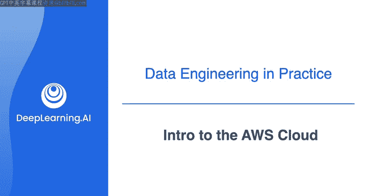
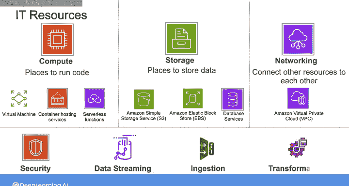
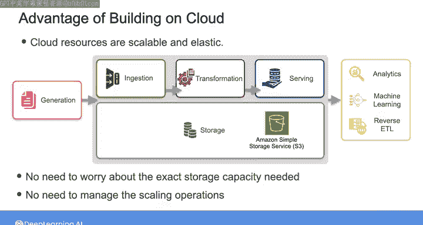
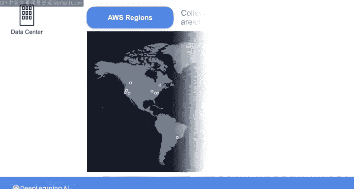
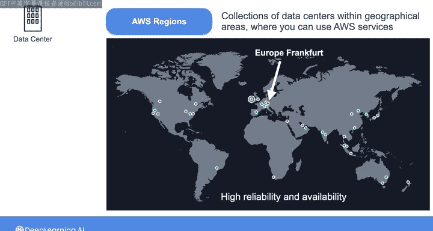

# 吴恩达《数据工程（导论，源系统、数据摄取和管道，数据存储和查询｜1-2-3课）｜DeepLearning.AI Data Engineering》 - P15：14_AWS云简介.zh_en - GPT中英字幕课程资源 - BV1wTtWeeEH5

At AWS， we describe the cloud as the on demand delivery of IT resources over the internet with pay as you go pricing。

In other words， this means that AWS is designed to provide you with the resources you need to build your data systems or other applications essentially in an instant when you need them and you can shut those resources down when they are no longer needed and at the end of each month you only pay for what you use As Joe mentioned earlier。

 this is a very different paradigm from building your own on-pres data center where you would typically be committed to any IT resource purchases for years to come when I say IT resources I'm talking about things like compute storage and networking resources on AWS compute resources are places to run code like virtual machines。

 container hosting services or serverless functions St resources are places to store your data including services like the Amazon simple storage service or S3 or Amazon Elastic blockstore。

As well as database services where you can run relational databases， NoSQL databases， G databases。

 and more， networking resources allow you to connect other resources to each other and to the outside internet。

An example of a networking resource is Amazon virtualr private cloud where you have your own private network in the cloud Beyond compute storage and networking。

 there are many more categories of AWS resources and services in areas like security data streaming。

 ingestion， transformation and others the advantage of building your data systems on the cloud is that cloud resources are scalable and elastic。

 What I mean by that is， for example， if you are building a data pipeline that includes S3 object storage as part of the solution。

 you don't need to worry ahead of time about exactly how much storage capacity you'll need you don't need to manage the scaling operations as your data grows or shrinks instead the service automatically scales up and down It's elastic the same type of scalability and elasticity also exists for other AWS services。

This means you don't need to guess capacity ahead of time you can always be ready for spice and demand or changing traffic to your system and you can more easily avoid paying for resources that you don't need think of using AWS like how you consume electricity with electricity you only pay for what you use and at the end of the month when you pay your bill the details of how that electricity was made or delivered to your house are all abstracted from you AWS resources and services are hosted in physical data centers that AWS has built out all over the world and you use these services over the internet through As which allows you to build solutions without needing to build out and manage your own data centers so when you're using AWS you won't be thinking in terms of single data centers instead you'll deploy resources into what are called AWS regions which are collections of data centers within geographical areas where you can use AWS services。

Hosting your solutions in a geographically distributed manner like this ensures the reliability and availability of your systems and allows for resilience in the event that an individual data center goes offline due to a natural disaster or some other problem AWS regions are named after their geographic area like USS East Northern Virginia or Asia Pacificacific Mumbai or Europe Frankfurt as examples each AWS region comprises multiple availability zones。

 otherwise known as AZs which are smaller groupings of data centers within the region AZs are designed to be far enough away from each other that if something happens like an electrical outage。

 a flood or other AZ level failure， they can fail over to the other AZs in the region which can then absorb the traffic so your systems are unaffected by the issue and so the way it works is that multiple data centers make up one availability zone and multiple availability。

Zones make up an AWS region When you create resources on AWS you select the region and also potentially the availability zone depending on the service you are using then behind the scenes。

 these data centers and availability zones are connected to each other with low latency links that run on the AWS global network of fiber cables connecting all of these facilities in your work as a data engineer you will often combine multiple AWS resources and services together like building blocks to form solutions。

AWS offers over 200 services， with some being more general purpose and others being more specific in their intended use。

There is more to the AWBS global infrastructure， but this is a good start。

The concepts we covered in this video will come up again and again as you learn more about AWS St with me for the upcoming video as we explore some of the core AWS services you'll be working with in these courses。

