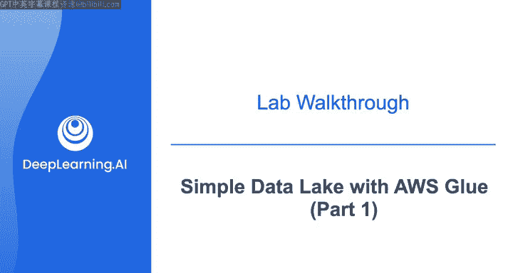
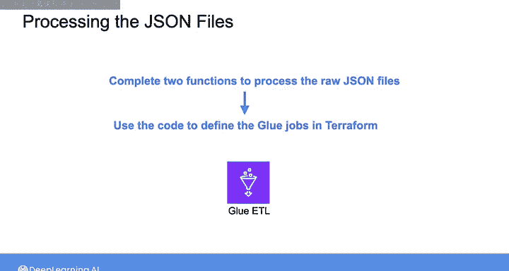
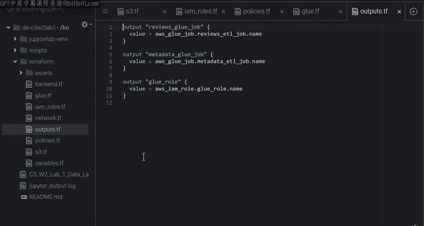

# 吴恩达《数据工程（导论，源系统、数据摄取和管道，数据存储和查询｜1-2-3课）｜DeepLearning.AI Data Engineering》 - P160：22_实验演练：使用AWS Glue构建简单数据湖（第1部分）.zh_en - GPT中英字幕课程资源 - BV1wTtWeeEH5

In the lab you'll work with a simple data lake that uses Amazon S3 as its primary storage you'll be given an S3 bucket containing raw JON files that represent reviews and metadata for some Amazon products itll process and transform these files into parquet files and then store them in the same bucket to process the data you'll define glue ETL jobs usingterraform and then use a glue crawler to populate the data catalog with your process data This enables you and your stakeholders to query the process data in the S3 bucket using Amazon Athena with SQLqueries there will be an optional part at the end of the lab where youll explore the effects of compression and partitioning when storing your data in S3 and how these techniques impact storage capacity and the data retrieval performance in this series of lab walkthrough videos I'll give you an overview of the transformations you'll apply to the JSON files go through how you can define your glue jobs in terraform and show you how to use a glue crawler and Amazon Athena to query your data lake In the first part of the lab。

Will complete two functions that you'll use to process the raw Json files containing product review and metadata Each review contains the reviewer's ID and name the product ID the review text and its summary。

 the rating of the product and the time of the review Each review also has a helpful field that consists of two numbers。

 the number of users who found the review helpful and the total number of users who rated the helpfulness of this review。

 you'll import this review data into a tabular data frame。

 process the data by extracting the year and month and split the helpful columns into two columns。

 Then later you'll use the year and month columns to partition your data in the S3 bucket。

 and here's an example of a metadata item from the second JO file Each item contains the product I。

 some information about the product， a list of related products。

 the sales category and sales rank and so on。 you will also import this data into a tabular form and keep these columns you'll unn the sales rank column and split it into two columns sales category。

N cells rank， then you'll drop the records in the numerical columns that contain null entries and replace the null values in the other columns with empty strings。

Once you define these two functions， you'll use the code to define the glue jobs for your transformation tasks using terraform under the terraform folder。

 you'll find all the terraform files that define the resources you need for the lab。

 such as S3 and glue， the IM rolls and policies that allow the glue job to interact with the S3 bucket。

 and the input variables and output values， although you'll only interact with the glue file。

 let's go through some of these other files so that you can get a complete understanding of the resources used in the lab。

In the S3 bucket， the provided Data lake bucket is defined as a data block。When you run terraform。

 you will create another bucket that will contain the transformation scripts for the gluejo。

 The third block here ensures that the script bucket you create is not available for public access。

 while you can manually upload the scripts to the script bucket。

 you can also use terraform to upload the scripts to the bucket by defining them using the resource type AWS S3 object。

 So in these resource blocks， you can find the name of the bucket destination。

 The key you will assign to each script when they are loaded to the S3 bucket and the local path of the scripts。

 which is under the assets folder。 to allow the glue jobb to access the S3 data lake。

 you need to create a rule that the gluejo can assume。

 Then you'll attach a permission policy to the rule detailing allowed actions on the S3 bucket。

So here in the IM rolls file， you will see the AWS IM roll block that defines the IMroll and the AWS IMroll policy block that outlines the permission policy attached to the role the details for the role and the permission policy are defined in the separate policies file The first block generates an assume role policy where you list the trusted entities that can call AWS services on your behalf which is AWS glue in this case the second block generates the permission policies for the assumed role where you list the resources and the actions allowed to be performed on these resources you can see that the list includes S3 and all actions on S3 are allowed Now let's check the glue file here you can see two resource block of type AWS glue job Each defines a glue jobs that you'll need to run to process the review and the metadata datas for each glue job you need to define the name of the job the role you'll attach to the job and the command block where you'll specify the location of the transformation script the default arguments block contains the arguments expected by the transfer。

As well as the arguments for the glue itself So the arguments S3 bucket， source path， target path。

 compression and partition columns are all arguments that are expected by the transformation scripts These arguments define the source path from which you will extract the raw data。

 the destination path where you will store the process data。

 the compression algorithm you'll use to store the process data and the name of the columns that you'll use to partition your data。

The remaining arguments are all optional and consumed by AWBS gluelu to set up your job。

Feel free to check out the AWS glue documentation for more information about these arguments After the default arguments block。

 you will see this timeout attribute where you can specify the duration in minutes you want to allow the glue job to run before it's terminated。

 this helps prevent the glue job from running longer than expected due to some code errors or data anomalies and for the last argument in this block。

 AWS gluelu uses a distributed framework called Spark behind the scenes so you can specify the number and type of workers that Spark will use to run your glue job。

Finally， in the outputs file， you can see the list of the output values that you can use after running terraform。

 These outputs consist of the names of the glue jobsbs in the IM roll。 Later。

 you'll use the IM roll to create the glue crawler。 In the next video。

 we'll go through how to define your glue jobs in terraform。 I'll see you there。

