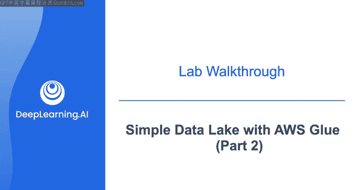
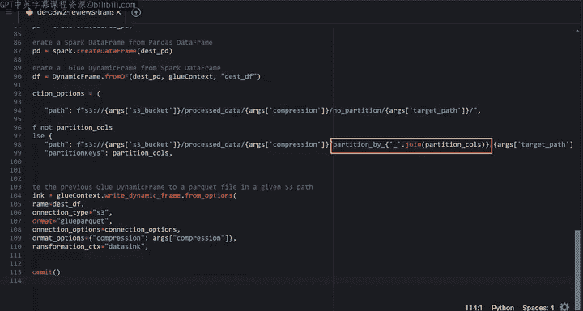
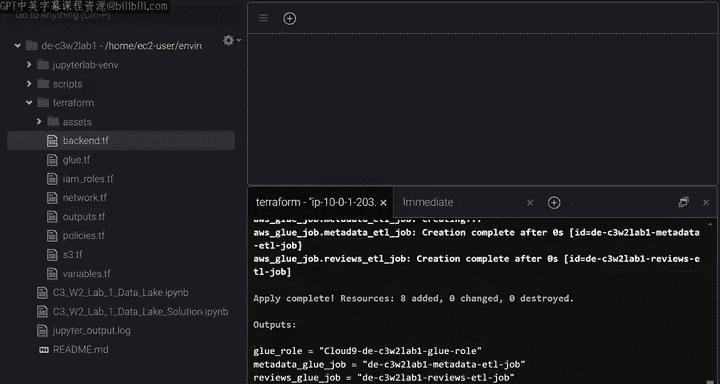
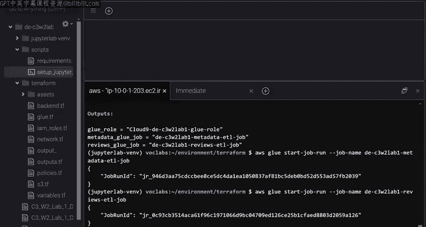
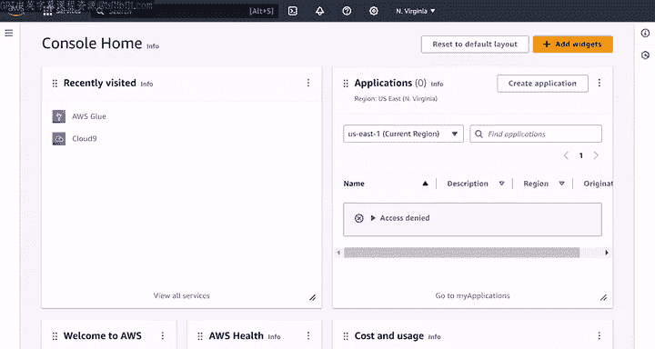
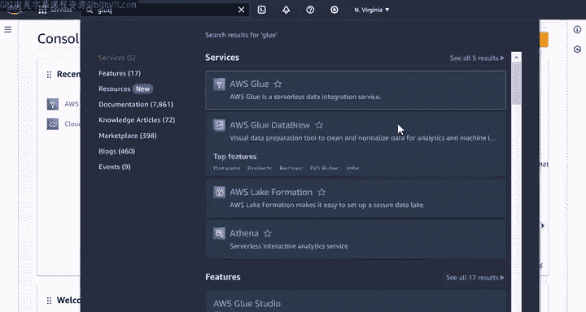
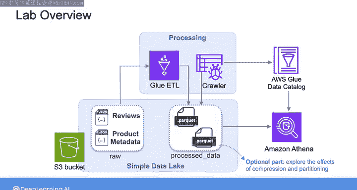

# 吴恩达《数据工程（导论，源系统、数据摄取和管道，数据存储和查询｜1-2-3课）｜DeepLearning.AI Data Engineering》 - P161：23_实验演练：使用AWS Glue构建简单数据湖（第2部分）.zh_en - GPT中英字幕课程资源 - BV1wTtWeeEH5

In the previous video， you saw the types of transformations you'll apply to the JON files。 Now。

 let's go over the two transformation scripts that are provided to you under the terraform assets folder。

 When you run terraform， the scripts will be copied from this local directory to the script bucket。

 We'll go over the review transform script together。

 but the metadata transform script has a very similar structure。

 Here's how you can extract the arguments defined in the gluejo to use them in this script As I've already mentioned。

 G EtL uses Sp behind the scenes。We'll go over the details of Spark in the next course。

 So here I'll just give you an overview of what this script does to interact with the sparkark framework。

 you start by creating an object called glue context， which will allow you to initialize a glue job。

 connect to the S3 bucket source， extract the data from the source into a data frame and finally store the process data into the S3 bucket。

 And once you're done， you need to call the commit method to conclude the glue job。In the lab。

 you will complete this transformation function to process the review data set。

 it expects a panda's data frame and returns another panda's data frame that contains the process data。

This glue context method， create dynamic frame allows you to connect to the S3 bucket to extract the raw data。

 Here's a path to the CV file inside the bucket。 This method will read the CSv file and import it into a glue data frame。

 You can work directly with this glue data frame to transform the data。

 But for the sake of this exercise， we transform this data frame into a panda's data frame so that we can call the transform function on it。

 you'll get a chance to interact with Sp and glue data frame in the next course。

 The return panda's data frame that contains the process data is then converted back into a glue data frame。

 This is because the next method， write dynamic frame。

 which stores the process data into the destination target expects a glue data frame。 In this method。

 you indicate that you need to make a connection to an S3 bucket。

 specify that you want the data to be stored in a parquet format。

 give it the path for your process data and specify the compression algorithm you want to use Looking at the path for your process data。

 The key will start with process data， followed by the name of the compression algorithm and then the partitioning status。

Partitioning is used。 You also need to pass the partition columns as script arguments。

 This key format， incorporating the name of the compression algorithm and partitioning status will come in handy in the optional part of the lab。

 where you'll experiment with these data formatting options。

 So after you complete the transform functions in both of the transformation scripts。

 you'll run terraform from the terminal to create the resources， the script bucket should be created。

And you should get back the names of the glue jobsbs and the glue roll。

Then from the terminal， you will use these names to run the glue jobs。

Let's check the status of each job from the console。

 but you could also do this in the terminal in the search bar。

 I'll type glue and then open this surface。

On the left， I'll click on ETL Jobs。Here are the two glue jobs。

I'll click on the first one and then on the runs tab。

You'll see the status of all the attempts of running this glue job。 After a while。

 you'll see that the two jobs have run successfully。Let's look at the process data in the S3 bucket。

 It starts with process data。Then snappy， which is the name of the compression algorithm used。

 Then you'll see that partitioning was used to store the data。Inside toys reviews。

 you see that the data is partitioned by year then month。

 and finally the data is stored in parquet format。Now let's say your end users want to query the process data from the S3 bucket。

 You need to first create a table that contains the metadata for your process data using AWS glue data catalog the AWS glue data catalog is a central repository that stores metadata for all your data assets across various data sources inside the glue data catalog you can create your metadata databases which can contain many tables each storing essential metadata such as column names data types and partition keys to populate your catalog databases。

 you can use an AWS glue crawler to automatically discover and extract metadata from a data store and then an update see glue data catalog accordingly。

 Once the table in the data catalog is set up your end users can query the data using Amazon Athena with regular SQL queries in the lab to create a metadata database for your process data and to query the data using Athena。

 you'll use AWS wrangler which is the AWS SDK for pandas built on top of open source libraries such as pandas and Bodo3 It extends。

of pandas to AWSYou'll first create a database in the glue catalog that will contain the metadata of your process data。

 Then using Bodo3， you'll create a glue clientt object。

 Then you can call the createate crawler method on this glue clientt to create the glue crawler you'll need to specify a name for the crawler attach it to the role you created using terraform。

 specify the name of the database of a glue catalog and the path to your processed data。

Then you can call the start crawler method on the glueplant to start the glue crawler。

 you might need to wait a few minutes for the tables to be created after the table has been created youll use AWS wrangler to query the data using Athena。

 you'll use the Read SQL query method which expects the SQL query as a string and the name of the catalog database。

 it then executes the query and returns the results as a pandas data frame。And that's it。

 you're ready to try out the lab， but like I mentioned earlier。

 there is an optional part at the end of the lab where you'll explore the effects of compression and partitioning when storing your data in S3 if you're interested in trying out this optional part。

 you can take a look at the next video where I'll walk you through those optional experiments or you can jump straight into the lab。

