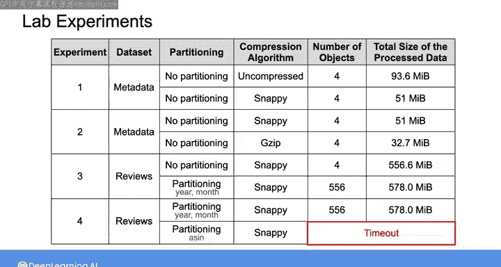
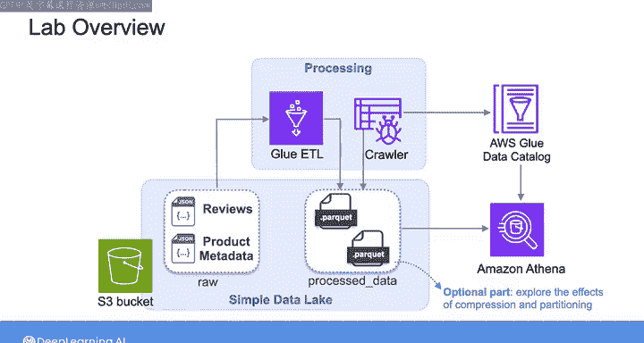
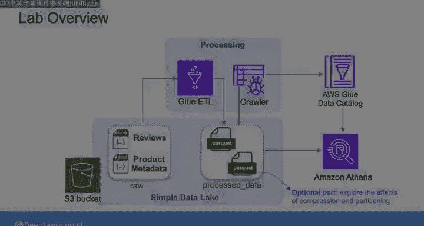

# 吴恩达《数据工程（导论，源系统、数据摄取和管道，数据存储和查询｜1-2-3课）｜DeepLearning.AI Data Engineering》 - P162：24_实验演练：使用AWS Glue构建简单数据湖（第3部分，可选）.zh_en - GPT中英字幕课程资源 - BV1wTtWeeEH5

In the first part of the lab， you created two glue jobs to process the review and metadata data sets。

For the glue jobs you chose Snpy as the compression algorithm and you specify the partition columns for each data and the optional part of the lab。

 you will perform four experiments to explore the different configurations for the glue jobs to understand the effects of compression and partitioning on storage in the first experiment。

 you'll explore the effects of compression by changing the compression argument associated with the gluejo while not partitioning your data。

 you'll first process the metadata and choose the uncompressed option for the compression argument。

 then you'll process the data again， but this time you'll choose snappy for the compression algorithm after you get the process data from both experiments you can use this command with the summarize option to display the information about the number of objects and a total size of the given S3 path。

You can see that with compression， less storage is occupied by the objects and even though you didn't specify a partition key。

 there are several parquet files because AWS glues underlying processing framework will try to partition your data automatically in the second experiment you will compare two compression algorithms Snpy which you already use in the first experiment and Gzip which you will use in the second experiment you'll notice that with GZip compression。

 the total size is smaller than S snappy Gzip and Snpy are both popular compression algorithms while Gzip results in better compression ratios Spy is generally faster than GZip in the third experiment you'll explore the effects of partitioning by comparing the processed review data that's compressed using Snapy but was not partitioned with the process data you got from the first part of the lab where you partition the reviews by year and month with the partition key specified you can see that there are 556 parquet files each corresponding to a particular year and month and with no partitioning the data was automatically partitioned into four parquet files when partitioning your data。

You need to choose an appropriate key that organizes the data into meaningful files that are aligned with your query patterns This is because when you specify the partition in the where clause。

 Athena scans the data only from that partition to restrict the amount of data scanned by each query。

 thus improving performance and reducing cost， a bad partitioning key divides the data into too many small files which can increase storage cost and make data processing slower。

 so for example， in the last experiment you'll choose the ASIN column which is the review identifier as the partition key it will take more than 15 minutes to partition the data using the as in column which will result in a timeout status。

Thanks for sticking with me through these lab walkthrough videos now it's your turn to trout the lab when you get to the optional part near the end。

 feel free to complete those experiments or skip over them I'll see you in the next lesson to go over the data Lakehouse architecture。

