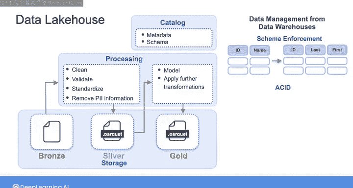

# 吴恩达《数据工程（导论，源系统、数据摄取和管道，数据存储和查询｜1-2-3课）｜DeepLearning.AI Data Engineering》 - P163：25_数据湖仓架构.zh_en - GPT中英字幕课程资源 - BV1wTtWeeEH5

You can think of a data lakehouse architecture as a data lake with additional features built in to create an experience that is similar to a data warehouse It aims to combine the flexible and lowco storage benefits of a data lake with the superior query performance and robust data management of a data warehouse This enables analytics and reporting applications as well as machine learning and big data processing use cases let's take a closer look at the key architectural components and characteristics of a data lakehouse at its core a data lakehouse is very similar to a data lake it uses a single storage layer built on top of object storage to store large amounts of data of any type you can organize a storage layer into different zones like you saw in the previous video to facilitate data governance and ensure better data quality databricks。

 which is the company that first introduced the notion of a data lakehouse refers to a storage layer organized by data zones as the medallion architecture labeling the raw data。

zone as bronze， the clean data zone as silver and the curated data zone containing modeled and enriched data as gold Trans data is stored in the silver and gold zones and written in open file format typically parquet for more efficient storage and allow analytics and query engines of all kinds to access the data directly In addition to the data lake characteristics lake houses include the data management features found in data warehouses they enforce schemas at the storage level to ensure that the data you load adheres to specified formats and quality standards and they also support schema evolution data lakehouses typically adhere to acid principles meaning that transactions are atomic。

 consistent isolated and durable This enables your data users to concurrently read insert。

 update and delete data while ensuring it's reliable for analytical processes lake houses also have built in data governance and security features such as robust access controls data order。

data lineage trackingYou can also connect to a data lakehouse using connector APIs。

 then use SQL to perform incremental updates and deletions to your data sets。

These are critical features that enable compliance with data regulatory and privacy rules。

 and since lake houses retain old versions of files and metadata。

 you can also roll back to or access any version of your historical data as needed。

By integrating the best capabilities of data warehouses and data lakes。

 data lakehouses provide a unified architecture that supports everything from SQL applications to business reporting to machine learning Since the inception of the data Lakehouse。

 various cloud and software providers along with open source organizations have been creating new products to help organizations move toward a data Lakehouse architecture join me in the next video to take a closer look at some of the details of data Lakehouse implementation。

