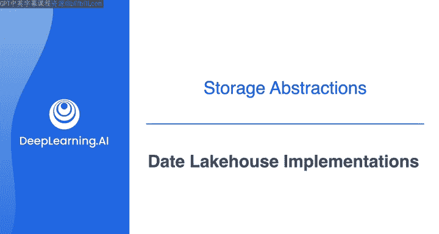
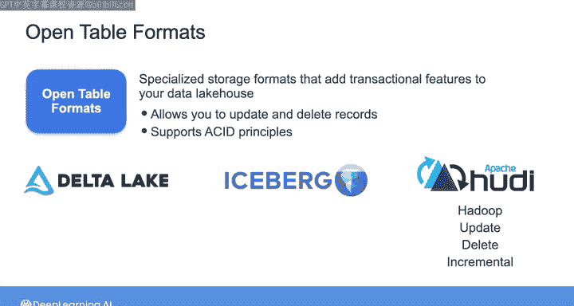
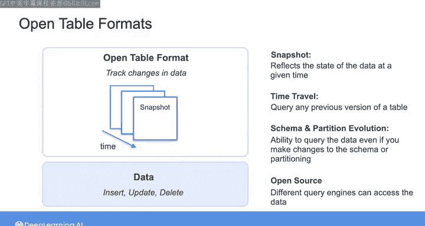
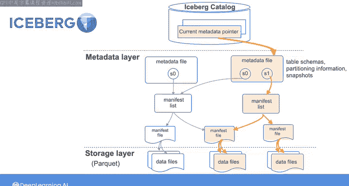
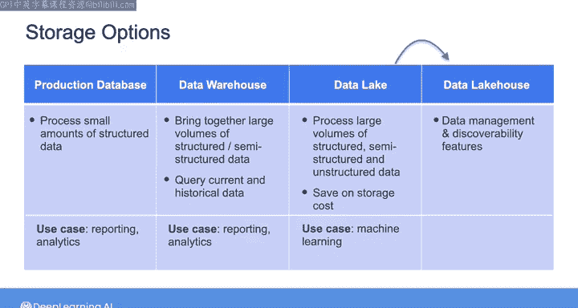

# 吴恩达《数据工程（导论，源系统、数据摄取和管道，数据存储和查询｜1-2-3课）｜DeepLearning.AI Data Engineering》 - P164：26_数据湖仓实施.zh_en - GPT中英字幕课程资源 - BV1wTtWeeEH5

Ever since the inception of the data Lake House， we've seen an interesting fusion happening with cloud data warehouses and data lakes。

Cloud data warehouse providers have started integrating features typically associated with data lakes and meanwhile。

 data lake Tech have started embracing characteristics。

 typical of data warehouses like enforcing and managing schemas as well as SQL functionality in this video we'll look at data lakehouse implementation using open table formats and in the next video Morganorgan will walk you through how you can implement a lakehouse on AWS when it comes to lakehouse implementation A number of opentable formats have been developed to support the idea of a more transactional data lake These opentable formats include Databricks Delta Lake Apache iceberg and Apache Hoie。

 which stands for Hadoop update delete incremental Opentable formats like these are specialized storage formats have add transactional features to your data lakehouse this allows you to easily update and delete individual records in the storage layer that's built on top of an optic storage data lake while supporting the asset principles traditionally found in a data warehouse so how do opentable formats work exactly。

In short they provide a logical abstraction that sits on top of your stored data when you perform an operation on your data tables。

 such as inserting updating or deleting a record， the opentable formats track those changes and store them as a series of snapshots that reflect the state of the data at a given time these snapshots enable a feature known as time travel where you can query any previous version of a table by specifying a timestamp as well as roll back the table to a previous version to recover from any incorrect changes made to a table this also supports schema and partition evolution。

 meaning that you'll still be able to query the data。

 even if you make schema changes like adding or deleting a column or changing how you partition the data sets Since opentable formats are open source。

 they also enable different query engines to access the data stored in the data lakehouse so you can use whatever processing tools you like that are suitable for your use case without having to duplicate the data and restructure it into another format and so in your work as a data engineer you might encounter databricks deelta Lake Apache iceberger。

And Apache hoodie these technologies all offer the same features of schema evolution and time travel。

 but they usually differ in terms of the underlying implementation details For example。

 here's how iceberg works similar to a data lake there is a data catalog and a data storage layer which contains files written in parquet for efficient storage but then there's a metadata layer that says between the catalog and the storage layer whenever you update or create a data file iceberg creates a new manifest file to keep track of these data files and additional details about the metadata of each file then a new manifest list is created to keep track of the information about the location of the manifest files which snapshot each manifest file is a part of and partitioning information and finally a new metadata file written in JSON format is created that contains a new snapshot that points to the new manifest list these files include information like the current table schema partitioning information snapshots in which snapshot is the current one within the iceberg catalog there's a pointer。

For each table stored in the lakehouse that references the table's most current metadata file so this pointer gets updated whenever a new metadata file is created When you run a query。

 the pointer in the catalog tells a query engine which metadata file is the current one based on the table that is being queried the query engine then retrieves a manifest list for the current snapshot in the metadata file then the relevant manifest files and finally the relevant data files This metadata layer helps iceberg determine which data files need to be read and it ignores files that are not relevant to the query This significantly speeds up query performance。

So when it comes to choosing between a data warehouse， a data lake or a data lakehouse。

 it's really about choosing the right storage abstraction to support your organization's needs if you're at an early stage company that only needs a process small amounts of structured data for analytics and reporting。

 you might be able to get away with connecting your BI tools directly to a read replica of your production databases。

 however as a volume and sources of datag， you'll want to use a cloud data warehouse to bring together structured and semistructured data for multiple sources and allow your data users to query current and historical data for analytics and reporting without adding too much extra load on your production databases。

 if your organization requires massive amounts of data。

 especially if it's unstructured say for machine learning applications。

 then you might want to consider implementing a data lake architecture to save on storage costs In this case you can choose to evolve your storage architecture into a data lakehouse by adding on data management and discoverability features to enable both machine learning applications。

and low latency analytical queries as you've seen the technical architectures of cloud data warehouses and data lakes have started to converge I think this trend of convergence will only continue the data lake and the data warehouse will still exist as different architectures but in practice their capabilities will blend together so in the future instead of choosing between a warehouse or a lake you will have the option to actually choose a converge data platform based on your specific circumstances and data use cases Next up。

 Morgan will walk you through how you can implement a data lakehouse and AWS using AWS lake formation and after that I'll give you a walkthrough of the upcoming lab where you'll get a chance to create your own data lakehouse architecture。

