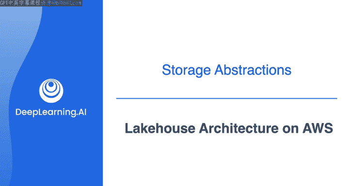
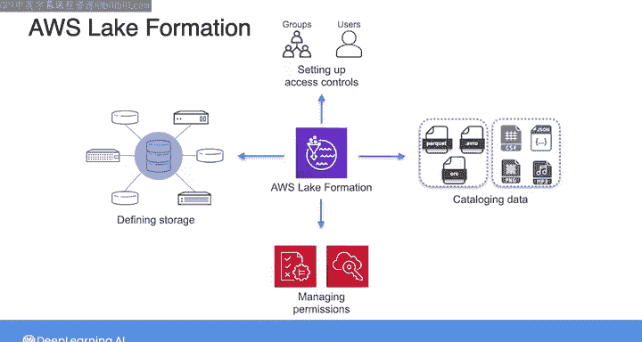
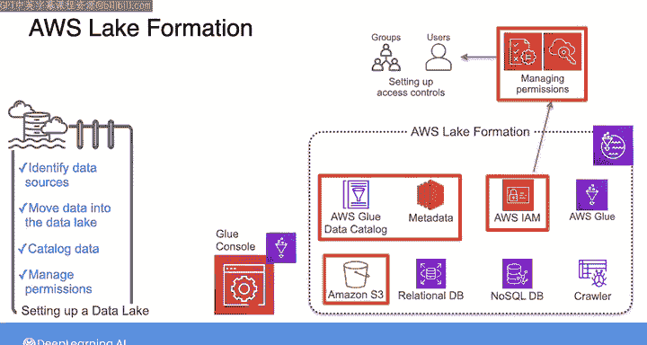
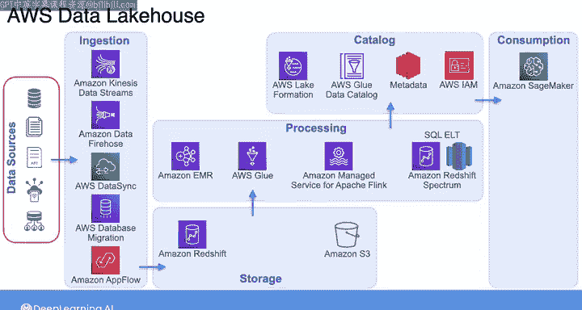

# 吴恩达《数据工程（导论，源系统、数据摄取和管道，数据存储和查询｜1-2-3课）｜DeepLearning.AI Data Engineering》 - P165：27_AWS上的湖仓架构.zh_en - GPT中英字幕课程资源 - BV1wTtWeeEH5

You've learned a lot already from Joe about the differences between data lakes。

 data warehouses and data lakehouses and you've completed a lab using AWS gluelu and Amazon S3 to set up a simple data lake It's common for organizations to start with a simple data lake like this and then evolve over time to use a more mature solution like a data lakehouse so now it's time to discuss how you can architect a data lakehouse using AWS services including AWS Lake formation and Amazon Redshift spectrum at its core。

 AWS Lake formation is designed to simplify the process of building and managing data lakes traditionalitionly setting up a data lake or Lakehouse involves a lot of manual steps defining storage。

 setting up access controls， cataloging data and managing permissions to data assets this can be complex and timeconing and lake formation automate some of these tasks making it simple。

For you to get started So here's how it works you start by identifying your existing data sources like Amazon S3 or relational and NosqL databases then you can use lake formation to move that data into your data lake After that you use lake formation to crawl through the data catalog it and get it ready for analytics Finally you can give your user secure self-service access to this data with their preferred analytics tools It's a streamlined way to make sure everyone in your organization can easily find and use the data they need you may recognize some of these tasks as things you've done before with AWS glue and that is because lakeformation is actually built on top of AWS glue and I So it' using features of glue you are already familiar with like glue jobs workflows and crawlers to perform these tasks when you're using lake formation you can create things like workflows but also manage these features directly in the glue。

With a typical data lake or lakehouse， there are many AWS services interacting with each other and with end users accessing different data sets along with that comes a fair amount of overhead for managing permissions and so how part of lake formation helps automate the creation of data lake is managing complex fine grainined permissions Lake formation also provides finegrained access control on the data stored in S3 and the metadata in the data catalog so you can centrally manage permissions and IEM policies to streamline the process of governing and sharing your data internally and externally for both analytics and machine learning applications Now that you've got a high levell understanding of lakeform let's review a diagram of an example of data lakehouse architected with AWS services will dive deeper into various aspects of this architecture as we go along First you have the data sources which from。

Data engineer's perspective are often out of your control。 These are things like databases。

 file shares， SaS applications and more。 Then you have the ingestion mechanisms which would ingest data into the data lakehouse As you have learned in previous courses there are various services you can use for data ingestion including Amazon Kisesis data streams Amazon Data Firehose AWS datasync AWS Data migration service and Amazon appflow Also AWS Lakeform can manage some data ingestion tasks through AWS glue All that ingested data needs to be stored somewhere So next to the ingestion layer there is the storage layer that uses Amazon Redshift and Amazon S3 above that sits the processing layer where you would read data from the Lakehouse storage layer and transform it for downstream consumers you would use services like Amazon EMR or AWS glue Amazon managed service for Apache Flink or。

SQL data processing on Amazon Redshift Then there's the catalog layer that uses lakeformation to provide a central catalog to store and manage metadata for all data sets hosted in the storage layer In this layer you can also use lake formation to manage permissions and provide fine-grained access control Then finally。

 the rightmost layer here for the lakehouse architecture is the consumption layer which provides AWS services you may use to consume the data。

 including but not limited to Amazon sagemaker for machine learning use cases Amazon Quicksite for business intelligence and data visualizations and Amazon Athena and Amazon Redshift spectrum for querying data in the lakehouse we will spend more time exploring Amazon Redshift spectrum in the next video Since you have already learned a lot about data sources and ingestion use cases I won't focus on those more right now but I would like for you to join me in the next video for a closer look at these storage。

Processing， catalog and consumption layers of the Z datata Lakehouse architecture。

 I'll see you there。