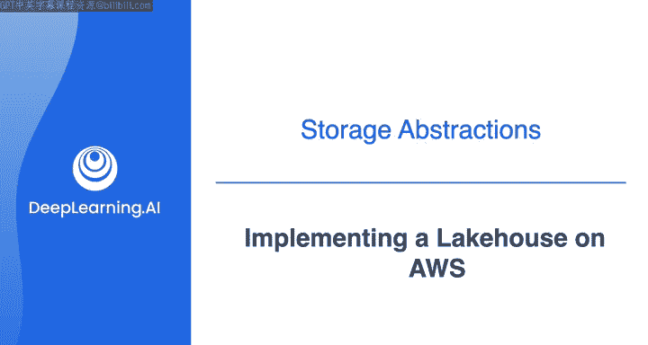

# 吴恩达《数据工程（导论，源系统、数据摄取和管道，数据存储和查询｜1-2-3课）｜DeepLearning.AI Data Engineering》 - P166：28_在AWS上实施湖仓.zh_en - GPT中英字幕课程资源 - BV1wTtWeeEH5

In the previous video， I gave you a high level overview of how various AWS services can be combined into a series of layers in a data lakehouse architecture。

As a reminder， here's how that architecture looks。 you have the source and ingestion layers on the left over here then the storage processing and catalog layers in the middle and finally the consumption layer over here on the right I'd like to start off with a focus on these storage and catalog layers using S3 for storage is common for data lakes and for data lakehouses it's common to use both S3 and redshift as the storage layer typically S3 provides storage for structured semistructured and unstructured data whereas Amazon Redshift stores highly curated structured or semistructured trusted data that fits into predefined schemas This dual storage approach leverages the cost efficiency and scalability of S3 for large structured and unstructured datas while utilizing redshift for highper analytics on more structured datas so part of the reason for creating a data lakehouse is that you want to be able to。

Analyze the data that is stored across S3 and Redshift at the same time。 you could of course。

 write ETL jobs that move data from S3 to redshift on a recurring basis but creating a data pipeline for this effort might be costly over time and can lead to data redundancy it also creates an opportunity to introduce bugs or issues into the data anytime you are moving and transforming data you are opening the door for mistakes to be made which can impact data quality and availability So with that being said。

 it would be nice if you could somehow integrate your data lake with your data warehouse natively this is where Amazon Redshift spectrum comes in which works as an integration between S3 and redshift for querying data This is represented here in these storage layer but it is a key part of the consumption layer for a data lakehouse on AWS Redshift spectrum allows you to run queries on data stored in S3 without having to。

it into Redshift first。 This is great because it eliminates the need for complex ETL pipelines to move data between your data lake and your data warehouse。

 So this helps you make a data lakehouse possible by integrating these two data storage systems So using something like redshift spectrum to be able to query data in both the data lake storage and the data warehouse storage is definitely a preferred method over moving data out of S3 using ETL processes into redshift querying。

 More on this when we get to the consumption layer Next up will move on to the layer above the storage layer。

 which is the catalog layer。 a central data catalog is used to provide metadata for all data sets in your lakehouse in a single place and make it easily searchable。

 This is extremely important for self-service discovery of data in your lakehouse you learned earlier about a data swamp。

 you don't want your data users to be w through murky waters。 Instead you want to be able to provide。

Clarity about the data in the lakehouse In this case， were using lake formation。

 which uses glue behind the scenes to create the data catalog to store metadata for all data sets hosted in the lakehouse Lake formationation coordinates glue crawlers to identify datas and then persistently stores metadata including schema information partition information and data location in the glue data catalog Now it's important to remember that it's common for data sets in the storage layer to have evolving schemas and increasing data partitions over time so populating the metadata catalog isn't a oneand done job it's something that has to be maintained and kept up to date to automatically keep the catalog up to date you can configure AWS glue to periodically crawl through the lakehouse storage layer to discover new or updated data sets and extract their metadata which is then stored in a table in the catalog so while lake formation and glue。

arere great for managing and cataloging your data handling evolving schemas and large data sets efficiently is where Apache iceberg tables may come into play。

 you learned in an earlier video about iceberg tables and how they make it easier to make changes to your data schema without disrupting existing processes or underlying data this is made possible in part through schema and data versioning which allows users to track changes to data over time with versioning you can use the time travel feature to access and query historical versions of data and analyze changes to data between updates and deletes Lakeform also supports iceberg tables and you can create iceberg tables that use parque format in the AWS glue data catalog Next up will move on the consumption layer and I want to spend some more time covering Redshift spectrum and Amazon Athena you'll have an opportunity to use Athena in the upcoming lab and though you won't be using。

pectrum it is commonly used in data Lakehouses on AWS so you should understand the basics Redshift Spec enables Redshift to present a unified SQL interface for data consumers that can accept and process SQL statements where the same query can reference and combined datas hosted in the data Lake or S3 as well as the data warehouse storage or redshift This means that by using Redshift spectrum。

 you can reduce data latency In other words， by querying data in place you can get insights faster without waiting for data to be moved or transformed Redshift spectrum queries use massive parallelism to run queries against large data sets and a lot of the processing occurs in the Redshift spectrum layer so that means most of the data remains in Amazon S3 after your Redshift spectrum tables have been defined you can query and join the tables just as you would with any other Amazon Redshift table。

Multiple Redshift clusters can also query the same data at the same time in Amazon S3 without the need to make copies of the data for each cluster using Redshift spectrum。

 you can do things like keep large volumes of historical data in the data lake and ing a few months of hot data into the data warehouse using Redshift spectrum or you can create enriched datas by processing both hot data from Redshift and historical data from S3 without needing to move data in either direction and you can also more easily offload volumes of large historical data from the data warehouse into S3 which provides more costeffective data lake storage while still being able to easily query the data as a part of Amazon Redshift queries then there is Amazon Athena Athena makes it possible to query data in S3 directly using standardSQL so there is no need to load the data into another system to query it using SQL instead you can create tables using Athena and query it directly Athena。

I serverless so there is no infrastructure to set up or manage and you pay only for the amount of data scanned by the queries that you run you will get a chance to try this out in the upcoming lab。

 Athena also supports something called Feerated queries which allow you to query data that's outside of S3 it supports a wide range of data sources for federated queries including Redshift the Amazon Athena Redshift connector enables Athena to access your Amazon Redshift tables so you can write queries that pull in data from your data warehouse so for consumption using SQL you can query your data sets in S3 and Redshift using Athena and or Redshift spectrum。

 which both can use the schema stored in the lakeformation catalog and apply it by following the schema on RE approach you learned about earlier in the course from Joe Allright so that's an example of a data lakehouse architecture on AWs using Aws Lakeform and other services。

Including Amazon Athena and Amazon Redshift Spectrum。In the upcoming lab。

 you'll get hands on with some of these services， have fun， and I'll see you soon。

