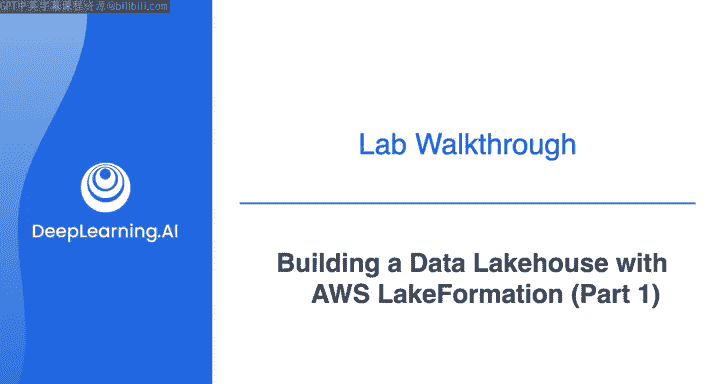
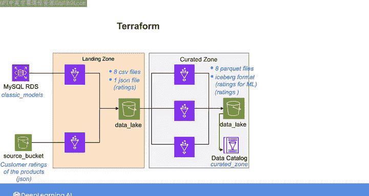
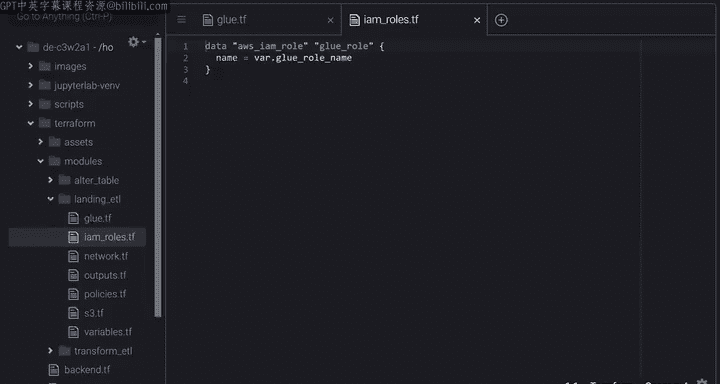
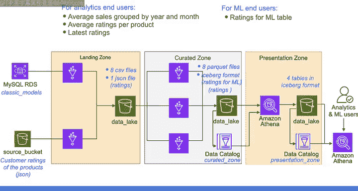

# 吴恩达《数据工程（导论，源系统、数据摄取和管道，数据存储和查询｜1-2-3课）｜DeepLearning.AI Data Engineering》 - P167：29_实验演练：使用AWS Lake Formation和Apache构建数据湖仓.zh_en - GPT中英字幕课程资源 - BV1wTtWeeEH5

In the lab， you'll implement a data lakehouse with a medallion like architecture using Amazon S3 Apache iceberg and Aws Lake formation。

 You're provided with an S3 bucket labeled as the data lake bucket that will act as the underlying storage for your data lakehouse implementation The S3 bucket is registered with lake formation。

 So you can explore how you can establish governance and fine grain permissions for the data stored in the data lake using lake formation。

 you're also provided with two source systems and RDS MysQqL database that contains the classic models data that you've worked with in course1 and an S3 bucket that contains a Json file with the customer ratings of the products found in the classic models data。

 youll first bring the raw data from both sources to the landing zone of the data lake bucket then you'll process each data apply schema enforcement and then store the process data in the curated zone of the data lake bucket。

 Finally， you'll use the process data to create additional tables that include the information needed for your analytics and machine learning and users and store the。

Tables in the presentation zone of the data lake bucket you are also provided with two databases in the G data catalog curated zone and presentation zone databases each containing some empty tables for each object you create in the curated and presentation zones of the data lake bucket you'll associate it with a table in the corresponding catalog database so that the data can be queried using Amazon Athena you'll also choose the iceberg format for some of the data stored in the curated zone and all the data stored in the presentation zone and then explore the schema evolution and time travel features of this open table format In this video I'll give you an overview of the data format in each zone of the data lake house then in the next video I'll go through the iceberg format and the governance feature of the lake formation service that you'll apply in the lab Let's start with a raw data that you'll ingest into the landing zone from the MysQL source database you'll extract each table and save each as a CSV file and the landing zone This means that you'll create eight CSV files where each file corresponds to one of these tables。

And has the S3 key that starts with the landing zone then RDS and finally the table name from the source bucket。

 you'll extract the JSON file ratings， which consists of a list of JSsonN objects。

 each object contains the customer number， the product code and the product rating assigned by this customer to the given product you'll ingest the JSON file as a data frame。

 add the field ingest underscore Ts that represents a timestamp when the file was ingested into the data lake bucket and then finally store the data frame as a JsonN file in the landing zone using an S3 key that starts with landing zone。

 then JSON and finally ratings After you transfer the raw data to the landing zone。

 you'll extract the data， perform three transformations to it and then store the process data in the curated zone in the first transformation you will focus on processing the CSV files you'll extract all eight tables from the landing zone and convert each into a data frame then for each table。

 you'll add two metadata columns and jest underscore Ts which represents the timeamp when the。

was ingested in the curated zone and source， which represents the name of the source database You're also provided with a schema that these process tables have to follow in the curated zone。

 describing the name and the type of each column in each table so youll enforce the schema by casting the numerical columns to the expected type and finally you will store each table as a parquet file using Snapy as the compression algorithm and specify the S3 key that starts with curated zone then the table name for each table you create in the curated zone。

 youll write its metadata to the corresponding catalog table in the glue catalog database that's labeled as curated zone in the second transformation you will focus on preparing the data that is needed for the machine learning team by combining the latest ratings data with the customer and product info from the CSV tables from the landing zone you'll extract the CSV tables and the latest ratings from the JSON file and convert each of them into a data frame you will then create a new data frame that contains some customer info from the customer table some product information from the product table。

And the ratings from the ratings data you'll add an additional column to this data frame that contains the timestamp when the data was processed and finally store the data frame using the iceberg format in the curated zone of the data lake bucket by specifying the S3 key that starts with curated zone then ratings for ML then iceberg in the next video I'll go over the iceberg format and what you should expect under this path you'll also associate the process data to its corresponding catalog table in the glue data catalog curated zone database in the third transformation。

 you'll focus on just extracting the latest ratings and storing them in iceberg format in the curated zone of the data lake bucket using the S3 key that starts with curated zone then ratings and finally iceberg if the ratings table in the curated zone already contains the ratings assigned by a customer to a product then with a new data you ingest you'll extract the new pairs of customers and products and update the ratings if the pair already exists you'll also associate the ratings data to its catalog table in the glue data catalog curated zone。

You'll carry out these transformations using glue ETL by defining the ETL jobs for the landing and curated zones using terraform I won't go through all the details of the provided terraform files but I'll highlight a few components for a more detailed explanation of the terraform files you can revisit the lab walkthrough videos for the simple data lake lab of lesson1 under the terraform files you'll find three modules the landing ETL and transform ETL modules contain the configuration files for the corresponding ETL jobs for the landing and curated zones you'll use the al table and the optional part of the lab to explore the schema evolution of the iceberg format For now I'll focus on these two modules under the landing ETL module if you check the glue configuration file you'll find the glue jobs that ingest the raw data into the landing zone of the data lake bucket you'll also find a block that defines the information needed to connect to the RDS database。

And in the IMrolls configuration file， there is a data block for the rule that will be assumed by all gluejobs note that this is a data block and this is because the glue roll is already created and provided to you under the transform ETL module you will find the configuration file for the three glue jobs that it'll use to process the raw data from the landing zone and store it in the curated zone under the assets folder。

 you can find the folder containing the Python scripts for each transformation。

 each script contains three parts， extracting the data from the source processing the data and then storing the data into the target destination feel free to skim through these files to get a quick overview of how each transformation is coded and in the lab you'll be asked to complete a small part of the code in these Python scripts The first file batch transform pi corresponds to the job of processing the CSv files from the landing zone andforcing schema to each table and then storing the process data as parquet files in the curated zone。

So in this file， you can find the schema definition of each table defined as astruct type。

 each containing a list ofstruct fields corresponding to the name of the column。

 the type of the column， and whether the column can contain null values or not。

 thesestruct type andstruct field objects are provided by Spark。

 which you'll use to enforce a schema on the process data you'll learn more about Spark in the next course in the other two scripts you'll extract the raw data from the JSM files and transform it to create the ratings for aM and ratings data stored in iceberg format。

You'll find the set of configuration settings which are used to enable iceberg for AWS glue So by setting these configurations。

 you can use AWS glue to perform read and write operations on iceberg tables in Amazon S3 or work with iceberg tables using the AWS glue data catalog I've included a link in the resource section that includes more information about these configurations After you have all your process data ready in the curated zone you'll create additional tables in the presentation zone that will be shared with your end users for your analytics end users you'll create two tables。

 one that contains the average sales grouped by year and month and another that contains the average ratings per product you will also create an additional table that represents the ratings table you created in the curated zone and for your machine learning end users you'll create one table that represents the ratings for MLl table you created in the curated zone while you could use glue ETl to create these tables in the presentation zone you'll instead use Athena to create these tables Since you've associated catalog tables to the data in the curated zone you can use Athena as a processing tool。

AsHere's an example of the SQL query you can use with Athena to create the ratings table in the presentation zone you start your query with the create table keywords。

 then you choose a name for the table which I'm calling ratings。

 then inside this with statement you specify the format of the table you want to create which is iceberg and the path to the presentation zone in the data lake bucket then outside the parentheses。

 you type as and then the query whose results you want to store in the presentation table so here I selected all records from the ratings table of the curated zone when you work with Athena。

 you use the name of the catalog database and the catalog table you created in the glue data catalog。

 which points to the actual data in the S3 bucket After you write this query。

 you'll pass it to the start query execution method from the AWS wrangler package where you also specify the name of the catalog database you want to associate with the C table which is presentation zone in this case So after you execute the statement the actual data in the S3 bucket and its catalog table in the G data catalog。

Be created youll repeat the same process for the other tables and store all of them in iceberg format in the presentation zone。

 so that was an overview of the format of the data in the landing curated and presentation zones of your data Lakehouse join me in the next video for an overview of the iceberg format and other Lakehouse governance features。

