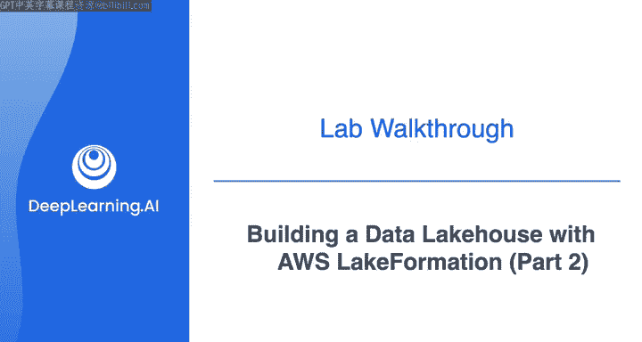
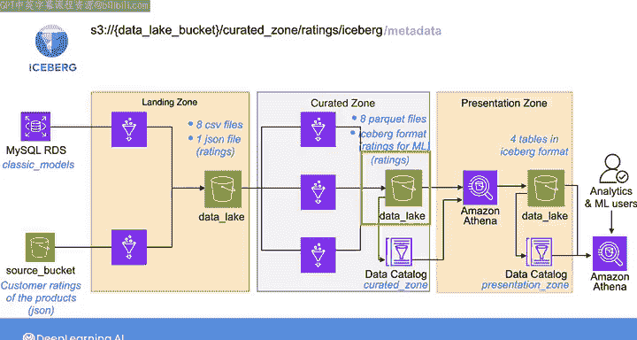
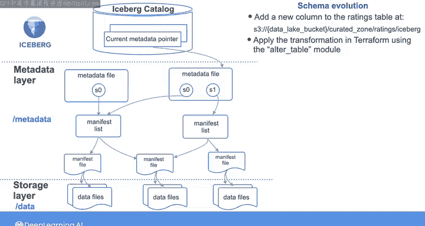
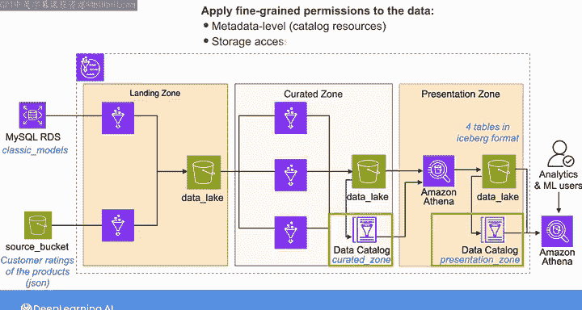
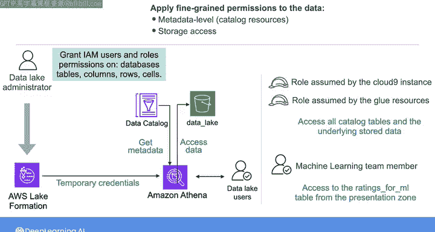

# 吴恩达《数据工程（导论，源系统、数据摄取和管道，数据存储和查询｜1-2-3课）｜DeepLearning.AI Data Engineering》 - P168：30_实验演练：使用AWS Lake Formation和Apache构建数据湖仓.zh_en - GPT中英字幕课程资源 - BV1wTtWeeEH5

In the previous video， you saw how you'll store your process data in iceberg format in the lab。

 Now let's go through the iceberg format and see how these files are organized in the S3 bucket。

 I'll take as an example， the ratings data created in the curated zone。

 When you bring the ratings data to the curated zone， you will specify this path in the S3 bucket。

 If you further check the file that has the iceberg prefix， you will see two additional prefixes。

 metadata and data。 the metadata prefix represents the metadata layer。

 which contains the metadata manifests list and manifest files that we've discussed in a previous video。

 On the other hand， the data prefix represents the storage layer。

 which contains the actual data stored in Part A。 Here's the content of the metadata layer just after you create the data。

 the JO file represents the metadata file， which contains information about the table schema。

 the location of the table as stored in S3。 the date and time of when the table was last updated and the Uu ID of the current snapshot which is created every time the content of the table is updated Every time you make changes to the metadata of the。

able， another metadata file will be created。 This avro file that starts with Sap is another metadata file that represents the manifest list file corresponding to one snapshot。

 It points to the list of the manifest files that contains detailed metadata about the snapshot This manifest list file points to this manifest file which is another avro file and here's the content of the storage or data layer which contains the parquet data files recall that at the top of the metadata and storage layers。

 you have the catalog layer， which points to the current metadata and helps identify where to read or write data for a given table in the lab。

 this catalog layer is implemented using glue data catalog which contains a catalog table for each iceberg file you create in the curated and presentation zone the catalog tables are organized into curated zone and presentation zone databases like I mentioned earlier and the optional section of the lab you'll explore the schema evolution feature of iceberg you'll be asked to add a new column to the rating table to accommodate for the change and schema of the input data。

From the source bucket you'll apply the transformation andterraform using the third module Al table when you add the new column to the ratings tables。

 only the metadata file will be changed and you won't have to rewrite or update any of the data files you'll also explore the time travel feature of iceberg and see how you can query from both the new and old versions of the rating table Finally you'll explore how you can apply fine grain permissions to your data lake using lake formation As I already mentioned the data lake provided to you as registered with lake formation and you'll act as the data lake administrator I included in the resource sections。

 links to AWS documentation that show you how to set up lake formation and associate it with your data lake Lake formation allows you to enforce permissions at two levels metadatale permissions on the data catalog resources such as datas and tables and storage access permissions on the underlying data stored lake formation enables you the data lake administrator to grant I am users or rules fine grain permissions on data databases tables columns row。

And cells when you use lake formation to manage the access to your underlying data。

 it provides temporary access to an integrated analytical engine such as Amazon Athena or AWS glue to access the S3 data In this way you don't need to write a detailed IM policy to grant data lake users direct permissions to interact with the underlying S3 objects。

 However， the permissions you grant to your data lake users using lake formation are meant to augment the regular IM permissions。

 not replace them。 The data lake user still needs to be attached to an IM policy that grants them access to the AWS glue service the lake formation service and Amazon Athena The way it works is that with an IM policy you apply broad permissions to a user or role but then with lake formation you apply finegrain permissions to grant them access to specific S3 objects in the lab you're provided with the roles assumed by the cloud9 instance and glue resources and a user that represents a machine learning team member The broad permissions for these IM entities have already been defined for you in the lab you'll use lake formation to。

find grain permissions to the data lake tables in particular。

 you'll grant the rule assumed by the cloud9 instanceense permissions to access all catalog tables and the underlyings stored data and you'll grant the machine learning user permissions to access only the ratings for ML table from the presentation zone and then you'll verify that they cannot access other tables with that I think you're ready to try out the lab This lab can be a bit long so feel free to skip or just skim the optional section if you're short on time after you finish the lab I'll see you back here for a quick summary of this week。

