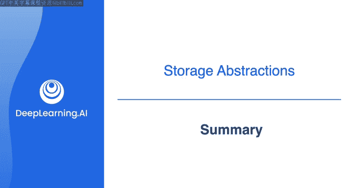
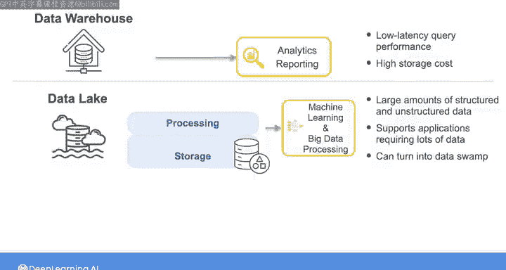
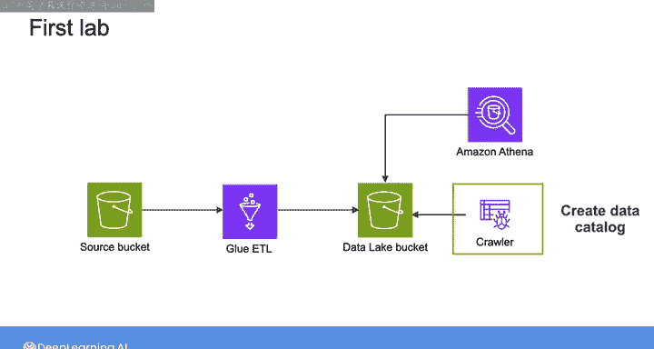
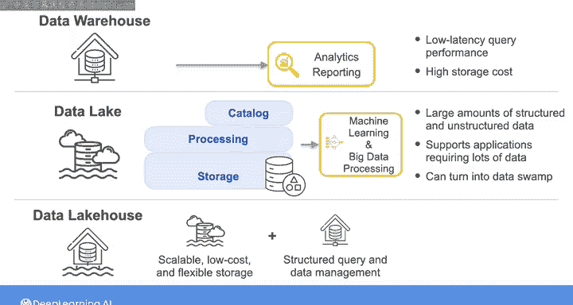
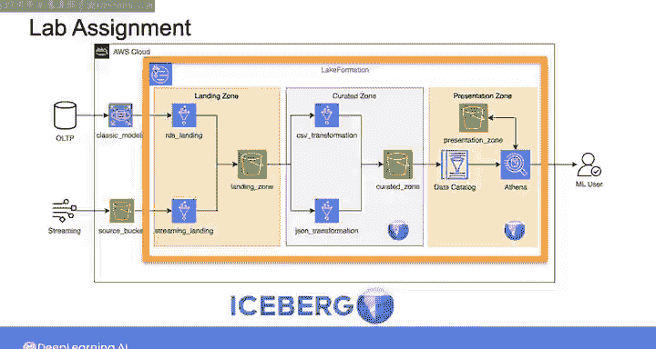

# 吴恩达《数据工程（导论，源系统、数据摄取和管道，数据存储和查询｜1-2-3课）｜DeepLearning.AI Data Engineering》 - P169：31_第2周总结.zh_en - GPT中英字幕课程资源 - BV1wTtWeeEH5

This week we walk through the evolution of storage abstractions from traditional data warehouses to modern cloud data warehouses。

 and then to data lakes and finally data lake houses。

You saw how the data Lakehouse architecture aims to combine the advantages of both the data warehouse and the Data Lake to support the growing data needs of many organizations。

Understanding the key concepts of each architecture enables you to choose the most appropriate storage solution based on your organization's needs。

 remember that modern cloud data warehouses can be used to store data for analytical workloads and reporting use cases and they enable low latency query performance by leveraging the massively parallel processing power of cloud computing but data warehouses typically come with higher storage costs On the other hand。

 data lakes are built on low-cost object storage to store large amounts of structured and unstructured data supporting applications that require massive amounts of data such as machine learning and big data processing。

 but without the proper data management features or data discovery tools。

 your data lakes can easily become unusable data swamps In the first lab of this week you saw how you can mitigate this challenge by creating a data catalog for the data sets stored in your data lake and you partition the data to improve data retrieval and finally data lakehouses combined the scalable lowcot and flexible storage capabilities of a data lake with a structured querying and data management feature。

of a data warehouse to provide a unified platform that supports both low latency analytical workloads and machine learning in the lab assignment you created a data lakehouse using late formation and iceberg tables。

As I said earlier， existing data warehouse technologies are increasingly incorporating features that allow them to also function like a data lake and data lake technologies or incorporating features that allow them to also function like a data warehouse so in your work as a data engineer going forward I think it's likely that you'll see the distinction between data lakes and warehouses and lake houses start the fade away in favor of the set of tools that allows you the flexibility to optimize your storage solutions to the needs of your organization then next week we'll dive into queries you'll see how queries work under the hood and we'll explore strategies for improving query performance I'll see you there。

