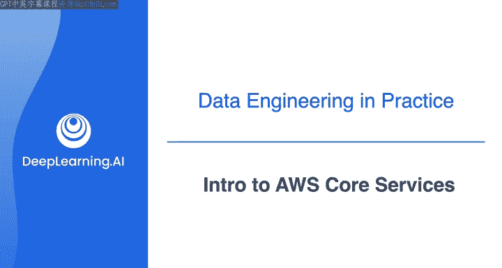
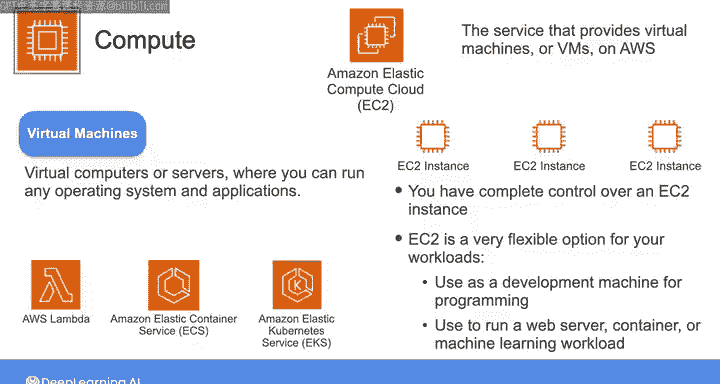
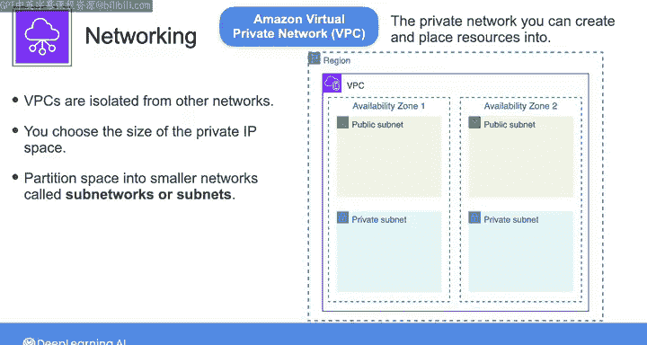
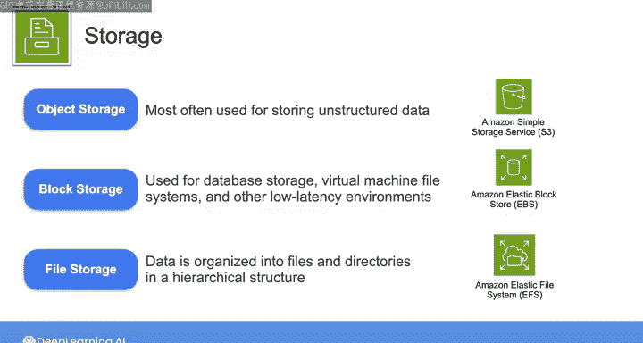
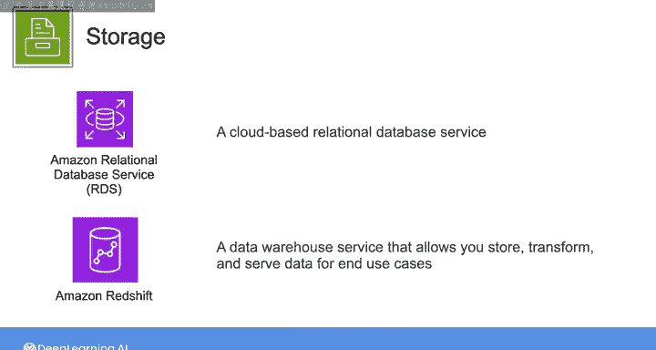
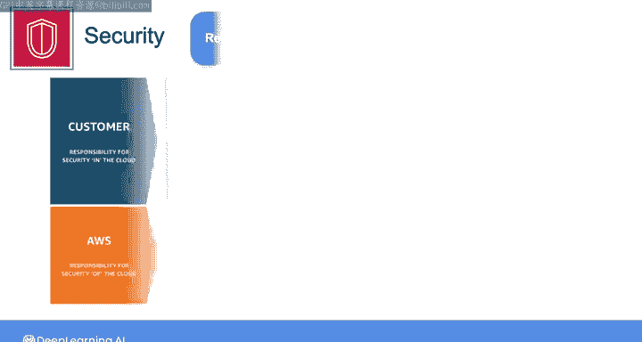
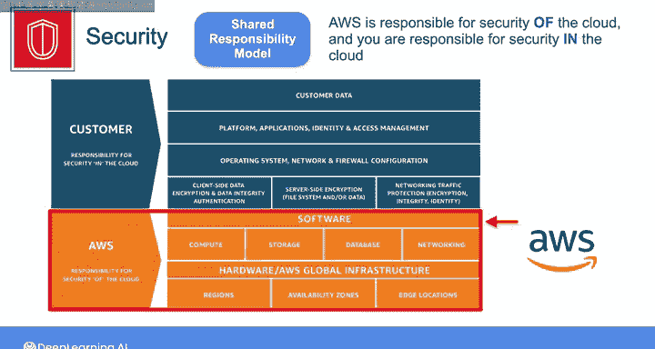
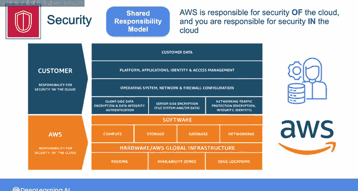

# 吴恩达《数据工程（导论，源系统、数据摄取和管道，数据存储和查询｜1-2-3课）｜DeepLearning.AI Data Engineering》 - P16：15_AWS核心服务简介.zh_en - GPT中英字幕课程资源 - BV1wTtWeeEH5

Now that you're familiar with what the AWS cloud is and how it works at a high level。

 I'd like to just briefly introduce you to some of the core AWS services that you'll be encountering throughout these courses。

I'll break these core services up into five categories。 Compute network， storage。

 databases and security。 Now， if you're an AWS expert already， you're aware that there is。

 of course much more to the AWS cloud than you can capture in five simple categories of services but I find that starting with these core categories makes the rest easier to conceptualize。

 So first up is compute There are many different compute services on AWS but there is one in particular that you are going to see a lot of in these courses and that is Amazon El compute cloud or EC C2 E2 simply put is the service that provides virtual machines or Vms on AWS you can think of a Vm as a virtual computer or server where you can run whatever operating system you want like Linux。

 Mac or Windows as well as any applications just like you would on any computer but in this case on the。

AWS cloud When you launch a single VM using EC2， we call that an Amazon EC2 instance When you spin up an EC2 instance。

 you have complete control over that instance， including the operating system applications and anything else that happens on the instance itself and so EC2 is a very flexible option for your workloads that offers you a lot of control you can use an EC2 instance as a development machine for programming or to run a web server or containers or machine learning workloads or whatever you want you can deploy a single EC2 instance or a fleet of them and scale horizontally to match demand so that's a very quick rundown on EC2 and beyond EC2 there are many different options for compute on AWS including serverless functions using a service called AWS Lambda which is where you can host code that runs in response to triggers or events as well as container hosting services like Amazon El container service or Amazon Elastic。

serviceMoving on to networking whenever you create an EC C2 instance or many other types of AWS resources。

 you need to place it into a network of some kind in AWS we call the private network you can create and place resources into an Amazon virtual private cloud or VpC for short Vpcs are private networks in the cloud that you can create and control that are isolated from other networks in the AWS cloud you choose the size of the private IP space you want and you can partition it into smaller networks called subnet or subnets for short a single VpC spans all availability zones within a region but you cannot span across regions so you need to create a Vpc in every region you want to operate in the same is true for most AWS resources they are region bound your data and resources don't leave the region unless you specifically build your solutions to behave that way which is important for compliance and security purposes so whenever you create。

Certain AWS resources like EC2 instances or instancebased databases。

 you need to select which VPC you want and which Az you want to place it in Now changing gears a bit here let's talk about storage when it comes to storage on AWS there are multiple different types of storage to be aware of like object block and file storage and AWS has services for each of these Object storage is the most often used for storing unstructured data like documents logs。

 photos or videos but really you can put any kind of data into object storage in these courses you'll be spending a lot of time getting familiar with Amazon S3 object storage service in the upcoming labs in contrast to object storage there is block storage which is typically used for database storage virtual machine file systems and other environments where low latency and highperform are critical within AWS you can attach block storage devices called。

on elasticastic block store volumes to EC2 instances which mount to the OS and you can then store and access data using programs running on EC2 Last but not least here we have file storage which is the most familiar type of storage for your average nontechnical user with file storage data is organized into files and directories in a hierarchical structure just like your file system on your laptop or a shared file system at work AWS has a managed service called Amazon elasticastic file system which provides a scalable file storage solution that can be mounted to multiple different systems at once for file access in some sense you could say databases are just another kind of storage service but databases fall into a separate core category。

Though databases use block storage behind the scenes to store data。

 they also provide special functionality for managing structured data like enabling complex querying。

 data indexing， and other features which are not typically offered by general storage services。

As a data engineer， you will frequently work with tabular data organized in relational database format in these courses。

 you're going to become very familiar with the Amazon Relational database service or RDS which as the name implies is a cloudbased relational database service you'll also be using a service called Amazon Redshift which is a data warehouse service that allows you to store。

 transform and serve data for end use cases there are a number of other database services on AWS but RDS and Redshift are the two you will see the most in these courses and later on I'll introduce you to others when it comes to security in the cloud AWS follows what we call the shared responsibility model the shared responsibility model states that AWS is responsible for security of the cloud and you are responsible for security in the cloud to get a better sense of what this means I'd like to use the analogy of a high-rise apartment building with an apartment。

Building the building owner and management company are responsible for ensuring the physical building itself is safe and up to code and that each apartment has working locks and maybe other security measures Now if you are a tenant in the building you are responsible for actually using those security features like making sure your door is locked when you leave or when you are home for the night and so in this sense。

 it takes both the building management and the tenant doing their part to make sure that any given apartment is secure so to get a sense of how the shared responsibility model works on AWs you can take the same idea of the highrise apartment building and apply it to Amazon E2 with E2 AWs is operating and managing the underlying components from the physical hardware and facilities where the E2 instances running up through what's known as the hypervisor layer which is where compute resources are provision to you and other AWs customers the security of all of these。

ents is 100% the responsibility of AWThen when you launch a Vm using E2。

 you are responsible for the management of the guest operating system for the Vm Any software updates of patching setting up the networking configurations like firewalls and managing access to your data as well as using the proper encryption techniques when needed The security of all of these aspects is 100% your responsibility。

 and so it takes both you and AW to maintain a secure E2 instance and the same goes for any other resource on the cloud AW service works a little differently and draws the line in a different place as far as where AW responsibility ends and yours begins。

 you'll learn more about this concept as you move through the courses and get exposed to different AW services So don't worry if this concept of shared responsibility for security isn't familiar to you yet so that was a brief introduction to a few of the。

Co services you will be working with in these courses。With all the labs in these courses。

 you'll have access to AWS Cloud resources without having to create your own account。

With that being said in the next video， I'll do a little walkthrough of the AWS Management console and if you'd like。

 you can create a free AWS account and follow along to get oriented。

In the next reading item you'll find some instructions for setting up your own AWS account。

 and I invite you to do so if you're interested in exploring AWS on your own alongside your work in these courses。

 but again， this is totally optional， you can absolutely be successful in these courses without creating your own account on AWS。

Join me in the next video for a look at the AWS Management Council。

