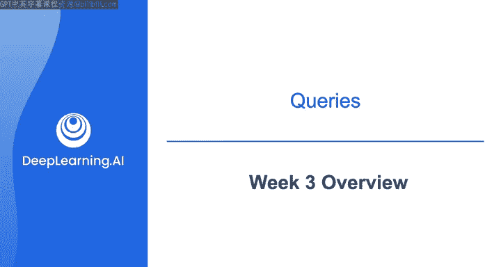
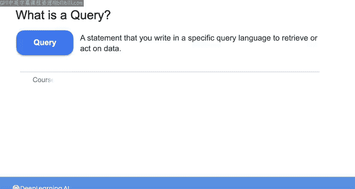
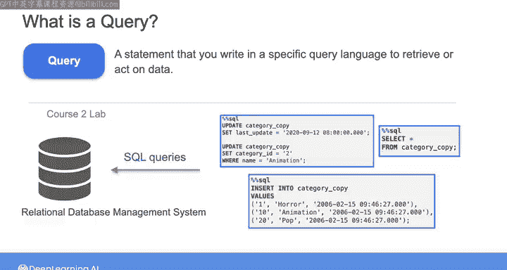
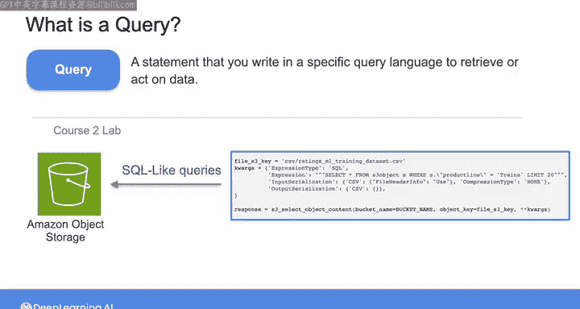
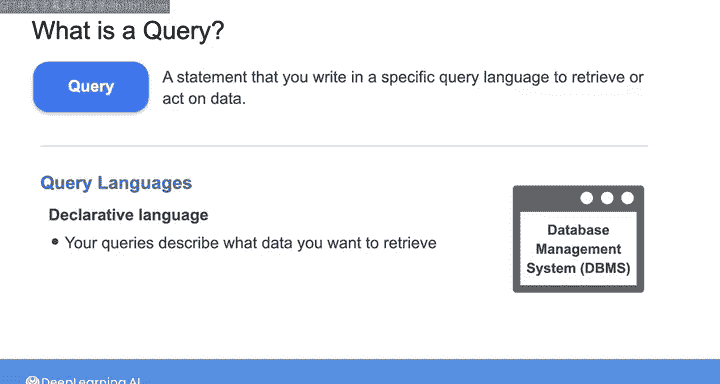
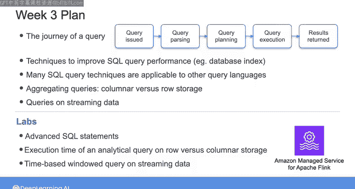

# 吴恩达《数据工程（导论，源系统、数据摄取和管道，数据存储和查询｜1-2-3课）｜DeepLearning.AI Data Engineering》 - P170：32_第3周概览.zh_en - GPT中英字幕课程资源 - BV1wTtWeeEH5

Welcome to the third and final week of this course In previous weeks。

 you learned how data is stored in storage systems such as databases and optic storage and how storage abstractions add additional management layers on top of storage systems This week we're going to look at how the way data is stored and managed。

 has a direct impact on the speed of data retrieval。

 meaning how fast you can query the data as well as how queries can impact the performance of the storage systems themselves in your work as a data engineer。

 you'll be writing queries to extract data from internal and external systems。

 as well as setting up data storage solutions that your stakeholders can query directly and so you need to understand how your data storage and management choices can impact querype and system performance and to do that you need to understand how queries actually work in detail a query is a statement that you write in a specific query language to retrieve data or act on data so for instance。

 in the previous course you wrote SQL statements to interact with a relational database management system or RDBMS。

But queries are not only limited to tabular data in another lab in that course。

 you use SQLlike statements to retrieve data from Amazon Ob storage and in the first week of this course you use cipher to query relationships and node properties from a neoo4j graph database query languages or declarative languages。

 meaning that when you write your queries， you only have to describe the DBMS what data you want to retrieve or what you want to do with the data without worrying about the exact steps that are needed to execute your query these details are abstracted from you and handled by the DBMS so with the DBMS handling the details it might be tempting to think that you don't have to understand exactly how queries are processed behind the scenes。

But if you don't really understand how queries work。

 one day you might end up running a query that brings down a critical database for a few days or more。

 and believe me， that's no good even if you're already good at writing efficient queries yourself understanding how queries or process can help you model the data so that it's easier and faster to retrieve by your stakeholders and so this week we'll explore the journey a query takes to be executed from the moment you write a query to when it's parsed through the creation and implementation of an execution plan to finally when the results are returned or the desired action is executed then we'll cover techniques you can use to improve SQL query performance。

 like creating a database index that can help optimize a search for specific records in a database。

 we'll be focusing on SQL this week because it's an extremely popular and wellestablish language and many of the techniques that will cover or applicable to other query languages as well we'll also look at aggregations。

 revisit our discussion for a row versus column storage and discuss queries on streaming data。

In the labs this week， you'll get handson experience with advanced SQL statements。

 compared the execution time of an analytical query performed on a row storage versus column storage。

 and finally use Amazon managed Service for Apache Flink to perform time-based windowqueries on streaming data joinin me in the next video to examine the life of a query。

