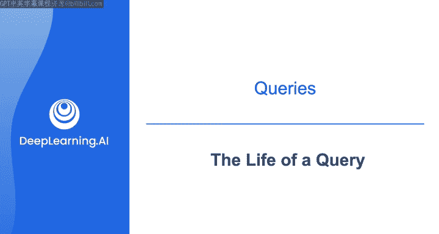
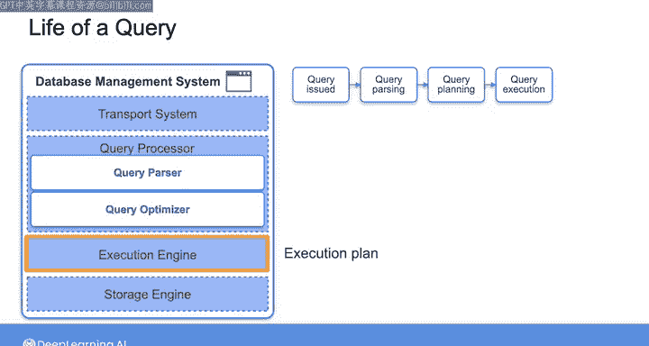
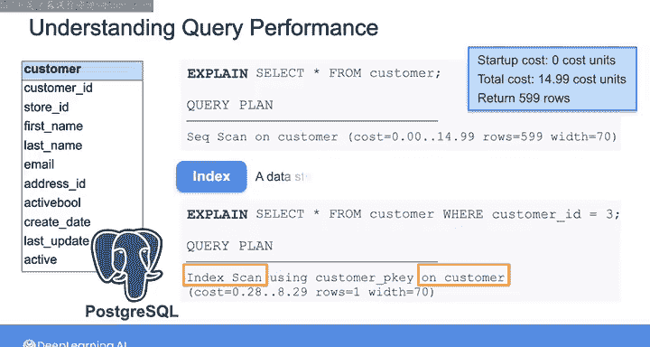

# 吴恩达《数据工程（导论，源系统、数据摄取和管道，数据存储和查询｜1-2-3课）｜DeepLearning.AI Data Engineering》 - P171：33_查询的生命周期.zh_en - GPT中英字幕课程资源 - BV1wTtWeeEH5

While running a query might seem like a simple task where you write code， run it and get the results。

 a lot's going on behind the scenes， multiple components inside your database management system work together to translate your query into a set of detailed action steps。

 so even the simplest select query statement goes through these stages in order to be executed。

Let's go through the life of a query so you can see how it's executed in a database here's a typical architecture for a database management system In week1 of this course we discuss the details of the storage engine so here I'll be focusing on the other components When you send your query to the database your request arrives through the transport system which hands a query over to the query processor the processor has two main components。

 the query parser and the query optimizer the query parser breaks down the query into query tokens which are the basic building blocks of the SQL query including keywords like select and from table and attribute names。

 operators and so on then the parser checks for proper syntax and validates the query by ensuring that all table and attribute names reference in the query actually exist in the database Control checks are also performed to ensure that you or whoever ran the query have the appropriate access to these attributes then the query parser converts the SQL code into bytecode which expresses the steps needed。

Exec the query in an efficient machine readable format The Bcode is then passed to the query optimizer。

 which analyzes the query and devs an execution plan to retrieve the results from the storage layer since a query can be executed in multiple ways the query optimizer attempts to find a suitable strategy that uses available resources as efficiently as possible to do this。

 the query optimizer generates various execution plans based on factors like the types of operations required the presence of indexes in the data scan size。

 then it calculates a cost value for each plan which can include several components such as the IO cost for transferring data from disk to memory as well as a computation and memory usage cost in the end the query optimizer picks to the least expensive plan。

And so query optimizes are fundamental to your query performing as well as it can Once the execution plan is created。

 the execution engine carries out the sequence of operations outlined in the plan and produces the query results。

 while all the details of executing a query are generally abstracted from you you can access the execution plan of any query statement to understand its performance before it's executed or troubleshoot the cause of a slow query after it's executed。

 For instance with relational databases you can add the explain command before your SQL statement to display the sequence of steps the database will take to execute the query This will also show you the various resource consumption and performance statistics and each query stage let's take a look at an example。

 here's the customer table of the DVD rental database that you saw in a lab in the previous course Let's say that I sorted this data in a Postgres database and I want to select all records from the customer table I can add the explain command in front of the simple select statement to fetch the execution plan created by the Postgres。

Qury optimizer the return plan specifies that it's going to perform a sequential scan。

 meaning a full table scan。 It also shows two cost values。

 The first is the startup cost for any processing needed before outputting the results。

 and the second is a total cost for the execution to retrieve the query result。 Additionally。

 the plan also outputs the estimated number of rows be returned and the expected row width and bytes So in this example。

 the full table scan will have a startup cost of 0 cost units but a total cost of 14。

99 cost units to return 599 rows。 let's say you want to run the select query again。

 but this time you decide to use this where clause to filter the records in the query so that only records with customer ID equaling3 will be returned。

 The return plan now specifies that it's going to use the index on the customer ID column to look for the specified row that matches the where condition instead of scanning the entire table recall from week1 that in the index。

A special data structure that you create as a way to keep some metadata on the side to help locate the data you want more efficiently you'll notice that with this indexbased strategy the total estimated cost is less than the cost of the full table scan we'll get into the details of the database index in another video so you can use this explain feature whenever you want to understand your query's performance and this feature is not exclusive to relational databases you can also use it with SQL databases as well as data warehouses or data to lake houses join me in the next video for a quick introduction to the first lab of this week。

