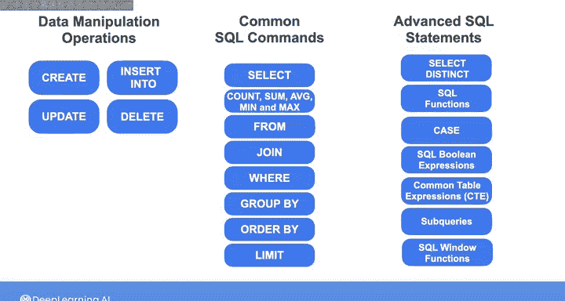
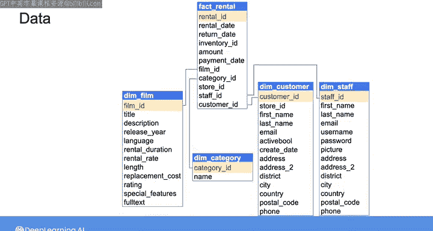
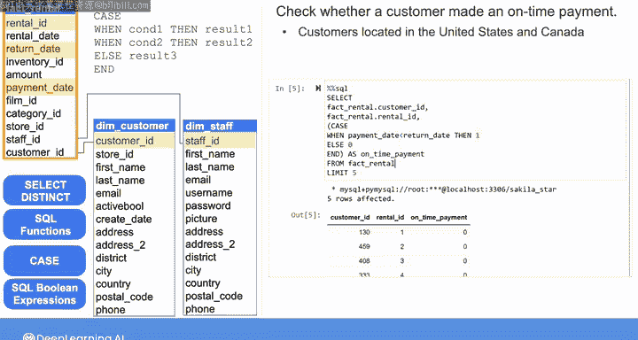
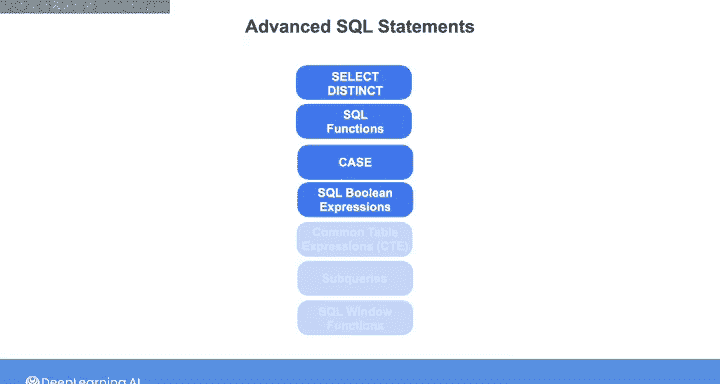

# 吴恩达《数据工程（导论，源系统、数据摄取和管道，数据存储和查询｜1-2-3课）｜DeepLearning.AI Data Engineering》 - P172：34_高级SQL查询（第1部分）.zh_en - GPT中英字幕课程资源 - BV1wTtWeeEH5

In the first lab of the previous courserus， you use SQLqueries to apply CrD operations on a relational database。

 whereCRD stands for createre， read， update， and deletete。

You learned how to create a table and new records。 You select statements to read a set of records。

 as well as update and delete existing records。 You also get a chance to apply a predicate to filter your data using the wear clauses。

 combine data from different tables using joins and apply aggregate functions such as count some average min and Macs In the next lab。

 you'll work with more advanced SQL statements。 These include select distinct SQL functions to manipulate strings and dates。

 case statements， SQL Boolean expressions， common table expressions or CTtes。

 Subqueries and SQL window functions。 Before you jump into the lab。

 let's go through these advanced SQL statements。

Here's the entity relationship diagram or ERD of the data you'll be working with。

 It contains the same information as a DVD rental database you worked with in course2。

 but here it's organized into what's known as a star schema。

 You'll learn more about the data model in the next course。

 the middle fact table called fact rental contains information for each rental transaction made by a customer such as the rental date。

 return date， amount paid the idea of the rentaled firm It category Id the idea of staff that serve the customer and so on。

 The other surrounding dimension tables contain more detailed information about the customers films film categories。

 actors， as well as the stores and the staff to walk you through these advanced SQL statements。

 I'll only be focusing on the rental fact table and the dimension tables for the customer， staff。

 film and film category。 Let's say you're interested in knowing which staff member served which customer from the fact rental table I'll select the staff I and the customer I。

😊。

This query returns all pairs of staff and customer Is。

 but since the customer could be served by the same staff member multiple times。

 the result can contain repeated pairs of staff and customer Is。

 you can add the SQL keyword distinct to the select statement here to ensure that the result contains only unique pairs of staff and customer Is。

 Now， let's include the first and last name of the staff member。

 which you can find in the staff dimension table， So I'll join the fact rental table with the dim staff table based on the staff I column。

 I'll add the staff first name and staff last name to the select statement here。

 You can concatenate the first and last names into one string。

 depending on the database management server。 the syntax for string concatenation might look different here。

 I'm working with a MysqL database where I can use the concate function to combine the first and last names。

 but this concate function will return the full name of the staff member without any spaces in the name。

 to make it easier to read。 Let's add a single space between the first and last name。

Then I'll label this column as staff name。Other than concatenating two strings。

 you could also apply other string manipulation functions。

 such as lower to convert the string to lowercase or upper to convert it to uppercase。

 You can also use the sub string function to extract a part of a string。 For example。

 to return the first letter of the last name。 I'll apply the sub string function through the staff Last name。

 This function expects two arguments。 The star position and the number of characters to extract。

 Since I only want the first letter， the star position and number of characters would both be one。

 Here are the results with the updated last name。Now。

 let's say you want to check whether a customer made an on time payment。

 meaning that they paid for the DVD rental before they return the DVD in the fact rental table。

 you can compare the payment date and return date columns for individual records。

 But to make this easier， let's use the SQL case statement to create a column that contains a one if the payment date is before the return date and a0 otherwise。

 the statement starts with a case keyword and finishes with the end keyword。

 In between these two keywords， you can use the when keyword to specify the condition and then keyword to specify the result。

 you want to associate with that condition。 after you list all the conditions。

 you can use the L keyword to specify the result to return。 if none of the listed conditions are met。

 So let's use the statement to create the indicator column from the fact rental table。

 all select the customer I。 the rental I and then I'll write the case statement and specify the on time payment condition。

 which is when the payment date is less than the return date。

 Then the result is one else the result is 0。And then I'll finish the statement with the end keyword。

 I'll label this column as on time payment。 Let's limit this query to only show the first five rows of the result。

 Here are the results of this query。 All these five customers have zero in the on time payment column。

 meaning that they have paid for the DVD rental after they have returned the DVD Let's filter these results so that you can only see the results for customers who are located in the United States and Canada and for any rentals that occurred between May 24。

2005 and July 26，2005 to get the country of the customer。

 I'll join the fact rental table with the customer dimension table based on the customer I。

You'll need to use the where statement to filter the results based on country and then by date。

 First， let's check if the country of the customer is the United States or if the country is in Canada。

 or you can write this expression using the in operator and check if the country of the customer is in the list containing United States and Canada。

 I'll go with the in operator here， which could be handy when you're interested in more than two options。

 Next to check the date， you can use the between operator to check if the rental date is between 20050524。

 which is May 24， and 20050726， which is July 26。 I'll right end between these two Boolean expressions here since I want both the country and the date conditions to be true。

 Now I'll run the query to see the results。So we discovered the select distinct statement。

 some SQL string functions， bullolean expressions and the case statement。

 join me in the next video to go over some more advanced SQL techniques that you'll see on the lab。

