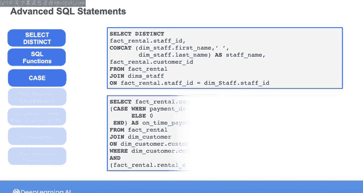
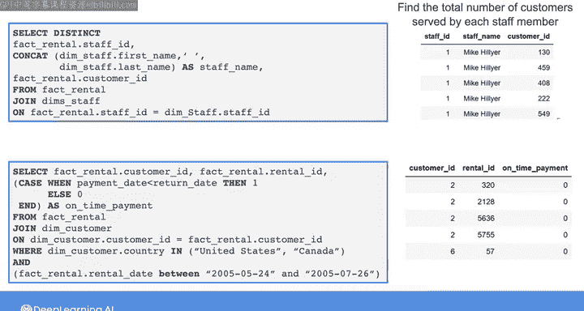
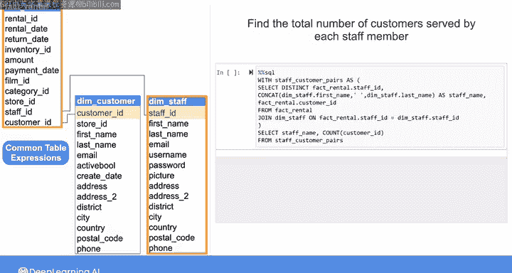
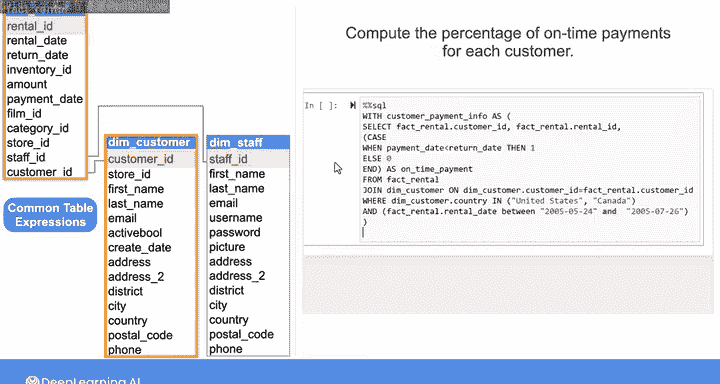
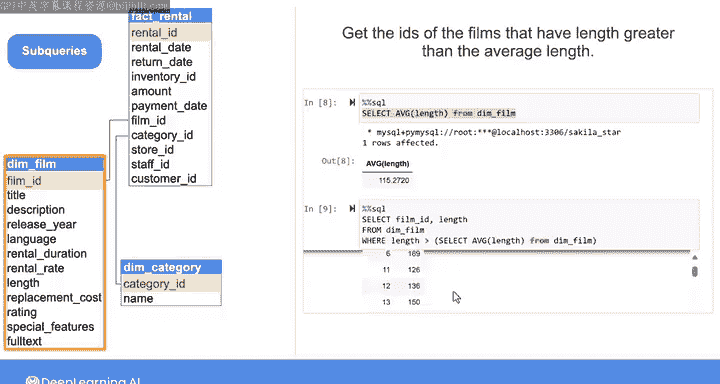
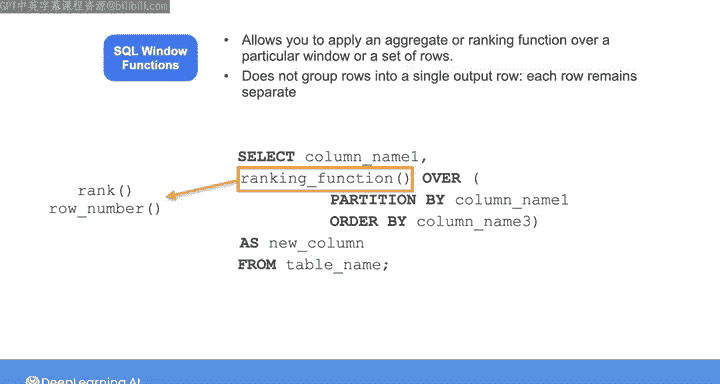
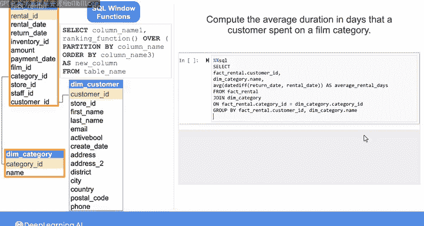
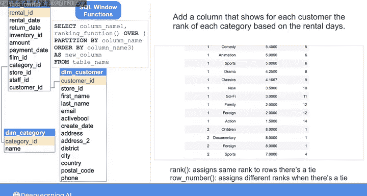

# 吴恩达《数据工程（导论，源系统、数据摄取和管道，数据存储和查询｜1-2-3课）｜DeepLearning.AI Data Engineering》 - P173：35_高级SQL查询（第2部分）.zh_en - GPT中英字幕课程资源 - BV1wTtWeeEH5

In the previous video， you saw how you can apply the select distinct statement and some SQL string functions to query the unique pairs of staff and custom IDs from a DVD rental database。

 Then you use the case statement to create a column that indicates whether a customer paid for their DVD rental on time and you filtered the results using Boolean expressions in the wear clause In this video。

 I'll show you how to apply some advanced SQL techniques。

 including commontable expressions subqueries SQL window functions and some SQL date functions to your queries。

 Let's say you want to perform some additional computations on top of each of the previous two queries。

 For instance， in the first example， you might need to know the total number of customers that were served by each staff member or in the second example。

 you might want to compute for each customer， the average of the ontime payment column to get the percentage of on time payments for each customer In both examples。

 I don't want to store these results in a separate table。

 I just need to be able to reference these temporary results to perform my computations so you can use。

Common table expressions or CTtes to define these temporary result sets that can be referenced elsewhere in the query。

 Let's take a look at the first example and compute the total number of customers that were served by each staff member to define the CTE。

 you start with the with keyword。 then you specify a name for the CTE which I'll call staff customer pairs followed by as keyword and the query that represents the temporary results enclosed between two parentheses So within these parentheses I'll write the query you saw in the last video that got you the unique staff and customer pairs Once you define your CTE。

 you can query it in the same way you query any table So I'll write a regular query to select the staff name and count the customer ID from the staff customer pairs CTteE and then group by the staff name you can see that there are only two staff members and they both served the same number of customers Now let's move on to the second example to compute the。

Percentage of on time payments for each customer I'll define the CTteE called customer payment info and write the query you saw in the last video to get the on time payment indicator column from this customer info CTteE。

 I'll select the customer I and compute the average of the on time payment indicator column to get the percentage of time each customer paid on time。

 I'll then group by the customer ID the results show zero as the percentage of time each customer paid on time。

 you can verify that this is true for all customers by defining this as a CTteE and then finding the maximum of the percent on time payment column。

 So after the first CTteE I can type comma and specify the name of the second CTteE as customer percent on time payment。

 Then I'll surround the second query with parentheses。

After these two CTEs， I'll select the max value of the percent on time payment column from the customer percent on time payment CTE。

 Indeed I do get a max value of 0， so it looks like no customer paid on time and you might want to investigate this further For now。

 let's continue exploring more advanced SQL statements。With CTtes。

 you saw that you can define your temporary results using the with keyword and you can query from the CTteE similarly to how you would from any table。

 You can also incorporate some temporary results within your main query using subqueries。

 Let's focus on the film dimension table。 You can see that each film has a certain length。

 and let's say you're interested in getting the Is of the films that have length greater than the average length。

 So you can start by getting the average length of the film by selecting average length from dim film。

 This query returns a single number， which represents the average of the film length。

 You can then incorporate this query as a subquery within the main query to return the I of the film with length greater than this average。

 So here I'll select film I and length from the dim film table where length is greater than the average。

 and I can get this average by writing the subquery that returns the average length of the films and enclose it within parentheses。

 You can see that the return movies have length greater than the average length。

The last type of query I'd like to go over are SQL window functions。

 This type of query allows you to apply an aggregate or ranking function over a particular window or set of rows。

 It's similar to performing aggregation and using group by but instead of considering all rows at once it applies the aggregation to a subset of rows and it also doesn't group rows into a single output row each row remains separate let's start with a ranking function to define the window you use the over clauses which expects two pieces of information。

 The column you want to partition the rows by and the column you want to rank the rows by to rank each row in each window you can choose from several ranking functions such as rank and row number let's go over an example First I need a query that I can use as a CTteE to apply the window function Let's write a query that computes the average duration and days that a customer spent on a film category so I'll focus on the rental fact table and the category dimension tables。

From the fact rental table joined with the D category table based on the category ID。

 I'll select the customer ID and the name of the film category。

 and then I'll compute the average of the difference between the rental date and return date using date diff。

 which is a function that finds the difference in days between two dates。 Finally。

 I'll group the results by customer ID and category name in order by the customer ID and the average rental days。

So here are the results which show for each customer the average number of days spent on each category。

 Now， let's add a column to this result that shows if for each customer the rank of each category based on the rental days。

 First， I'll define this query as a CTE called customer infofo。Then I'll select the customer ID。

 category name and average rental days columns from the CTE。

Then I'll add the ranking column using the rank function。

 I'll define the window using the over keyword and specify that I want to partition the rows by the customer I and order them by the rental days in descending order。

 I'll label this column rank category。Then finally。

 I'll order the results by the custom ID and rank category。

 You can see that the records are grouped by custom ID。 and within each custom ID。

 the film categories that have the highest rental days are also shown。

 The rank function assigns the same rank to the rows where there's a tie。 the row number function。

 on the other hand， assigns different ranks when there's a tie。 and for the same window function。

 if instead of the rank function， you use any aggregate functions such as the sum of the average rental days。

 It will return the running sum over each window。 So when the results here。

 you can see that you have the custom ids and the category names like before。

 But now the running sum column shows the total average rental days for this film category along with all the film categories before it。

 There are other window functions， such as lead and lag that you can check out in the optional part of this lab。

 Now it's your turn and throughout the lab。😊。

After that， join me in the next series of videos to see how some of these SQL statements are process behind the scenes and explore strategies you can use to improve their performance。

