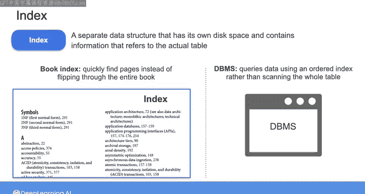
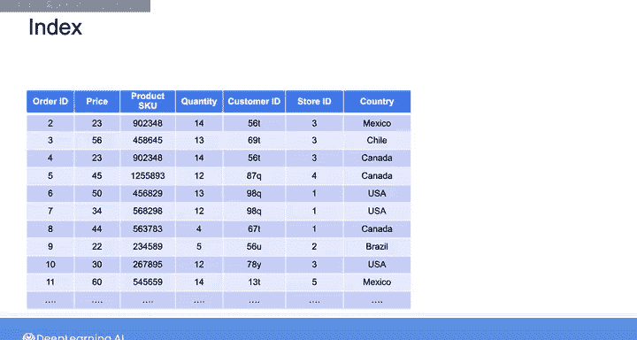
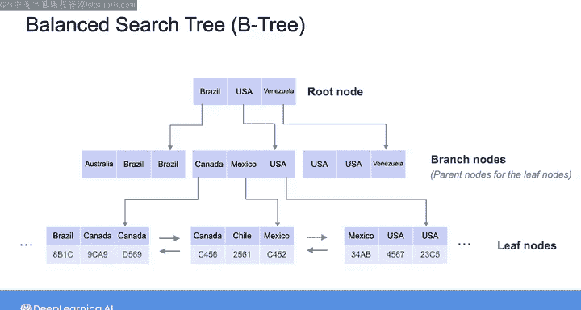
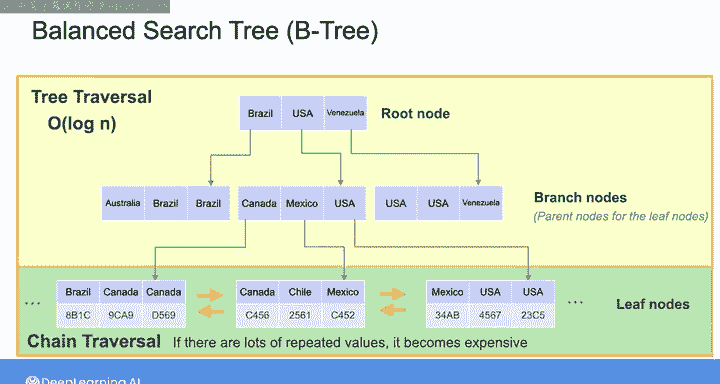
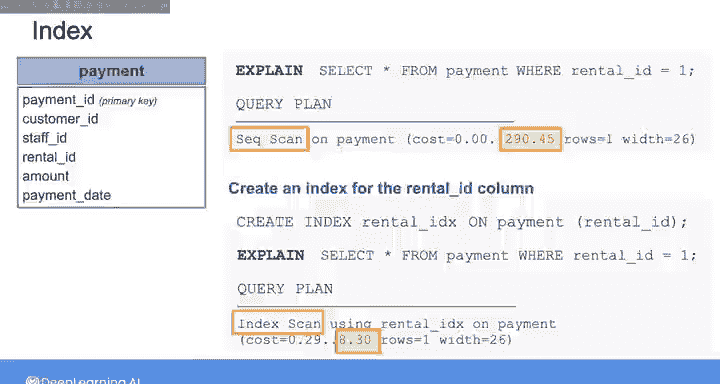
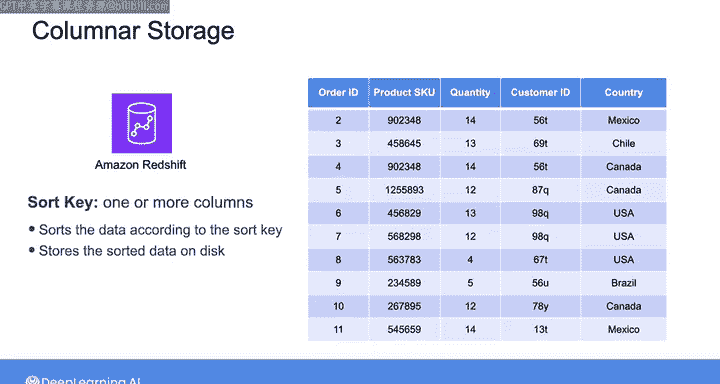
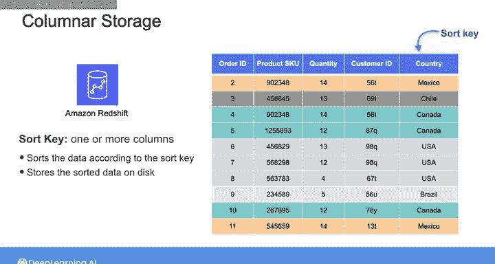
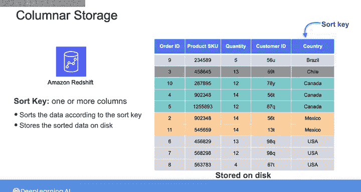

# 吴恩达《数据工程（导论，源系统、数据摄取和管道，数据存储和查询｜1-2-3课）｜DeepLearning.AI Data Engineering》 - P174：36_索引深入探讨.zh_en - GPT中英字幕课程资源 - BV1wTtWeeEH5

Back in week1 you saw that with relational databases you can create an index to help certain queries run faster。

 In fact， when the query optimizer analyzes a query。

 it considers if an index is present and whether using an indexbased plan can reduce the query costs So in this video we'll dive a bit deeper into the details of the index structure as a data engineer understanding how indexes are implemented can help you design better index structures and optimize your queries to improve SQL performance an index is a separate data structure that has its own disk space and contains information that refers back to the actual table it stores the data from one or more columns and a well-defined order So just as you would use an alphabetical index at the end of a book to quickly find pages related to specific topics instead of searching through the entire book。

 a database management system can query data by searching an order index rather than scanning the whole table and in this way the results are returned to you much faster So revisiting the example from week1 you can see here that the entries。

from the country column are stored alphabetically in an index structure when you want to query the orders that took place in a certain country。

 say you want to select all records from the order table where the country is USA the database can perform a binary search over the index to locate the rows and the actual order table that have USA in the country column but how is the index actually implemented In this example I showed the index entries in a table as a way to explain the concept of an index however。

 the data in an index is not actually stored sequentially as a table it's instead divided into blocks that are doubly linked together to enable forward and backward reading from any block the data stored within each block is sorted then the index blocks are linked together in a way that maintains the logical order of the entire index Moreover the location of the blocks doesn't matter because they are properly linked together this structure facilitates the update of the index when new data is inserted or old data is deleted For example。

 let's say an order from Thailand was added to the table。

Thailand is alphabetically between Mexico and USA you would add it in the third index block you see here and shift the rest of the data accordingly and if that record were to be deleted then you would remove the corresponding country from its index block this whole time the index blocks remain doubly linked Now in order to efficiently locate these index blocks。

 another structure known as the balance search tree or Bree is built on top of the index blocks the index blocks represent what is known as the leaf nodes for the tree then building up from these leaf nodes you have internal nodes also known as branch nodes that act as the parent nodes for groups of leaf nodes so for example。

 this internal node is the parent node of these three leaf nodes the internal node storess three entries Canada。

 Mexico and USA which represent the last country from each leaf nodes sorted in alphabetical order this way of the database is looking for a country whose name is between Canada and Mexico it will traverse down to the second leaf node here if a name is between Mexico and USA。

It will traverse down to the third leaf node This pattern of how nodes are grouped and linked is repeated up the tree until it reaches the first node or root node of the tree so let's say you want to queryrry orders that were placed in Canada to locate these rows。

 the database starts at the root node then looks for the country Canada Canada is not in the root node but since it's alphabetically between Brazil and USA the database chooses the second internal node which you know will contain countries that are alphabetically between Brazil and USA the database searches this internal node for Canada and finds that it is the first entry so the database chooses the first path and reaches a leaf node where it finds all the records within the leaf node that represent orders placed in Canada since the entries are not unique within the country column the database also needs to horizontally traverse across the leaf nodes to find all entries that correspond to Canada so in summary to retrieve data that has an index structure the database would need to traverse the B tree first Since the tree is maintained to be balanced meaning that the number of children node。

are evenly distributed between the parent nodes all the way up to the root node of the tree。

 Traversing the tree is always an efficient operation that takes o log n time。

 but if the indexes not contain unique elements once the database is located the appropriate leaf node it needs to then traverse horizontally across a chain of leaf nodes to retrieve all rows with the desired index value If there are lots of repeated values traversing the chain of nodes could end up being almost like scanning the entire table in which case a query optimizer will choose to scan the full table instead of using the index So when you create an index。

 you need to carefully choose the suitable column or columns to build your index on the general strategy is to create index structures that will improve the performance of your most performance sensitive queries。

 you also don't want to overload the tables with too many indexes because maintaining balance in many tree structures whenever the data gets updated may actually degrade the performance of your database to better understand how indexes can impact the cost of a query let's take as an example。

 the payment table of the。

VD rental database you saw in the first lab of this week First let's check the execution plan of a SQL query that doesn't involve indexes here I'm going to select records from the payment table where the rental ID is one。

 you can get the query plan by adding the explain keyword in front of this query from the return plan you can see that the query optimizer chose to do a sequential scan meaning a full table scan now let's create an index for the rental ID column I'll start with a keywords create index and give this index the name rental ID X I want to create this index structure on the rental ID column of the payment table so I'll type on payment。

Then a brackets rental ID I'll add the explain keyword in front of the same queries as before to check the execution plan。

 This time the query optimizer recognized the presence of the index and chose the indexbased strategy because it has a much lower cost。

 So here by adding an index I was able to reduce the query time by more than a factor of 30 I've included a few more examples about indexes and the reading item that follows this video。

 be sure to check those out to better understand indexes can really improve the performance of your queries。

 So far we've been discussing the concept of indexes for traditional relational databases but the same concept also exist for columnar storage For instance。

 when you create a table in Amazon redshift you can declare one or more of its columns as sort keys then without creating a separate data structure。

 redshift directly sorts the rows of the data according to the sort key and then sorts the data on disk For example。

 when you declare the country column as a sort key for this table all the rows of the table will be reorganized based on the country column like this This is what you see when。

Sing by a column or a group of columns in a spreadsheet。

 the reorganized version of each column is then stored on disk By the way other cloud data warehouses。

 such as BigQury refer to the S key as the cluster key but it's the exact same concept by properly creating an index in roworiented databases or specifying a sort or a cluster key for columnar storage。

 you can enhance the performance of certain queries by reducing the amount of rows that need to be scanned After taking a look at the additional index examples in the next reading item join me in the video after that to learn about another best practice when querying your data。

 which is to only query and retrieve the data that you actually need。

