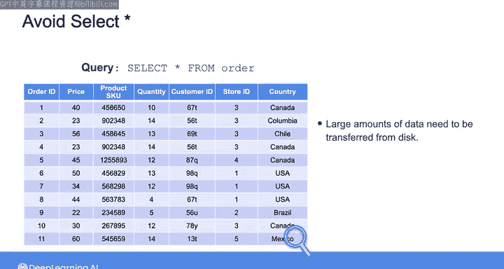
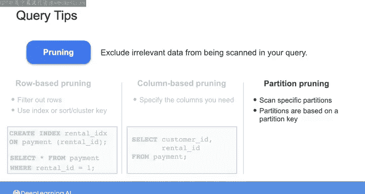

# 吴恩达《数据工程（导论，源系统、数据摄取和管道，数据存储和查询｜1-2-3课）｜DeepLearning.AI Data Engineering》 - P175：37_只检索所需数据.zh_en - GPT中英字幕课程资源 - BV1wTtWeeEH5

In the previous video， you saw that by creating a proper index for a table。

 you can avoid doing a full table scan， which can be very costly。It turns out， however。

 that you can actually do even worse than simply doing a full table scan and that's when you write a query that not only scans the entire table but also returns everything when he runs selectstar with no predicates meaning no warehouse clauses to filter the results the DBMS need to scan the entire table and retrieve every row and column This could be costly for the source database because large amounts of data needs to be transferred from disk and the data might need to be further process I remember a time when a new analyst at a large grocery store chain that I was consulting for ran a select So command on a production database and that brought down this entire critical inventory database for three whole days。

 the company had to spend a lot of money fixing this problem and things didn't look good for that poor analyst runningning select star on your cloud pay as you go database or data warehouse can also be very expensive。

You'll be charged for reading all the bytes from the entire table and for utilizing any compute resources while the query is running This is why in general you should avoid running selectckstar with no wear clauses to filter the results as a rule of thumb you should query only the data you need and if you'd like to explore the data。

 consider using a technique called pruning to exclude irrelevant data from being scanned in your query。

One of the most common pruning techniques is row-based pruning where you filter out rows that don't meet your wear condition For example。

 like you saw earlier， you can select all the records from the payments table where the rental ID column is one when filtering your results you can further improve your query performance by using indexes in traditional roworiented databases or by using sort or cluster keys in column storage such as BigQu or Amazon Redshift As you saw in the previous video you can create an index called rental IDX on the rental ID column in the payment table to speed up this query pruning techniques also include columnbased pruning where you specify in the query statement only the columns you need So for example。

 instead of selecting all records you can select only the customer ID and rental ID columns from the payment table this way the database won't have to scan all the other irrelevant columns。

There's also partition pruning where you only scan specific partitions that contain relevant data instead of scanning the entire table This type of pruning is possible when you work with a data store that allows you to partition your data based on a partition key such as date or location for instance with BigQury you can take this table here that's not partitioned and partition the records based on the order dates you can then further order each partition by the country So let's say a user queries of data and filters by a specific order date of April 1 and country value of USA the database only has to scan the records in the April 1s partition then look for records with USA as the country so to avoid incurring any surprising expenses or degrading the performance of the source data storage you should always make sure to only read the data that you need another factor that has a huge impact on query performance is the way you join data from different tables so we'll discuss the challenges that come with table joins in the next video I'll see you there。

