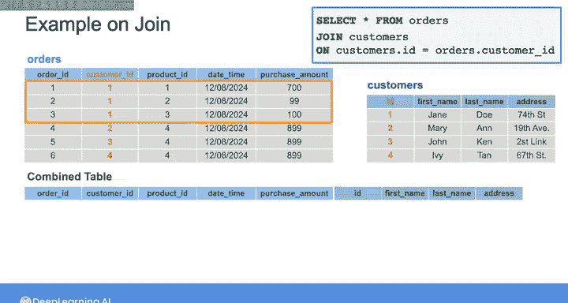
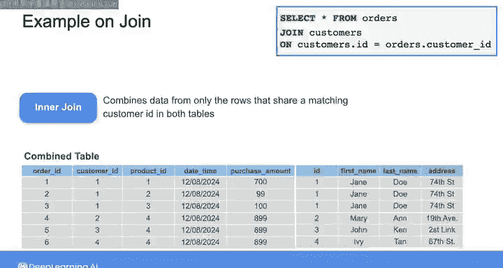
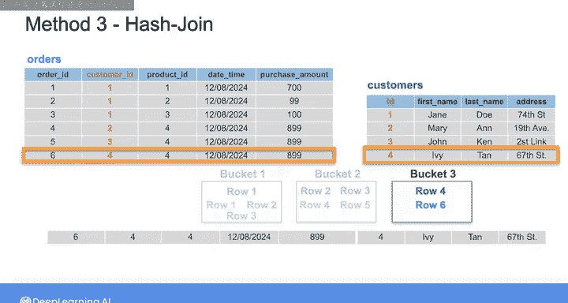
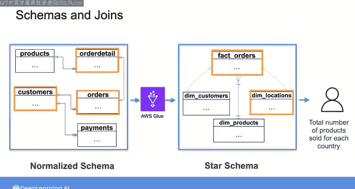
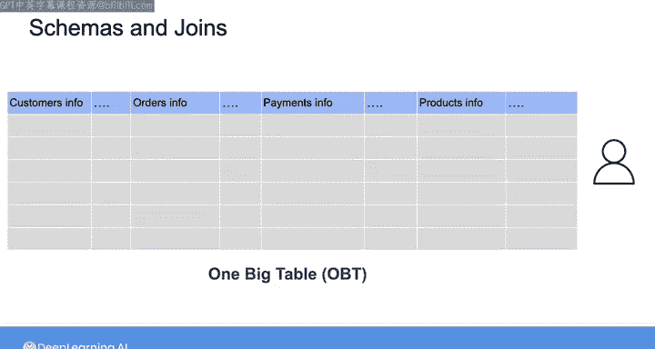
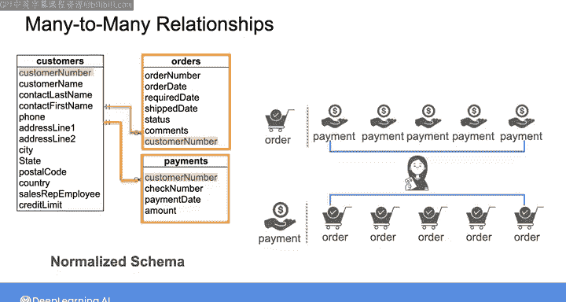
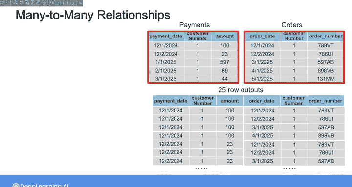

# 吴恩达《数据工程（导论，源系统、数据摄取和管道，数据存储和查询｜1-2-3课）｜DeepLearning.AI Data Engineering》 - P176：38_JOIN语句.zh_en - GPT中英字幕课程资源 - BV1wTtWeeEH5

Using Jos is one of the most common ways to combine data sets。

 allowing you to transform data and create new data sets within your data pipeline。Additionally。

 your end users might also use joins to combine the data you serve for them。However。

 joins are one of the most time consuming query operations。

 so it's critical that you understand how your end users will need to combine data with the joins when you're modeling the data to quickly recap how joins work。

 let's consider these two tables。The orders table contains information about each order placed in an ecommerce-commerce company and the customer table contains information about each customer。

 These two tables are related to each other through the customer's ID and are part of a normalized model that has data stored in separate tables to reduce redundancy to simplify the process of finding information about an order and the customer who placed it you can combine the data from the orders and customer table using a SQL join statement you'll select all the records from the orders table that's joined with the customer table on the ID column from the customer' table and the customer ID column from the orders table this way the corresponding customer information from the customer table is combined with the orders information based on the customer's ID So for example。

 for these three orders that all have a customer ID of one you'll append the customer information for the customer with ID of one then for this next order that has a customer ID of two you'll append the customer information for。

Customer with IDd of two and so on This type of join is known as the inner join where it combines data from only the rows that share a matching customer ID in both tables to help you understand why the join operation is one of the most timeconum query operations Let's go through three common methods for implementing joins Most database query optimizes will use one of these methods when devising an execution plan for join statement The default method is the nested loop join which works like a nested for loop starting with the first row in the orders table the database takes note of the customer ID then it scans every row in the customer table and only retrieves the rows with this matching customer ID It combines the information from this row of the orders table with retrieved rows of customer information This is repeated for every row in the orders table and the combined results are returned at the end。

The second method is the indexbased nested loop， which is a variation of the first method。

 This method can be used when an index exists for at least one of the join attribute which in this case could be the ID column in the customers table or the customer ID column in the orders table let's assume an index exists for the ID column in the customers table So you might have a Bre structure with a root node in nodes and leaf nodes that looks something like this。

 to execute this join， the database retrieves a first row from the orders table and then uses the ID index to locate all rows from the customer table that have a matching ID of one。

 So from the root node since one is lesson than 10 itll go down to the first internal node then since one is lesson than3 itll go down to the first leaf node Finally it finds a unique ID of one and its corresponding row address from the customers table The database will then retrieve the data from this row in the customer table and join it with the first row from the orders table it will repeat this for every row in the orders table and then return the combined results The last method。

I the hash join method and this method uses a hash function to map the rows from each table to bucket space and the value of the join attribute。

 which is the customer's ID in this example with this method。

 the database first scans all rows of the smaller table which is the customers table in this case and sends each row to a particular bucket For example we could have a hash function that maps row1 from the customers table to the first bucket rows 2 and3 to the second bucket and row4 to the last bucket then the database scans through the rows of the larger orders table。

 sending each row to a bucket based on the same hash function。 For example， it could send rows 1。

2 and3 from the orders table to the first bucket rows 4 and5 to the second bucket。

 then rows 6 to the last bucket Finally within each bucket the database combines the rows from the customers table and the orders table that shared matching customer IDs So in the first bucket here sends the row from the customer table and the rows from the orders table all have a customer ID of one the database would combine all these into three rows in the second。

Bet here， the database would combine the rows with a customer D of2 and then separately combine the rows with a customer D of3 and then finally in the third bucket it'll combine the two rows that both have a customer ID for at the end it'll return the combined results This method can be much faster because scanning the smaller buckets in parallel can be much faster than scanning the entire table in all of these methods the join operation requires a database to scan a considerable number of rows from each table and that can occur multiple times。

That's what makes a join operation one of the most timeconsum query operations。

 A from being able to write efficient join queries yourself as a data engineer。

 you should model and serve data to your end users in a way that enables them to easily join the data when needed。

 the data model and schema you choose affects the number of joins of end users needed to perform to get the data that they want In general。

 normalized schemas result in less redundancy in your data but require a more complex join statements to combine the data Here are two schemas you've seen in the first lab of the specialization。

 The first is the normal schema of the input data that you ingeestted in your pipeline。

 you then ran a glue job to transform the data into the star schema before serving it to the data analyst。

 Let's say the data analyst is interested in computing the total number of products sold for each country。

 If you kept the data in its original normalized schema。

 then the data analyst would need to join the customer table with the orders table and then join the orders table with the orders details table。

 On the other hand， in the star schema the data analyst would only need to perform one join by combining the fact orders table。

the dim locations table Another alternative is to combine the relevant attributes into one big table then the data analyst won't need to perform any joins at all Don't worry if data modeling is new to you we will get more into the details of data modeling and the pros and cons of each approach in the next course but aside from modeling your data another challenge you'll likely encounter when working with joins is when two tables have a many to many relationship for example。

 the payments and orders table shown here have a many to many relationship and payment can be associated with many orders and in order can be paid over several payments Each payment is associated with a customer and let's say that customer number one made five different payments。

Each order is also associated with a customer and let's suppose that customer number one made five different orders so you can join the payments table and the order table based on the customer number to get this table that sounds simple right the problem is that this table might not represent what you think it should at first glance you might think that this table shows the payment information and their associated orders but there's actually an error in the join logic here by joining the table on the customer number you are blindly joining the payments table with the order table without considering if a given payment is correctly mapped to its corresponding order because of this error every row in the payments table that's associated with customer1 is mapped to every row in the order table that's also associated with customer1 This creates five times5 or 25 rows in the output Now suppose that there are many other repeats in the customer number column This leads to a scenario known as row explosion where the query returns more rows than expected row explosion can generate enough output rows to consume a massive amount of database resources and can。

Actually cause queries to fail occasionally to avoid this problem。

 make sure that you check your query plan to see if it correctly describes what you intend the join to do and if this queryio will be run frequently then consider adding a table to your model that correctly maps a payment to its corresponding order number understanding how joins or process can help you design more efficient join queries as well as properly model the data for your end users and so I hope you'll join me in the next video for a look at aggregate queries。

