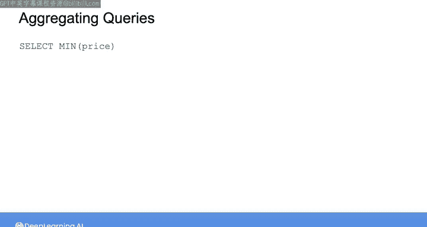
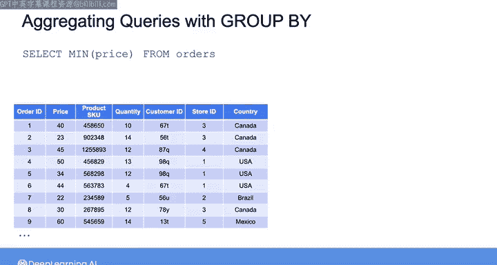
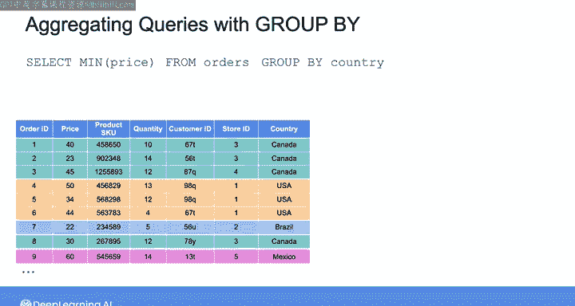
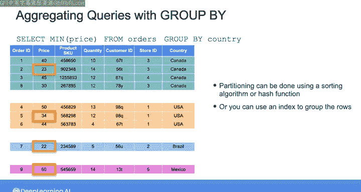
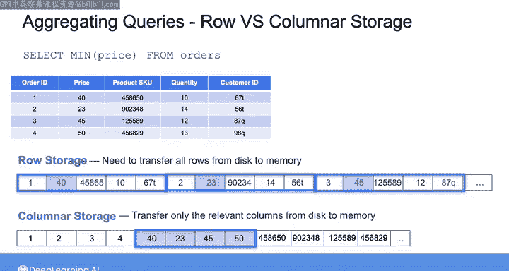

# 吴恩达《数据工程（导论，源系统、数据摄取和管道，数据存储和查询｜1-2-3课）｜DeepLearning.AI Data Engineering》 - P177：39_聚合查询.zh_en - GPT中英字幕课程资源 - BV1wTtWeeEH5

When building a system for analytical workloads， you have to support aggregating large data sets。

Arogate queries are used to compute a summary value of a column such as the sum average maximum minimum and count of the values in that column Here's a query where you select the min price from the orders table in roworiented databases aggregate queries like this one can be computed by a full table scan where you scan each row in the table looking for the row with the minimum value in the price column or you can speed up this query by using an index structure if it's available so for example。

 if you have a Bre index on the price column like this then the query optimizer can decide to use the index and traversesus tree to reach the leftmost leaf node to return the minimum price when working with aggregate queries。

 you can also use a group by clause to group query results by a specific columns and return the summary values within each group So for example you can add group by country to your query to get the minimum price for orders placed in each country in this case the table must be first partitioned into groups where。

Each group includes just one country then the minimum price is computed for each group The partitioning is usually executed using a sorting algorithm or a hash function and could be avoided if an index exists on the grouping attribute which is the country column in this case In any case with aggregate queries you are performing operations and columns rather than rows。

 remember that with roworiented databases you store all the values within the same row next to each other on disk this means that to get the price value from each row。

 you have to transfer all the rows in their entirety from disk to memory So you end up transferring more data than you need to execute the analytical query this could work just fine with small data sets。

 but with large data sets， performing analytical queries and roworiented stores becomes much slower On the other hand。

 column storage stores all the values within the same column next to each other on disk So in this case if you needed all the values from the price column you just need to transfer the data from the first price value to the last price value thats stored on。

So performing analytical queries on columnar storage it's much more efficient because you only need to transfer the relevant columns of data for your analytical query from disk to memory In the upcoming lab you'll get a chance to compare the query performance between row and columnar storage you'll run an analytical query on a roworiented database hosted on Amazon RDS and then you'll run the same analytical query in Amazon Redshift which is a cloud data warehouse that leverages columnar St and finally you'll compare the execution times of both of these queries In the next video。

 Morgan will walk you through the details of Amazon Redshift。

Then after that， I'll give you a quick walkthrough of the lab。

