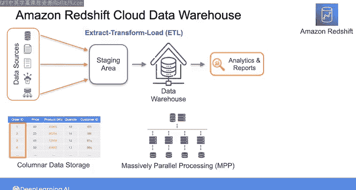
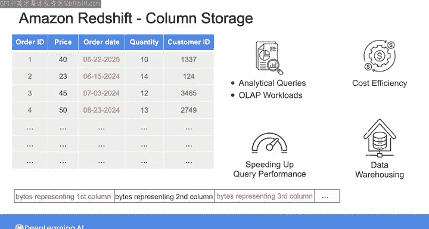
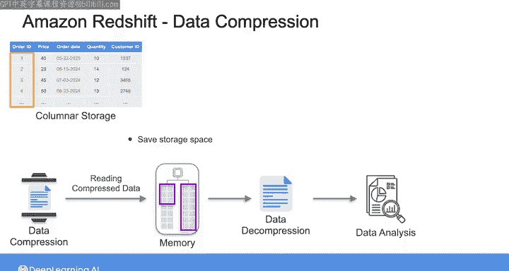
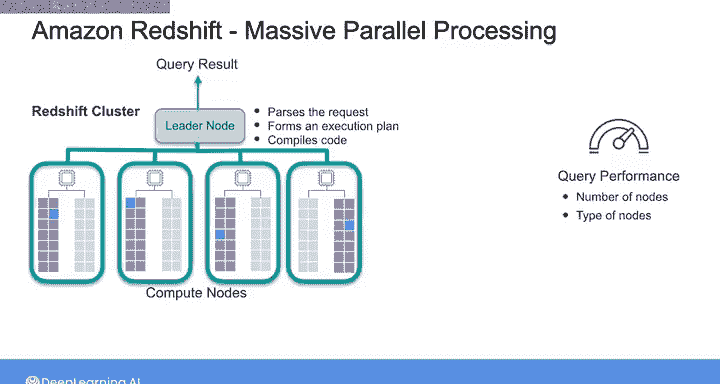
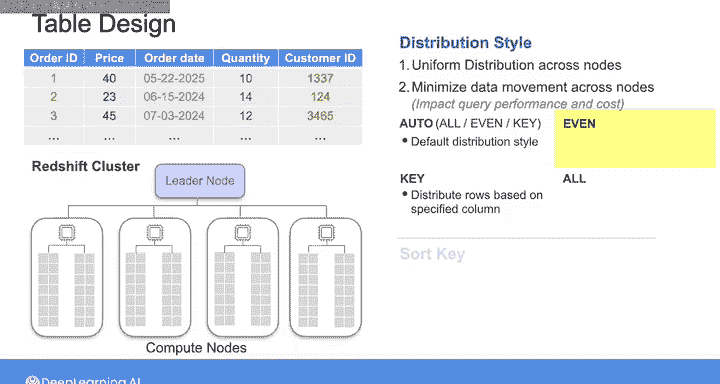

# 吴恩达《数据工程（导论，源系统、数据摄取和管道，数据存储和查询｜1-2-3课）｜DeepLearning.AI Data Engineering》 - P178：40_Amazon Redshift云数据仓库.zh_en - GPT中英字幕课程资源 - BV1wTtWeeEH5

You've been learning about queries， indexes， and various strategies and tips for writing efficient SQL queries Now let's talk about some architectural factors that affect query performance for data warehousing workloads running on Amazon Redshift。

Here we'll look at how redshift queries data and some considerations to keep in mind for table design that can optimize query performance。

 Redshift is designed to be a highly efficient data warehousing solution。

 and it achieves this through a combination of different internal architectural features including columnar data storage massively parallel processing and data compression encoding schemes Redshift is a columnar database which means that it stores data column by column together on disk rather than row by row This storage method is particularly efficient for analytical queries and OAP workloads that require aggregating data over many rows but only need to access a few columns for any particular query by storing data in this columnar way Redshift can quickly scan and retrieve the necessary data significantly speeding up query performance This is part of the reason why Redshift is especially well suited for。

Data warehousing and large scale data analytics， where fast query performance over large data sets and cost efficiency are important。

 columnar storage also allows for better data compression when you run a query Redshift reads the compressed data into memory and decompresses it as needed which means it can use more memory for actually analyzing the data and that means your queries can run faster So you can save on storage space and cut down on the amount of data being read from the disk Redshift also uses massively parallel processing or MPP which you've already learned a bit about last week with Joe let's quickly go over that again。

 Redshift is made up of a cluster that has multiple compute nodes and a leader node data associated with a workload is distributed across these compute nodes and each node is responsible for storing a portion of the data as well as processing queries on that data the compute nodes are partitioned into what。

Called slices a slice uses a portion of the compute nodes memory and disk space to process a portion of the data assigned to the node with NPP。

 these compute nodes work together to handle query processing with each slice running the query on different portions of the data when you submit a query to redshift the leader node pars the query develops execution plans and generates a series of necessary steps it then compiles the code needed to perform the task and distributes it to the compute nodes for execution。

 Each slice processes its assigned portion of the data in parallel。

 Once a compute node is done with the work， it sends the results back to the leader node which then aggregates the results into the final results set。

 This parallel approach ensures the queries are executed quickly。 However。

 the performance of your queries may also depend on the number of nodes or node types you have in the cluster。

 Now， all that being said to optimize for efficiency and。

PerformanceYou can't rely on these builtin factors alone。

 There are multiple key factors to consider related to table design。 When you create your table。

 you can optionally define a sort key and distribution style which will heavily influence overall query performance。

 So let's dive into the details around distribution style first。

 I've alluded to this one already when we talked about how MPP works with redshift。

 The data gets divided amongst the compute nodes。 and how that division happens is controlled by defining a distribution style for the table。

 There are two main goals when defining an appropriate distribution style。

 The first is to have a uniform or even distribution of the data across the notess。

 Uneven distribution otherwise known as data distribution skew may result in some nodes doing a lot more work than other nodes。

 and since your query would be waiting on one node to churn through a large amount of data。

 it can lead to。

performance having an uneven distribution of data like this means that you can't take full advantage of the massively parallel processing capabilities Redshift offers The other goal is to minimize data movement across the nodes。

 If a query running on a node involves joining tables or aggregating data that is distributed across multiple other compute nodes。

 Some of the data may need to be redistributed between nodes over the network。

 This cross node data movement can result in increased network traffic。

 which in turn may slow down query performance and increase your query cost to minimize this。

 It's important to carefully select a distribution style for your tables。

 a reasonable data distribution across the nodes ensures that related data is colocated on the same node reducing the need for this cross node communication This optimization helps to balance the workload and improve query efficiency by keeping as much。

Processing as possible， localized to each compute node So when you create your table。

 you can choose from the distribution styles auto even key or all key will let you choose a specific column and then use that columns values to distribute the rows of data among the nodes the leader node will distribute rows with the same key value to the same node you may be tempted to define a specific key for every table you create but this requires some thorough analysis of the data and you might not know exactly which column would make the most sense In this case。

 you may instead want to use auto which will let redshift assign an optimal distribution style based on the size of the table data if you can provide a value for distribution style it will default to auto or you can use the even distribution style and Redshift will have the leader node distribute the rows across the nodes using a roundrobin approach regardless。

Of the values in any particular column Even distribution is most appropriate when a table won't really need to have joins run against the dataset。

 Then there is also the all option With all a full copy of the entire table is distributed to every node when using even or key redshift places a portion of the tables row on each node but when you use all redshift ensures that every row is colocated for every join that the table participates in this is nice for cases where you frequently join smaller tables with much larger tables by having a full copy of the small tables on every node you eliminate the need for data shuffling across nodes during join operations however the all distribution multiplies the storage required to store the table data by the number of nodes in the cluster and so it takes much longer to load update or insert data into multiple tables for this reason using the all distribution is。

Only appropriate for relatively slow moving tables Now let's move on to sort keys and how that impacts query performance。

 Redshift stores your data on disk in sorted order according to what you define as the sort key when you submit a query to redshift。

 the query optimizer uses the sort order to determine the most optimal query plans the sort key you choose for a table impacts query performance because it determines how the data is physically organized on disk when your queries filter or join data based on sort key Redshift can more efficiently locate the relevant data reducing the amount of data that needs to be scanned from disk So choosing an appropriate sort key can minimize diskread operations and speed up overall query execution For example。

 if you frequently query a sales table by order date defining the order date as the sort key allows redshift to efficiently scan only the necessary portions of the table that match the date range in your。

QuerySimilarly， if you often filter by customer ID setting customer ID as a So key can optimize those queries you can think of this like how OLTP databases use indexes to speed up queries in a similar way OLAP databases like Redshift used So keys to speed up queries So those are some considerations to keep in mind for table design Up next Joe will walk you through the upcoming lab where you'll compare performance between row and columnar databases and I'll see you again soon。

