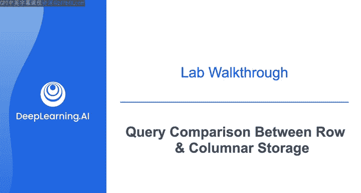
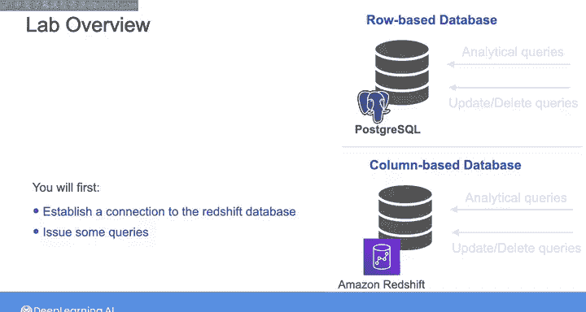
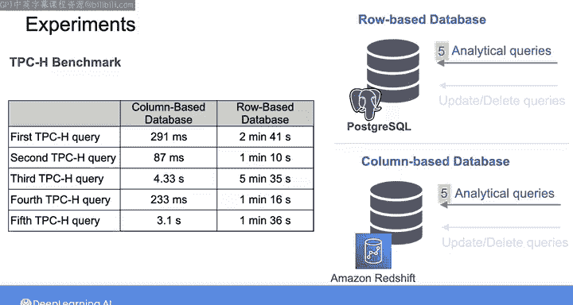
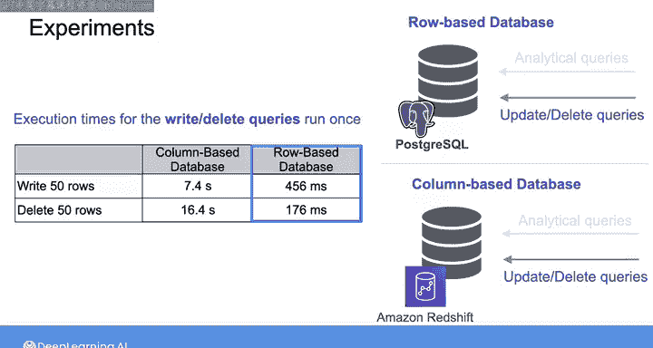

# 吴恩达《数据工程（导论，源系统、数据摄取和管道，数据存储和查询｜1-2-3课）｜DeepLearning.AI Data Engineering》 - P179：41_实验演练：比较行存储和列存储的查询性能.zh_en - GPT中英字幕课程资源 - BV1wTtWeeEH5

In the lab you'll explore the performance differences between rowbased and columnbased databases by performing analytical queries。

 as well as update and delete queries on both types of storage and comparing their execution times。

 In this video I'll give you a quick overview of the datas you'll work with and go over the results of the experiments you'll run on the two types of databases to assess the execution time of the analytical queries you'll work with a benchmarking data that's based on this entity relationship diagram。

 The data is stored in a Postgres SQL database that represents rowbased storage and it's also stored in a redshift data warehouse which is a columnar database This data contains information related to orders。

 the line items that make up the orders information about the customers who place the orders and information about the suppliers who provided the products。

 you'll run five analytical queries to query the data from each store。

 This set of data and SQL queries is referred to as a TPCH benchmark。

 The goal of this benchmark is to simulate a set of basic scenarios to examine a large。

and execute queries to answer business questions It's designed to evaluate the performance of various database systems and how they execute complex queries。

In the lab you will complete a function that generates 50 rows containing random entries and write them to a line item table。

 you'll check and compare the execution time of this query for both databases。

 Then you'll delete these rows from both databases and again compare the execution times of this delete query Before you start the experiments in the lab you'll first establish a connection to the Redshift database and issue some queries to it。

 you'll notice that interacting with the data warehouse is very similar when you work with any regular database let's go over the experiments from the lab I've run the five analytical queries from the TPC benchmark on both databases and got these results with benchmarking。

 you would ideally run the queries multiple times to get an average of the results。

 but since this is just a quick demo I only ran the queries once to save time and cost in the lab you'll be asked to only run the first query and the remaining ones will be optional。

 If you decide to run all of them， you might get different numbers than these ones here。

 but you should notice that with the rowbased database all the analytical queries took a few minutes to run。

Whereas with the columnbased database， all the analytical queries took milliseconds or a few seconds to run。

 This shows that performing analytical queries on column based databases is much faster than on rowbased databases On the other hand。

 when it comes to performing write or delete queries you can see that writing and deleting the 50 rows from the rowb database is much faster than writing and deleting the data from the column based database Again。

 these numbers might look different for you but you should be able to see that performing a write and delete queries is faster with the rowbased databases than it is with the column based databases So now if you can try out the lab yourself and run these experiments on the PostgresQl database and the reshift database After that。

 join me in the next video where we'll explore more strategies for working with complex queries。

