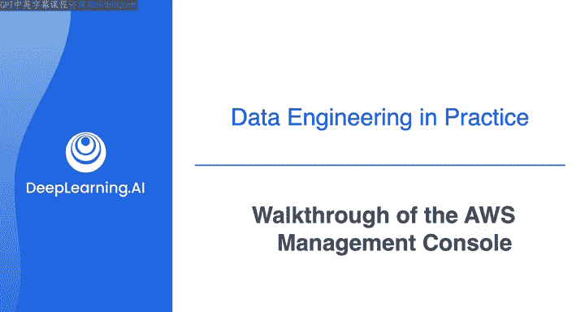
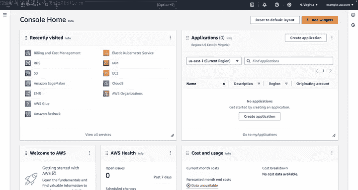
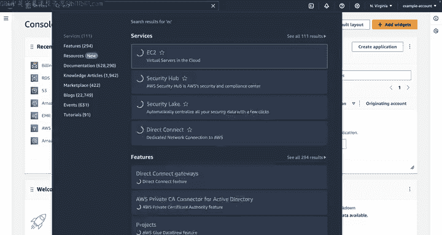
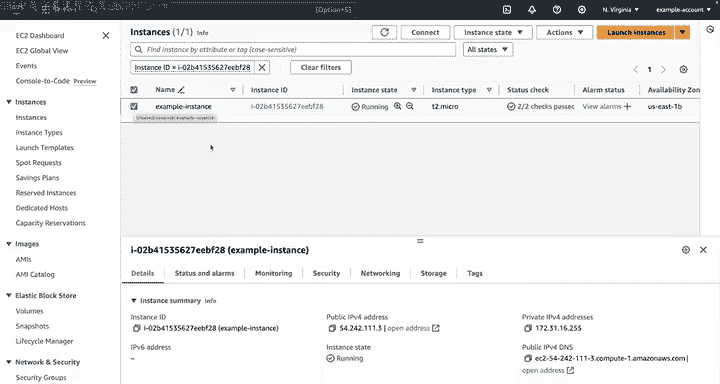
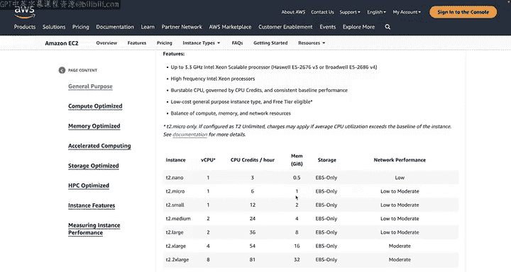
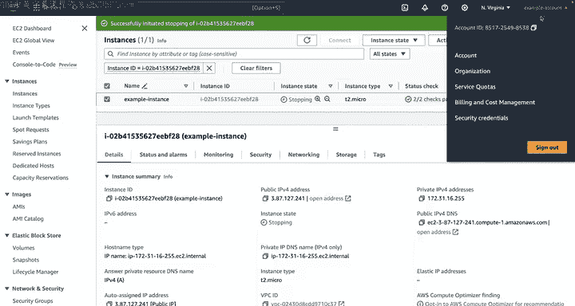

# 吴恩达《数据工程（导论，源系统、数据摄取和管道，数据存储和查询｜1-2-3课）｜DeepLearning.AI Data Engineering》 - P17：16_AWS管理控制台演练.zh_en - GPT中英字幕课程资源 - BV1wTtWeeEH5

You might not have worked with AWS or any other cloud services before taking this course。

 and that's okay， you don't need to have any prior experience working with cloud services in order to complete the lab exercises in this course。

In each lab， an AWS environment will be set up for you。

 so you don't need to have your own AWS account to complete the lab。

You'll see your first lab next week， but I want to take a moment now to show you what the AWS Management console looks like。

 which is the first place you'll land each time you spin up a new lab。

If you're interested in exploring the console on your own。

 you can follow the instructions from the previous reading item to create your own AWS account and follow along with me in this video or just sit back and relax。

 and I'll give you a preview of the AWS management console， you'll be using in the labs。

 When you start each lab you'll be given instructions to open the AWs management console。

 Once you have done that， you'll see a landing page that looks something like this as AWS continues to update its platform and services。

 The UI of this console may change and your console might look a bit different than what you see in this video but all of the basic navigation instructions。

 I'm about to show you should stay relatively the same on the console homepage。

 there's this recently visited section that shows the services you have accessed most recently。

 When you start a lab， this section might not contain any services。

 But any time you want to access a particular service to create a resource。

 you can click on this search bar and start typing the name of the service you need。 For example。

 let's say you want to access。😊。

Existing E C2 resources or spin up newance。 simply type E C2 into the search bar and click on the service that appears。

 you will be brought to the service dashboard that looks similar to what you see here。

 Most services will have a navigation menu on the lefthand side。

 and you can navigate to a particular window by clicking on one of those menu items。 Now。

 let's say you want to launch a new E C2 instance from the E C2 dashboard here。

 you would select launch instance。 which brings you to a page where you can select all the configuration details you want to provide for the instance。

 and there are default values for many of the configuration options so you can quickly get started。

 First， you need to provide a name for the instance。 I'll call this example instance。

 Then you can select the Amazon machine image or AM you want to use which will determine the operating system and applications that are preinstalled on the instance along with other configurations。

 here， I'll keep Amazon Linux as the AM selection。 Then you can choose the instance type， which。

Demins the size and blend of hardware capabilities the EC2 instance provides because this is a quick demo of how to use the management console。

 I'll just accept the default value， which is a T2 micro here。

 T2 is the instance type and micro is the size。 Then you need to select that you want to proceed without a key pair to connect to the instance from here you can scroll down except the rest of the default values and launch the instance and you don't need to worry too much about the rest of these specific configuration details at this point。

 I just want to show you how to get familiar with navigating the AWS management console in the lab exercises。

 you'll be given detailed instructions to follow for configuring E C2 instances。

 This instance will take a few minutes to boot up so we will come back when it's done When you use the AWS management console to launch an instance like this。

 You invoke the AWS API for this action。 You could perform the same task using other tools like the AWS command line Air or Ci or the AWS software development。

Or SDKs。The AWS management console is just one way to interact with the AWS API。

 Okay so the E C2 instance is now available。 And here I can see that there is one running instance。

 I can now interact with this instance using the console。 But first。

 what is this virtual machine I've just created。 Well。

 let's take a look at the documentation for EC2 to get a better sense of just what the characteristics of this little cloud computer are。

 So as I mentioned before， this instance is a T2 micro。

 which is the default E2 instance type here at the top of the documentation page under general purpose。

 I can select T2 to look at the specs for all of the different types of T2 instances under features。

 I can see this instance comes with a 3。3 GHz processor and then under memory in the table。

 I can see the T2 micro has 1 gig of memory or Ram So this is a pretty small computer indeed In fact。

 your mobile phone likely has more power in terms of processing and memory capacity than this T。

Micro instance if you needed a more powerful virtual machine for your workload on AWS you could opt for one of these other T2 instances or a different general purposese instance type to serve your needs you can also choose from instance types optimized for compute memory or storage as well as accelerated in highperformance computing So the takeaway here is that with EC2 there are literally hundreds of instance types to choose from and depending on your project。

 you can provision a machine ranging from a fraction of the power of a mobile phone all the way up to a supercomputer in the cloud Now back to the T2 micro instances we have running here one thing that you want to ensure you are doing when working in your own AWS account is that you delete or stop any resources when you are not using them to avoid getting billed for them in the case of EC2 you only get charged for EC2 instances when they are running and for their elastic blockstore or EBS resources that are attached to the instance So to avoid getting charged here。

 I will stop the instance by selecting instance。

and then stop instance a warning pops up here telling me that I will still be billed for associated EBS resources or elastic IP addresses。

 which we do not have in this case so I'll select stop and that will stop the instance The next thing I want to show you is how to find your account number and the region you are currently working in which are pieces of information you'll need during some of the labs in the top right corner you can click on the dropdown next to your account name to copy the account ID I created this account for demo purposes only and your account ID will be unique to you then you can click on the region dropdown to view or change the region you are operating out of and as a reminder the AWS region you see here is a geographical area containing the data centers where your resources are hosted So that wraps up this quick walkthrough of the AWS management console again at this point you don't need to worry about the details I just wanted to give you a little orientation to the platform you'll be encountering in the labs。

In each of the labs throughout these courses， you'll be given step by step instructions for how to interact with the console and set up the various resources for the data pipeline you'll be building。

Next up， I'll pass you back to Joe to wrap up this week。

