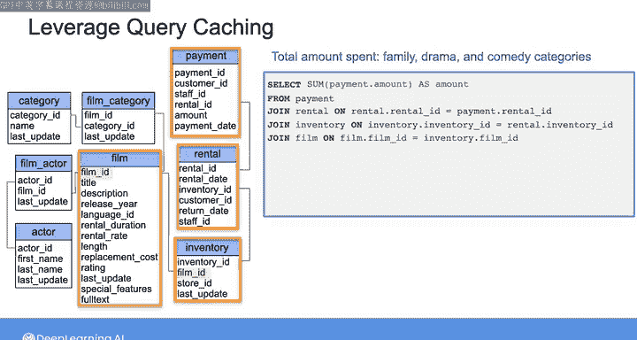
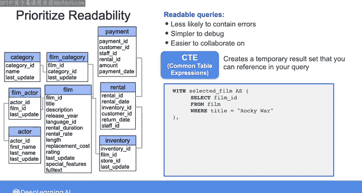
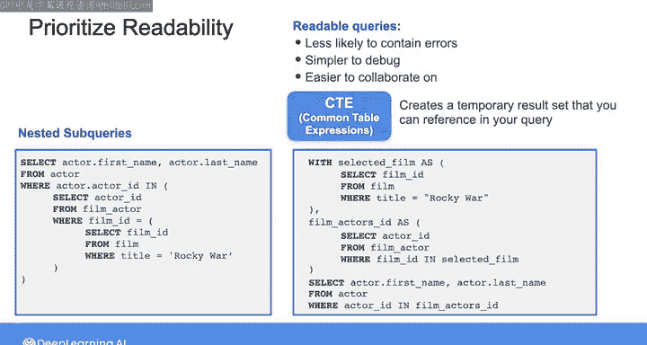
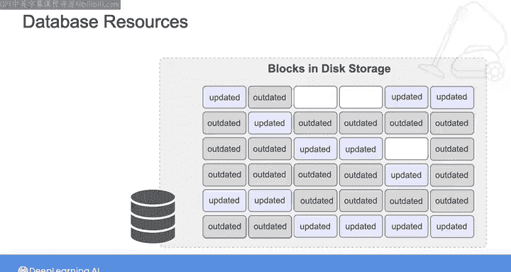
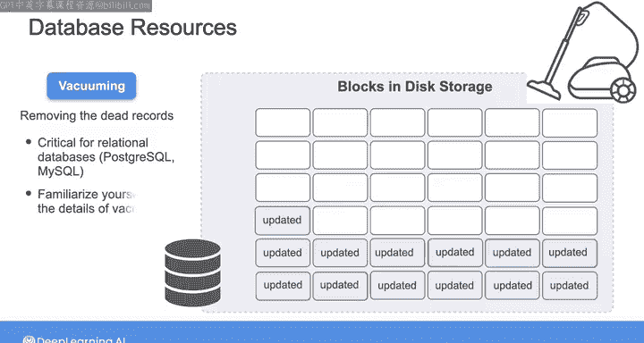

# 吴恩达《数据工程（导论，源系统、数据摄取和管道，数据存储和查询｜1-2-3课）｜DeepLearning.AI Data Engineering》 - P180：42_额外的查询策略.zh_en - GPT中英字幕课程资源 - BV1wTtWeeEH5

In addition to knowing how queries are processed behind the scenes。

 understanding strategies for working with complex queries such as query caching and common table expressions。

 as well as other database maintenance techniques like vacuuming can help you improve the performance of your queries let's say you're working with the DVD rental database you saw in the previous course and you want to calculate the total amount spent on three film categories。

 the family drama and comedy categories， you can start by selecting the sum of the payment amounts from the payment table。

 then to get the names of the film categories from the category table， you'll need multiple joins。

You need to join the payment table with the rental table based on the rental ID then you'll join the results with the inventory table based on the inventory ID Next you'll join this with the film table based on the film ID then you'll join this with the film category table based again on the film ID and finally you'll join this with the category table based on the category ID Once you've done all these joins。

 you'll be able to select the category name Since you only care about the family drama and comedy category you'll filter the results using this where clause then you'll group the results by the category name so that you can calculate the aggregated total spend for each film category you can also order the results by the amount to sort the total spendings from lowest to highest running this query frequently on a large database containing this data could be very costly to avoid rerunning the same query repeatedly and incurring significant charges at many databases especially。

How all app databases allow you to cache query results to make them available for instant retrieval later on by leveraging query caching。

 you can reduce a load on your database and enhance the user experience for queries that are executed frequently Another piece of advice for writing complex queries is to prioritize readability just like you would with any code readable queries are less likely to contain errors simpler to debug and easier to collaborate on you can enhance the readability of your queries by using common table expressions or CTEs to create a temporary result set that you can reference elsewhere in your query This is a concept you practice in the first lab of this week For example。

 let's say you want to get the names of the actors that acted in the film Rocky War you can create a CTE or temporary table called selected underscore film that selects the film I from the film table where the film title is Rocky War then you can create another CTE called Fil actors ID that selects the actor ID from the film actor table where the film。

I the one you got from the selected film CTE and finally。

 you can write a main query to select the first and last names from the actor table where the ActI is the one you got from the film ActID compared to writing many nested subqueries CTEs can help you structure a complex queries in a more readable way which makes it easier to understand the flow of your queries along with optimizing the queries themselves you also want to optimize the use of DBMS resources to execute the query as efficiently and quickly as possible certain databases are designed to allow concurrent access to data while the data is being updated when you delete or update record in these databases。

 they create new records while physically retaining on disk the outdated data as pointers to the last state of the database this can also help the transaction roll back to its previous state in case of any failure however。

 as these outdated records accumulate and are no longer needed to be referenced。

 they can lead a tableblloat and this is where the database occupy。

On the physical disk far exceeds the actual data size In addition to the wasted disk space。

 the database has to skip over many blocks to retrieve the required data。

 slowing down queries since a query optimizer relies on the internal statistics of the data on disk to generate query execution plans outdated records can also lead to suboptimal or inaccurate plans Similarlyly indexes can also become inefficient as they accumulate entries for outdated data and so to free up space for new records and allow for better query and index performance you should remove these dead records using a process called vacuuming you can vacuum a single table multiple tables or all tables in a database vacuuming is more critical for relational databases such as Postgres and Mysql because large numbers of transactional operations can cause a rapid accumulation of dead records and when you work in these systems you need to familiarize yourself with the details and impact of vacuuming So with that you now have more strategies to optimize the performance of your queries。

We covered lots of ground with querying batch data。

 I'll see you in the next lesson to take a look at querying streaming data。

