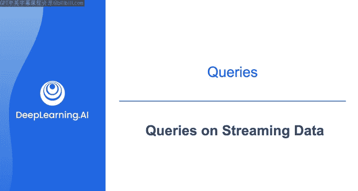
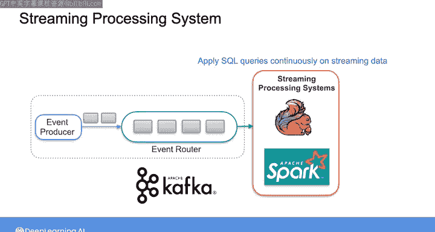
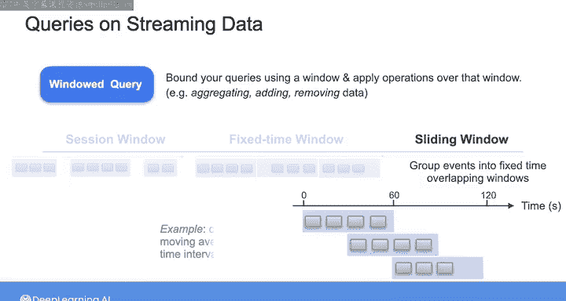
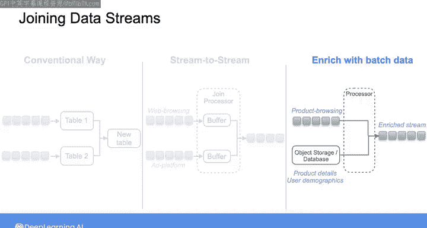

# 吴恩达《数据工程（导论，源系统、数据摄取和管道，数据存储和查询｜1-2-3课）｜DeepLearning.AI Data Engineering》 - P181：43_流数据查询.zh_en - GPT中英字幕课程资源 - BV1wTtWeeEH5

So far we've been discussing how to query batch data， but as streaming data becomes more prevalent。

 you might find yourself needing to aggregate and join together streaming data as well when querying your streaming data。

 you must adopt query patterns that reflect the real-time nature of this data let's say you want to ingest data from the streaming system and process the stream of data as soon as you receive it you can use stream processing systems such as Apache fllink and spark streaming which enable you to apply SQLqueries。

 even complex ones continuously over your stream of data。

 streaming platforms such as Kafka also support querying data in Kafka streams with these systems you can continuously aggregate the streaming data by applying something called a window query which allows you to bound your queries using a window and then apply operations such as aggregation adding or removing data over that window let's take a look at three common types of windows。

 session fixed time and sliding windows A session window is ideal for handling events that arrive at irregular times。

roup events that occur at similar times and filters out periods of time when there are no events when using this type of window you need to specify the maximum time gap allowed between events to identify when one session ends and another one begins For example。

 let's see our analyzing website clicks for each user and decide to set the time gap of inactivity to be five minutes or more between your session windows Then here you'll have three session windows because they each separated by five minutes or more of user inactivity note that session windows are unique to each key so in this example。

 each user gets their own set of session windows doing analytics on these windows could， for example。

 allow an analyst to do something like followup with an email that has a coupon for a product that was viewed by the user in their last session window to determine the session boundaries the processing system starts with a new session window when the first event occurs In this case the first website clicked by a user then the system continues to accumulate arriving events for that user as long as new events。

Within five minutes of the previous one once there's a fivemin inactivity period。

 the system closes the window， sends the consumer any specified aggregations like max min or average values and then flushes the data If no events for the user arrive later the system starts a new session window and so with session windows the windows can extend to be of any size as long as events keep on arriving close to each other alternatively。

 you could aggregate the data for events over windows of fixed size known as fixed time or tumbling windows For example。

 here you have three fixed time windows each lasting 20 seconds the system processes all data arriving within each window and then sends the aggregations as soon as the windows closed this can be useful if you like to compute for example。

 the total number of clicks that happen every 20 seconds This is similar to traditional batch ETL processing where you might run a data update job every day or every hour However。

 the streaming processing system allows you to generate windows more frequently and deliver results with lower latency with session and fixed time windows。

The windows are non overlapping but with sliding windows。

 you can group events in the windows of fixed time length that can overlap。 for example。

 here you have three 60 second overlapping windows generated every 30 seconds this type of windowing can help you calculate things like a moving average within a time interval In addition to aggregating streams of data you can also join multiple streams or combine a stream with batch historical data the conventional way of joining multiple data streams is to transform each stream into a table and then join the tables in the database but streaming processing systems are increasingly supporting direct stream to stream joining so for example。

 you might want to join a stream of web browsing data with streaming data from an ad platform Since those streams can be produced at different event rates and have different latencies。

 typical streaming join architectures rely on streaming buffers that can retain those events for a certain period of time Even from the streams get joined in the buffer and or eventually emit after the buffer's retention period passes aside from joining two streams of data you might also want to join stream。

St with batch historical data that's stored a database or object storage in order to produce an enrich stream of events For example。

 you might want to enrich product browsing events from an ecommerce-commerce website with product details and user demographic information to do this。

 you might use a serverless function or a processing system to look up the product and user information in an in-memory database or object storage then add the required information to the event and finally output the enhanced events to another stream for the last lab of this week。

 you'll work with the streaming data that you saw back in course1。

But now you'll apply timebased window queries to process this data in the next video Morgan will give you an overview of the Amazon managed Service or Apache Flink that we will use to accomplish this and now for that I'll walk you through the upcoming lab。

