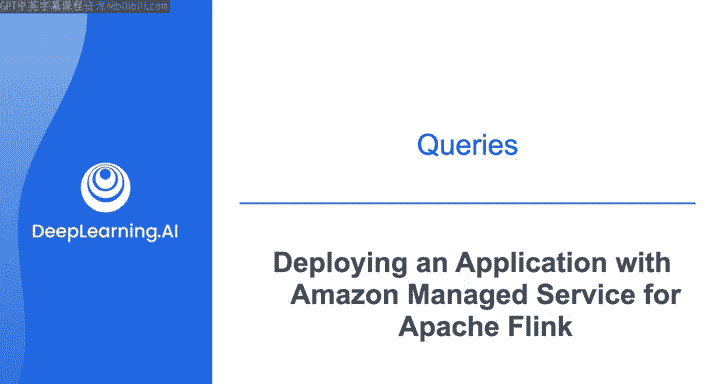
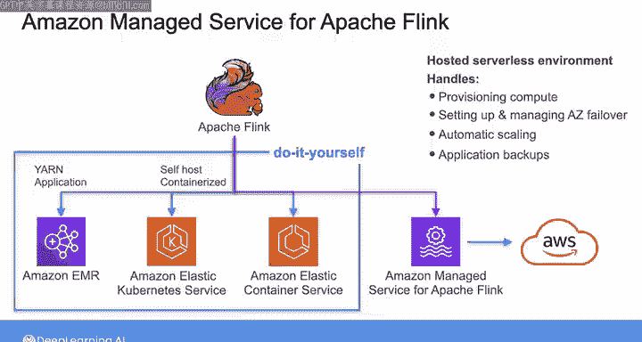
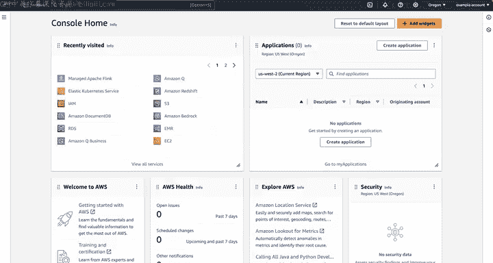
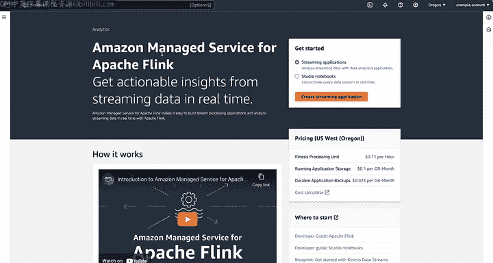
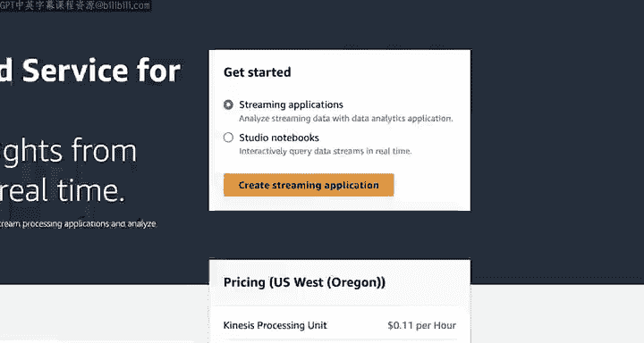
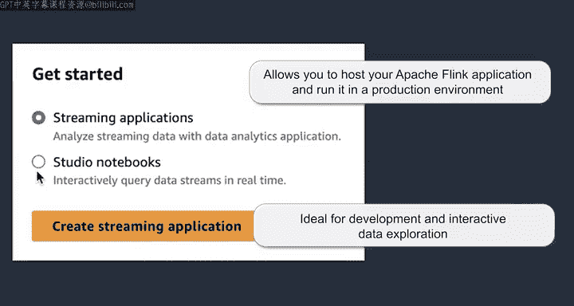
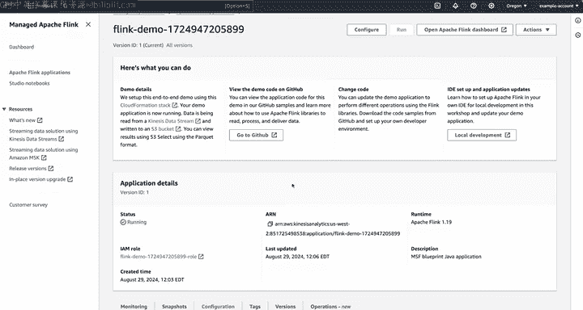
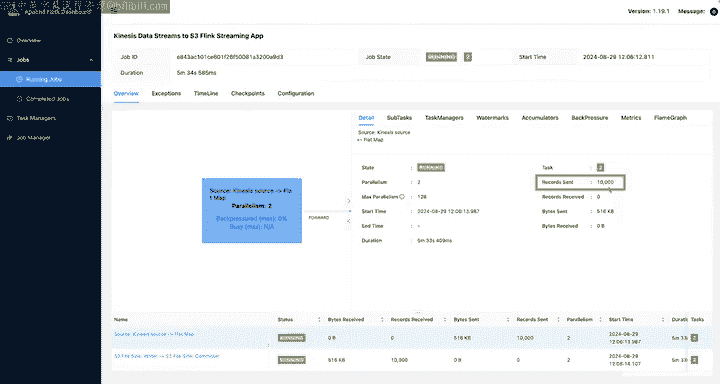

# 吴恩达《数据工程（导论，源系统、数据摄取和管道，数据存储和查询｜1-2-3课）｜DeepLearning.AI Data Engineering》 - P182：44_使用Amazon托管服务部署Apache Flink应用.zh_en - GPT中英字幕课程资源 - BV1wTtWeeEH5

You just heard from Joe about how you can use tools like Apache Flink to query streaming data。

 and in the upcoming lab you will have an opportunity to get hands on with Apache Flink。

When you're looking to run Apache Flink with AWS， you have multiple options to choose from you can run Apache Flink on Amazon EMR as a yarn application。

 or you can selfhost Apache Flink in a containerized environment using Amazon Elastic Kubernetes service or Amazon Elastic container service These are what you might call the do it yourself options but you can also choose to use a managed service like Amazon managed service for Apache Flink and that's what I'm going to talk about here。

 Amazon managed service for Apache Flink runs Apache Flink on AWS。

 It provides the underlying infrastructure for your Apache Flink applications and creates a hosted serverless environment for them to run in It handles a lot of the heavy lifting for you including provision and compute setting up and managing a Z failover for resilience automated scaling and application backups to give you a sense of how this works I'll run through a demo on。

How to set up Amazon managedage Service for Apache Flink and we'll cover some of the core concepts along the way here I am in the AWS management console and I will type Flink in the search bar and then select Amazon managed service for Apache Flink manage Apache Flink creates the hosted environment for you to run your Apache Flink applications but you would write your application locally just like you would with any other programming project using the Apache Flink framework under get started I can choose to either create an application or I can choose studio notebooks creating an application is what you would choose if you wanted to host your Apache Flink application and run it in a production environment This involves defining the necessary resources configuring the application settings and deploying your Flink job AWS then handles the underlying infrastructure scaling and operational aspects allowing you to focus on your application logic。

On the other hand， studio notebooks are ideal for development and interactive data exploration。

 They provide a browserbased interface powered by Apache Zeeplin that is integrated with Apache Flink and it allows you to run stream processing applications using standard SQL。

 Python and Scala using this interactive approach you can experiment with your Flink code test different scenarios and visualize results quickly and interactively This is particularly useful during the development phase or for an ad hoc data analysis task for the first part of this demo I'll create a streaming application Then later I'll create a studio notebook On the next page you need to select whether you want to start from scratch or from a blueprint I am going to select a blueprint which will create all the resources you need to get started using AWS cloud formation It will set up an Amazon kesis data stream as the source we want to analyze then it will set up the。

Soces needed to send demo data into the stream and deploy an application that will read from the stream。

 process the data， then send the process data to Amazon S3 to be stored。

 I will select deploy blueprint and cloudform will now deploy the necessary resources。

 This will take a few minutes to complete so we will come back when it's done。

 All the cloudform template is now done deploying and our demo application is now running。

 This demo application sends sample data for stock ticker prices through the kinisesis data stream simulating stock market data coming in real time。

 and then deploys a Flink application that does a simple data transformation and then writes the data to S3 This blueprint gives you a link to the Github repo where you can explore the Apache Flink application to deploy and this one was written in Java。

 a lot of this code is boilerplate and used to get things set up So I want to direct your attention to the part of the program that actually does the。

In this run app with Kinisesis source method there is logic that sets up the source stream to be Amazon Kinisesis data streams then it runs the transformation logic this code reads stock data from an Amazon kinisesis stream into a fllink data stream filters the data to keep only stocks with a price of one dollar or higher and then writes the filter data to an S3 file now that you understand what the application is let's head back to the AWS console where we can then select the open Apache Flink dashboard button this opens the Apache Flink dashboard where there is one job running if we select running jobs in the navigation there is the blueprint job called Kinisesiss data streams to S3 Flink streaming app clicking that to view more details we can then see a graph of the operators we defined for this job we are reading the stock data from the stream using a flat map to filter out。

Stocks with the price lower than $1 and then writing the filter data to an S3 file the graph visually represents the flow of data through these operators。

 making it easier to understand the processing steps and how the data is being transformed and stored if I select this operator here。

 you can see that 10，000 records have been processed。

All right， so that was an example of running an Apache Flink application with a data processing and analysis job pulling data from Amazon Kesis data streams as I mentioned earlier another way you can use Flink on AWS is through Studio notebooks which can be great for data exploration or ad hoc analysis so that's what I'd like to show you next join me in the next video to deploy a studio notebook using Amazon managed service for Apache Flink。

