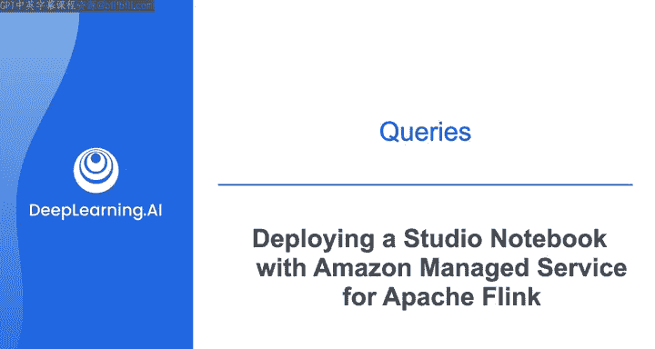
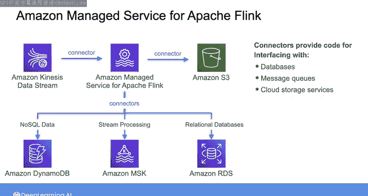
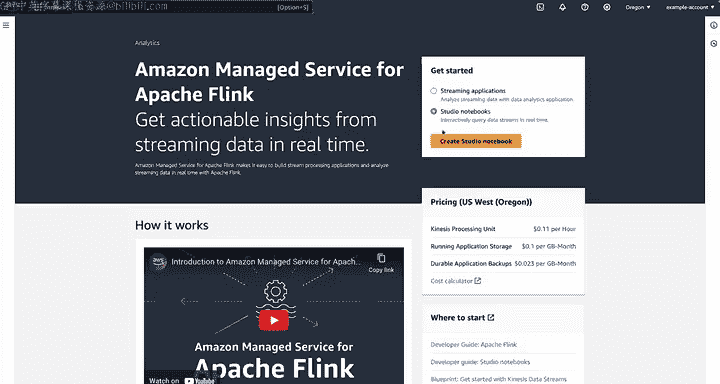
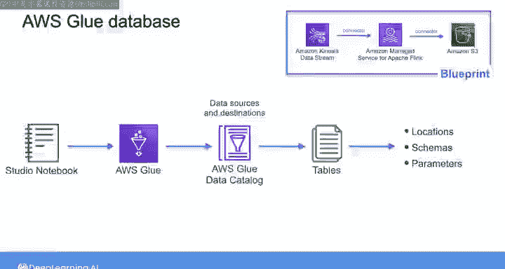

# 吴恩达《数据工程（导论，源系统、数据摄取和管道，数据存储和查询｜1-2-3课）｜DeepLearning.AI Data Engineering》 - P183：45_使用Amazon托管服务部署Apache Flink Studio笔记本.zh_en - GPT中英字幕课程资源 - BV1wTtWeeEH5

In the previous video， we deployed a Flink application to read data from an Amazon kinesis data stream。

 perform some transformations， and then write the data to Amazon S3。

Here we'll set up a similar deployment， but this time using a studio notebook。

But first I wanted to pause for a moment to just say a bit more about how Flink is working behind the scenes The way Flink was able to connect to the Kinesis data stream and write to S3 was by using what are called connectors connectors provide code for interfacing with various systems which include things like databases。

 message queuees and cloud storage services For instance you can connect to Amazon Dynamo Db for working with NosqL data or use Amazon Kafka for stream processing with Apache Kafka topics Flink connectors also support relational databases via JDBC which allows for integration with databases like MysqL or PostgresqL running on Amazon RDS these connectors enable Flink to interact with different data sources and destinations helping you with the creation of realtime data processing pipelines across different platforms and services Now let's create a studio node。

Booked together using Amazon managed service for Apache Flink so you can see the difference between deploying a notebook versus an application back in the AWS console I am on the managed Apache Flink dashboard and this time I will select Studio notebook。

And then I will select Create I again will use a blueprint。

 and this blueprint will send demo data to a managed streaming for Apache Kafka or MSK topic。

 which will then be read by Man Apache Flink。 We will then interact with the data using the studio notebook。

I will deploy the blueprint and then come back when it's done deploying Now the demo notebook is ready for us to interact with the MSK topic This demo is sending demo data around stock ticker prices to an MSK topic and we can use Flink to interact with this data in real time to open up the notebook I can select open in Apache Zeppellin This is a browserbased notebook that enables collaborative interactive data analytics Zeeppelin supports code written in languages like SQL。

 Python and Scala and you can visualize your data with different formats like tables and charts as well as integrate with tools and frameworks like Flink This is a popular tool with data scientists analysts and engineers to collaboratively develop and share insights from their data so this is the Zeepellin notebook created by the blueprint。

In zeppein notebooks， you use paragraphs to define units of work。

 Each paragraph can do things like run code， show text or perform data visualizations。

 and they can be executed independently。 This allows you to break down your data analysis or data processing tasks into more manageable steps making it easier to develop。

 test and debug your workflows。 you can use different interpreters within these paragraphs to do things like runsQL queries。

 execute Python scripts or interact with big data frameworks like Apache Flink and spark The first paragraph here is creating a user definedfined function for generating stock ticker data。

 This first line that says percentage Flink is specifying that the code will be executed using the Flink interpreter。

 Then we have some code that defines and registers a custom Flink function named random ticker UDf that returns a random stock ticker symbol from a pre。

Find the list and provides a random value for the ticker price。

 This function can then be used in FlinksQL queries to generate random ticker values。

 Then we have another paragraph， which defines a source table using a connector for the MSk topic Then we also have a query that is doing a select star from this table and displaying the results。

 we could change this display to be other types of visualizations like a line or bar chart as well。

 Then finally， this last paragraph that the blueprint provided allows you to run the initial data generation again by using that function we defined earlier。

 This is here so that you can perform time windowbased queries because if the data generation has already occurred and there is no data currently running through the stream you would end up with empty results。

 So you can run this to run the sample data again so you can test out your timebased queries。

 you'll see an example of using windowbased queries in the upcoming lab。Behind the scenes。

 this is using an AWS glue database to store information about the data sources and destinations your scripts are using。

 We used a blueprint， so the creation of this database and the connection information was set up by the cloudform template however in the real world when you create your studio notebook you would need to specify the AWS glue database that contains your connection information to your database sources and destinations then when you want to access your data sources and destinations you would specify the relevant glue tables contained in the database and the tables provide access to the glue connections that define the locations。

 schemas and parameters for your data sources and destinations that is it for our quick rundown on Amazon managed service for Apache Flink。

Coming up next， you'll get to put all of this knowledge to good use in the lab， as always， have fun。

 and I'll see you later。