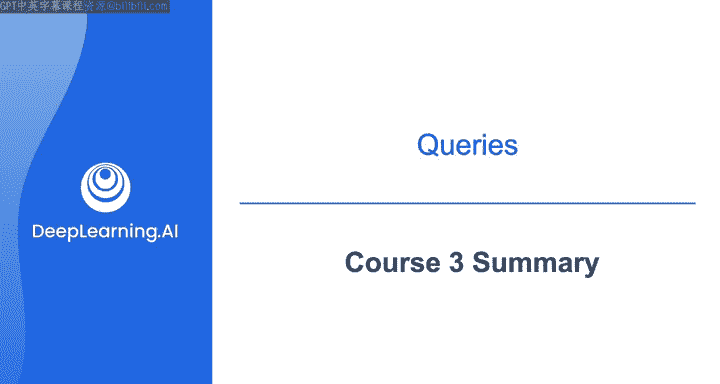
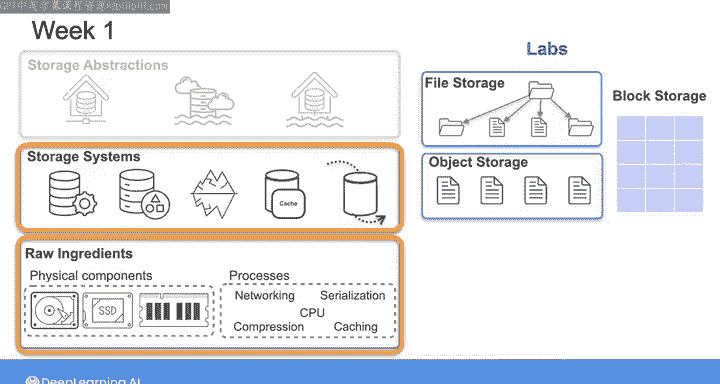
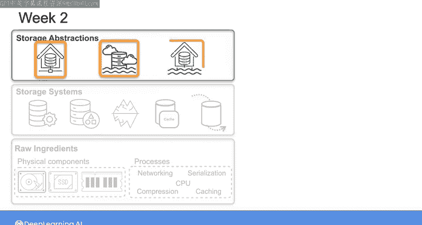
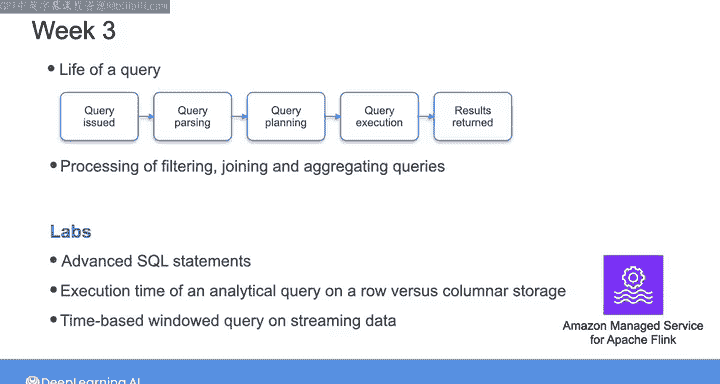

# 吴恩达《数据工程（导论，源系统、数据摄取和管道，数据存储和查询｜1-2-3课）｜DeepLearning.AI Data Engineering》 - P184：46_第3课程总结.zh_en - GPT中英字幕课程资源 - BV1wTtWeeEH5

Congratulations on finishing the third course of the data engineering specialization so that's three courses down and one to go In this course we covered a lot of ground for the most complex stage of the data engineering lifecycle storage so nice work in the first week of this course we looked at the first two layers in the storage hierarchy raw storage ingredients and the storage systems that are built from those raw ingredients and in the labs you compared the file block and object cloud storage options and got a chance to practice with a graph database。

In week2， we looked at the evolution of storage abstractions from data warehouses to data lakes and finally data lake houses you set up partitions and a data catalog for data lake and got some practice creating a data lakehouse using AWS Lake formation and Apache iceberg in the third week of the course we dug into the details of the life of a query and how filtering。

 joining and aggregating queries or process behind the scenes you've got handson experience with advanced SQL statements compared the execution time of an analytical query performed on row-based storage versus columnar storage and finally use Amazon managed service for Apache Flink to perform time-based window queries on streaming data with three courses completed so far in the specialization you've acquired many of the core skills you need to become a successful data engineer in the final course we'll focus on how you can model and serve your data for analytics and machine learning use cases I'll see you there。

