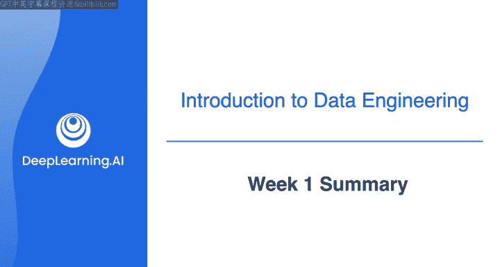
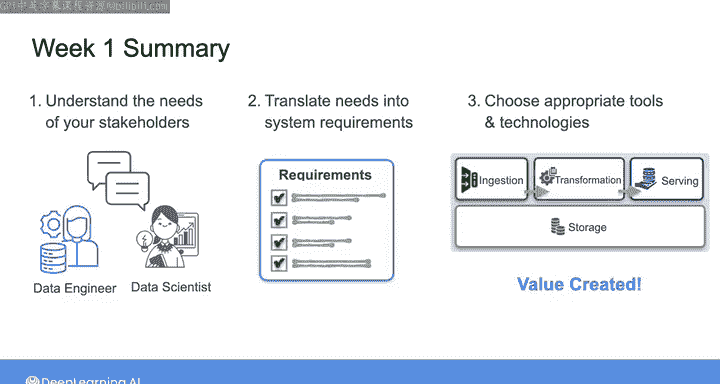
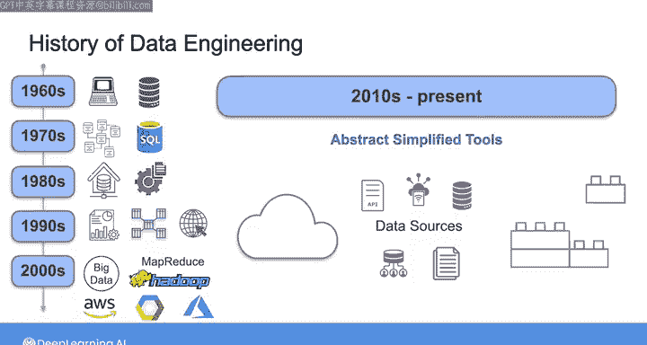
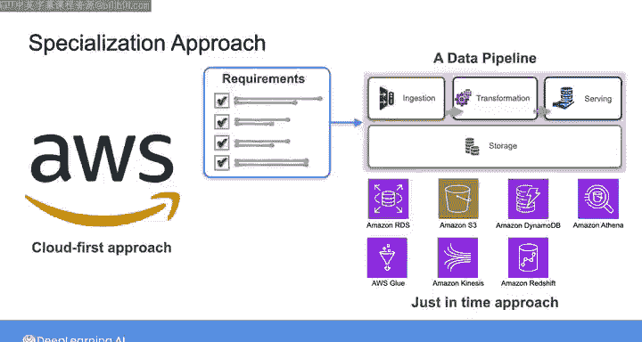

# 吴恩达《数据工程（导论，源系统、数据摄取和管道，数据存储和查询｜1-2-3课）｜DeepLearning.AI Data Engineering》 - P18：17_第1周总结.zh_en - GPT中英字幕课程资源 - BV1wTtWeeEH5

Well done I' making it to the end of week1， I hope you're already getting comfortable with what it means to think like a data engineer。

 and I hope you're also feeling oriented to some of the terminology and concepts surrounding the AWs cloud after Morgan's videos。

This week we started off with a scenario where you've been hired as a data engineer at an exciting e-commerce company In reality。

 there are a wide variety of possible scenarios you might find yourself in when it comes to your role as a data engineer。

 you could be the very first data engineer hired at your company tasked with building data systems from the ground up。

 or you might be joining an established data team， you might even find yourself at a company where someone else build the existing data systems。

 but they're no longer with your organization。You've got to figure out how to take the existing infrastructure and modify it。

 expand it and replace it to meet your business needs whatever situation you find yourself in as a data engineer。

 the elements we discuss this week will be relevant the first step to building successful data systems。

 whether you're starting from scratch， updating existing systems。

 working alone or with a team is to understand the needs of your stakeholders and how they will derive value from the data you serve when you can turn those needs into requirements for your systems and set up the appropriate tools and technologies to deliver on those needs you'll be well in your way to adding value for your organization start a framework with you for thinking like a data engineer where you can think of your work as happening in stages First identifying business goals and stakeholder needs then to finding requirements for your system。

 then choosing the appropriate tools and technologies and finally building and evaluating your data system this week we also took a look at the history of data and data engineering to get a sense of how we've arrived at the current state of。

Field。I shared some context on the cloud first approach we'll be taking in these courses when it comes to building data systems。

 and with Morgan， you looked at some essential concepts and resources for getting started building on the AWBS cloud。

In the next week of materials， we will be diving deep into each of the stages and undercurrents of the data engineering lifecycle。

 and then you'll get a chance to apply the Sp framework in a hands-on lab activity where you'll build your first data pipeline on AWS I'll see you there。

