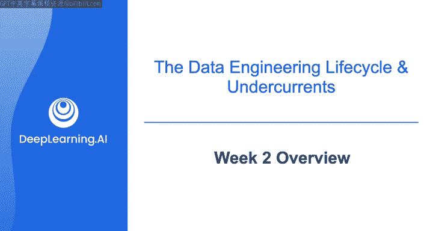
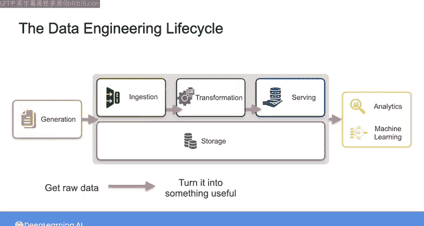
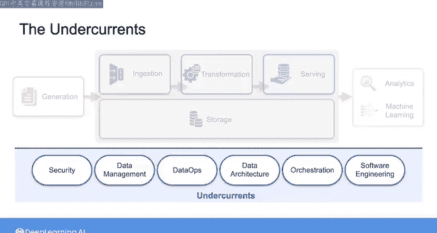

# 吴恩达《数据工程（导论，源系统、数据摄取和管道，数据存储和查询｜1-2-3课）｜DeepLearning.AI Data Engineering》 - P19：18_第2周概览.zh_en - GPT中英字幕课程资源 - BV1wTtWeeEH5

Welcome to week two this week， you'll dive deep into the data engineering lifecycle and undercurrents。

 which we introduced in the previous week。 As you saw in week1。

 the lifecycl begins with data generation from source systems over here on the left which is really a stage that happens before your job as a data engineer begins and then we'll look at ingestion。

 transformation storage and serving your data for multiple use cases like analytics and machine learning。

 or in simpler terms we'll be looking at how in your job as a data engineer。

 you'll work to get raw data from somewhere， turn it into something useful and then make it available for downstream use cases in the second lesson of this week。

 we'll look at the undercurrents of the data engineering lifecycle security data management。

 data ops， data architecture， orchestration and software engineering Now just to be clear。

 I want to emphasize that this week， just like the previous week of materials is。

More focus on a high-level mental framework for data engineering than it is about actually building data infrastructure and this is because I believe it's really important to get that mental framework in place before you start building this will make you more successful in all aspects of your work as a data engineer but with that being said this week isn't all about theory At the end of the week we'll look at how this mental framework comes together in practice on the AWS cloud and in the lab activity you'll be working with your first endto- end cloud data pipeline Jo me in the next video to begin by looking at data generation and So systems。

