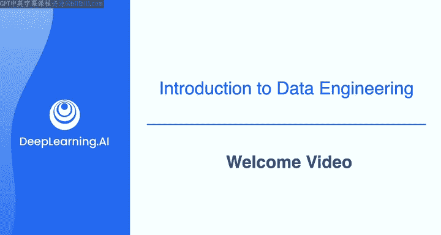
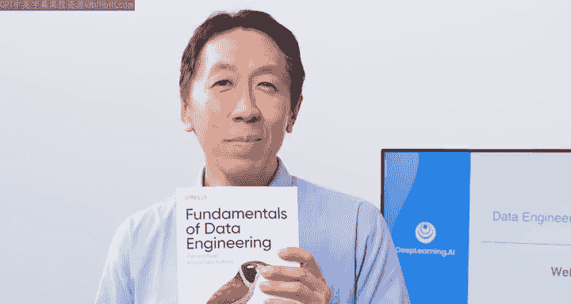
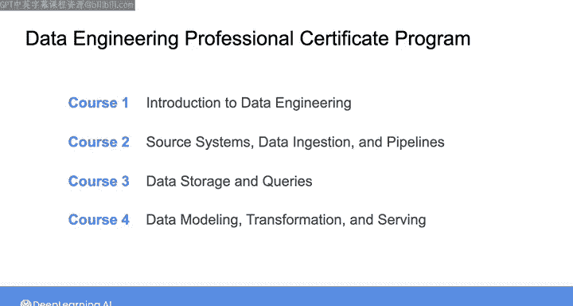

# 吴恩达《数据工程（导论，源系统、数据摄取和管道，数据存储和查询｜1-2-3课）｜DeepLearning.AI Data Engineering》 - P1：0_欢迎来到数据工程.zh_en - GPT中英字幕课程资源 - BV1wTtWeeEH5

Welcome to Data Engineing。In the last decade， pretty much every industry has become digital。

Digital communications are pervasive and digital data is replacing pieces of paper as the primary mechanism for information is stored in healthcare。

 finance， manufacturing， education， tech， and pretty much all industries。

But with this tidal wave of data comes to risk and also new challenges for how to store and process all this data to create value。

 whether your organization is looking to improve how it serves customers or outmaneuver the competition having good data pipelines is increasingly critical which is why there's also skyrocketing demand for data Engines I'm thrilled to welcome Joe Res as your instructor for this specialization Joe' a data engineer and data architect with decades of experience serving companies in their data needs He's also a professor podcaster and also co-author of this wonderfully written bestselling book Funds of data engineering Joe。

 I remember you once described yourself as a recovering data scientists what does that mean recovering data scientist is I guess a nickname I was given back in maybe the mid-2010s So this is about the time when data science was。

😊。

Becoming very， very hot and popularized and my background was in machine learning analytics and similar roles and what I had noticed was companies were hiring data scientists。

Without giving them the proper support and foundational infrastructure to succeed at their jobs。

 it often be。Going into a job as a data scientist with no data upon which to do the science so and seeing this over and over again。

 I started realizing that what was also important to help data science succeed was data engineering and so this is about building the foundation infrastructure data quality and providing the means for data scientists to succeed at their job so although I got my start and data science I moved into data engineering to help solve these problems for data scientists once it would launch data when the data scientists could pose a question and get an answer in five minutes an hour as opposed to a week or a month that drives massive efficiency differences and sometimes the difference is whether the data engineering is there to support that rapid development that's absolutely right and so what I've been seeing over the years is as you companies have seen data as an invaluable asset。

Now what I'm starting to notice is companies are investing in building that foundational part again to get that time to value down from days。

 months weeks down to hours minutes sometimes seconds Yeah when your data is a small CSD file on your laptop is okay there are still complexities there but once you go beyond that small set of data。

 the complexity engineering the pipeline makes a huge difference Oh absolutely and with the rise of AI today I think it's more important than ever to really take a datacentric first approach we can talk more about。

 but so I'm glad that finally the recognition is there。

 the data and the infrastructure and the methodologies to support data or finally here because again。

 especially with AI becoming front and center with every company in every workload it really feels like it's the time for data engineering but I want to ask a question to you。

You popularize a term called datacentric AI。 What does that mean for data engineers。 Yeah。

 so datacentric AI， as you all know， is the discipline of systematic engineering the data the build successful AI system and I think for data sizes ranging from that small CSC vow on your laptop to the massive data sets stored in data warehouses。

 including the way that large language model is trained today with trillions of tokens。

 the ability to engineer the data to get the AI the machine learning algorithm。

 the data it needs to succeed that's a while the exciting exploding discipline and so I'm actually excited about what you be sharing about datacentric AI in the specializedization as well the job of a data engineer is a really important one and is' also specialized skill So can you say more about the things someone will need to learn to gain that skill Ab so this program is all about framework principles。

Getting you to think like a data engineer， but it's not only that we're excited to be partnering with Amazon Web Services。

 also known as AWS on this program to provide you with hands-on practical exercises to develop your skills。

 building data systems on the cloud。Today most data engineers are building systems on the cloud and right now AWS is the most widely used public cloud so getting familiar with building systems on AWS will really be an asset to you as a data engineer so I'm really excited that these courses be combining the foundational principles of data engineering the kind of of this platform agnostic together with practical handson exercises if you're an aspiring data engineer。

 then these courses are for you。Or maybe you're already working as a data engineer and you're looking to further refine your skills。

These courses are also great for you if you are working adjacent to data engineering。

 whether that's in data science， machine learning， software engineering， analytics。

 or other data related role。In terms of prerequisite expectations。

 the only thing you really need is prior working experience with data and Python If you have some experience with SQL and cloud tools that's great too but it's not necessarily required We'll show you what you need to know and provide you with suggested resources to learn more This program comprises four courses in this first course we'll be looking at the big picture forming a mental framework for data engineering and spinning up some cloud data pipelines in the second course we'll focus on ingestion of data from S systems data ops and orchestration of your data pipelines The third course is all about data storage in the cloud and how storage is an essential part of all stages of the data engineering lifecycle in the fourth course is about modeling。

 transforming and serving data for end use cases so there's a lot to cover and I'm looking forward to sharing all this with you All that sounds fantastic。

Let's go on to the next video and get started。

