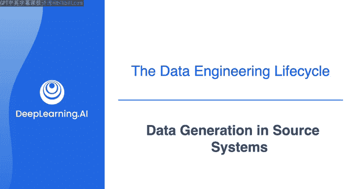
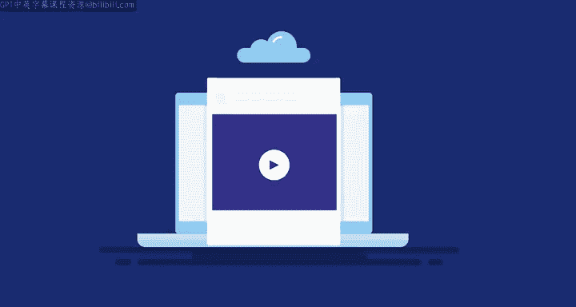
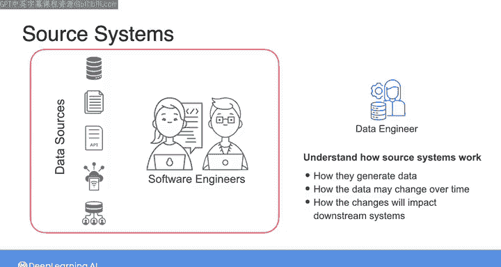

# 吴恩达《数据工程（导论，源系统、数据摄取和管道，数据存储和查询｜1-2-3课）｜DeepLearning.AI Data Engineering》 - P20：19_源系统中的数据生成.zh_en - GPT中英字幕课程资源 - BV1wTtWeeEH5

The first stage of the data engineering lifecycle is the generation of data and source systems and your role as a data engineer。

 you'll be consuming data from various sources。 For example。

 if you're working at an ecommerce-commerce company。

 you might build a data pipeline that consumes sales transaction data from an internal sales database and product catalog data from files the marketing team might need you to get social media data from an API and market resource data sets from a data sharing platform you might even find yourself working with data from internet of things or IotT devices such as GPS trackers to gather location of movement data for product delivery updates these systems are typically created and maintain by other teams including software engineers from other internal departments。

 external vendors or thirdparty platforms and so as a data engineer they're largely out of your control but it's important you understand how these systems work because data pipelines you build will rely on the data generated from these sources。

Start by taking a closer look at a few of the common source systems you'll be working with as a data engineer the most common source systems or databases which could be relational databases represented as tables of related data like you see here or other types of nosQL systems。

 including things like keyvalue databases， documents stores and more these databases might be part of the backend of a web or mobile application or you could be storing data from some other system and don't worry if you're not already familiar with the different types of databases we'll get into the details of databases later on apart from database source systems。

 you might also be consuming data in the form of files like text files。

 audio files like M3s or even video or other types of files Well individual files like these might not sound like something you could call a source system you'll find that in many cases in your work as a data engineer you need to download or you given access to files to begin your work Another common source system that you'll encounter as a。

Data engineerer is an API， which is short for application programming interface simply put an API allows you to issue a web request for data and then get that data back in a certain format such as XML or JSO you might also source data through a sharing platform。

 which is something that organizations may set up to share data internally or with a third party。

IoT devices， as I mentioned earlier， represent yet another type of source system that is becoming increasingly common with this type of source system。

 you might have many individual devices what's known as a swarm of IotT devices streaming data in real time The streaming data is typically sent to a database and the source system owner might make that data accessible via an API or data sharing platform In other cases you might need to ingest and combine all those individual streams of data for use in your own downstream workflows In a perfect world these source systems you depend on would deliver the data you need in a consistent and timely matter。

 such that you could build downstream systems that rely on the predictability of that source system and the real world however。

 So systems are unpredictable these systems sometimes go down or the team managing the system changes the format or schema of the data or maybe the schema stays the same but the data itself changes。

When I first started working as a data engineer， I remember working with a database that was maintained by an internal team of software engineers and one day that team decided to rearrange the columns in their application database。

And they didn't tell me about these changes I came to find out that the columns that my data pipelines relied on were changed renamed and some of them were even deleted this completely halted some of the downstream data workflows and I had to answer through some pretty upset stakeholders so that wasn't good and so when you're accessing data from So systems is essential to understand how those systems are set up and what kind of changes in the data or systems you can expect This means that as a data engineer。

 you'll be most successful if you work directly with So system owners to understand how those systems work。

 how they generate data， how that data may be subject to change over time and ultimately how those changes will impact the downstream systems that you build in my experience developing good working relationships with the stakeholders of So systems is an underrated yet crucial part of successful data engineering depending on your source systems and your goals。

 the next major phase of the data engineering。

Li cyclee ingestion can look quite different from one project to the next。

Join me in the next video to take a look at ingestion from So systems。

