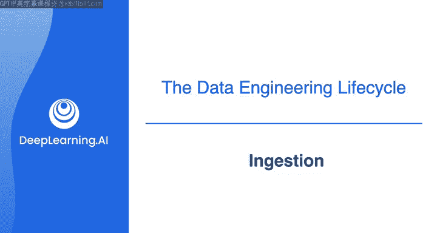
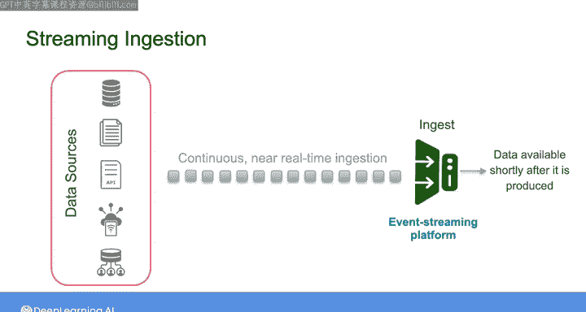
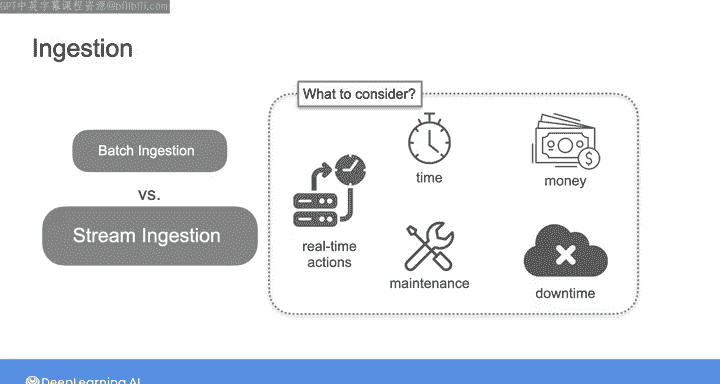
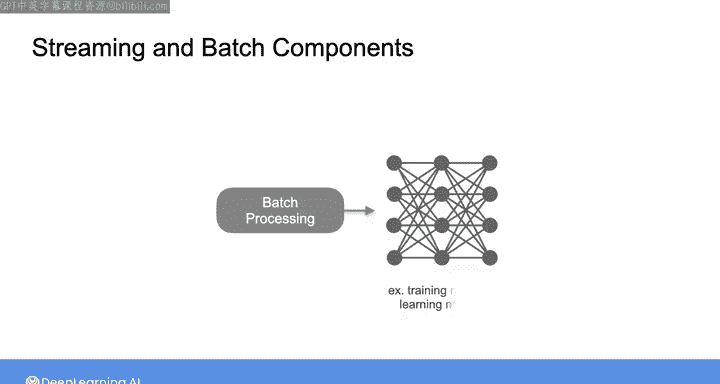
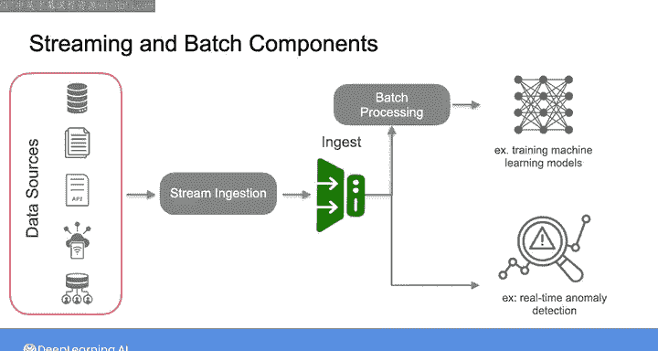

# 吴恩达《数据工程（导论，源系统、数据摄取和管道，数据存储和查询｜1-2-3课）｜DeepLearning.AI Data Engineering》 - P21：20_摄取.zh_en - GPT中英字幕课程资源 - BV1wTtWeeEH5

As a data engineer， you'll build architectures that begin with the step of ingesting data from SO systems。

 which means moving raw data from SOA systems into your data pipeline for further processing。

In my experience， So systems and data ingestion represent the biggest bottlenecks of the data engineering lifecycle if you started as I recommended in the previous video by working directly with source system owners to understand how those systems work。

 how they generate data， how that data may be subject to change over time。

 and ultimately how those changes will impact the downstream systems you build。

Then you'll be well positioned to avoid common pitfalls in the ingestion phase。

 One of the critical decisions that you need to make when designing data ingestion processes is how frequently you need to ingest the data。

 meaning how often you need to move data from these source systems shown here on the left into your data pipeline for further processing might choose to ingest data every so often in batches like once every hour or once a day Another approach as becoming increasingly common is to ingest data as a constant stream of events in near realtime。

 So in this video I'll focus on introducing these two major data ingestion patterns batch versus streaming you can think of data being produced as a continuous series of events and those events might be clicks on a website or sensor measurements or something else out in the world events like these are happening continuously and so in a sense。

 you could think of nearly all data as being streamed at its source batch ingestion is just a convenient way to。

s these stream of events in large chunks， either on a predetermined time interval or as data reaches a preset sizeized threshold。

 for example， you could handle an entire day's worth of data in one single batchge and for a long time batch processing was the default way to ingest data while there are more options for ingestion today batch processing remains a practical and popular way to ingest data。

 particularly in cases where the data is used in analytics and machine learning with streaming ingestion on the other hand。

 you're ingesting and providing data to downstream systems in a continuous nearre-time fashion Now when I say you're ingesting data and near realtime I mean you're making it available to downstream systems a short time after it's produced possibly less than one second later in this case you need to use specific tools such as an event streaming platform or a message queue to continuously ingest streams of events with these tools becoming more ubiquitous streaming ingestion has become more accessible and popular。

However， streaming ingestion is not necessarily the best choice for all use cases and there are significant tradeoffs to consider when deciding whether streaming ingestion is an appropriate choice over what might be considered the simpler approach of batch ingestion before working on a stream processing solution you should be asking yourself things like what actions can you take on real-time data that would be an improvement over batch data would streaming ingestion costs more than batch in terms of time。

 money maintenance and potential downtime， how will choosing stream ingestion over batch ingestion or vice versa influence the rest of your data pipeline batch ingestion is an excellent approach for many common use cases like model trading and weekly reporting My advice is to adopt a streaming ingestion system only app for you taking the time to identify a business use case that justifyifies a tradeoffs of using it over batch It's also important to note that streaming ingestion generally coexist with batch processing for example。

 machine learning models are usually trained on a batch basis。

That same training data might have been originally ingested via streaming because of some separate goal of your architecture like real-time anomaly detection。

 rarely do data engineers have the option to build a purely streaming data pipeline with no batch components instead you'll choose where the boundaries between batch and streaming will occur beyond just exciting between a batch versus streaming approach there are other important nuances to the ingestion stage like how you might use change data capture or CDC for short to trigger certain ingestion processes based on data changes in the source system and whether you'll be adopting a push or pull approach which is to say whether a source system will be pushing data to you or you'll be actively pulling it from a source we'll get into all these details and more throughout the specialization but for now join me in the next video to look at data storage which is really part of every stage in the data engineering lifecycle。

