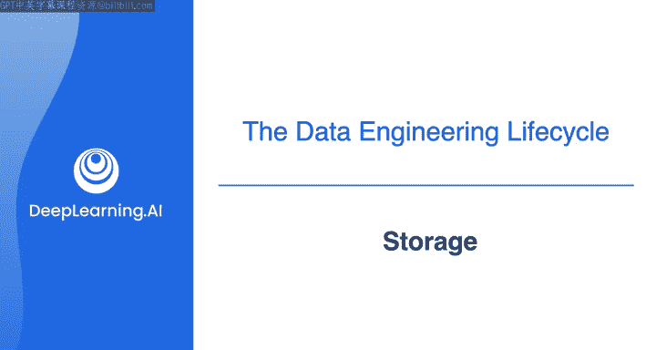
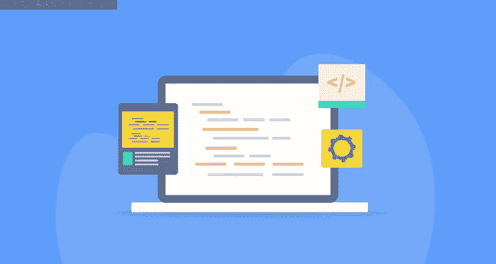
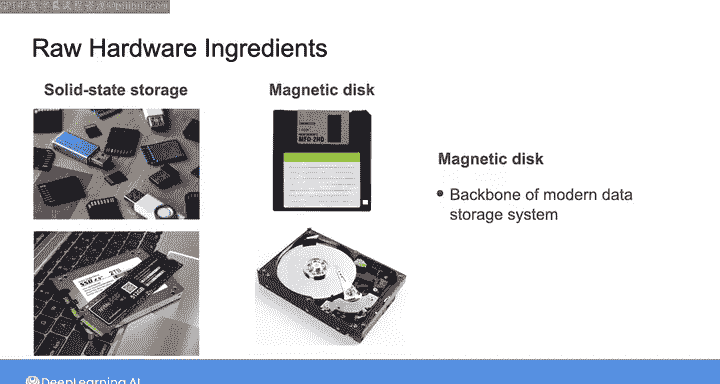
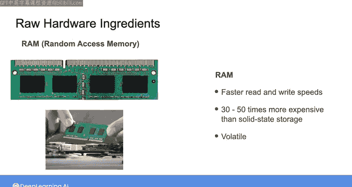
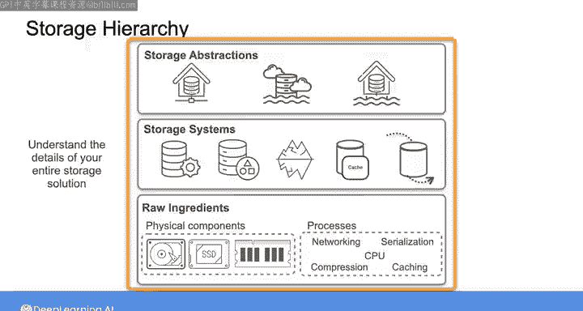

# 吴恩达《数据工程（导论，源系统、数据摄取和管道，数据存储和查询｜1-2-3课）｜DeepLearning.AI Data Engineering》 - P22：21_存储.zh_en - GPT中英字幕课程资源 - BV1wTtWeeEH5

I'd like you to think for a moment about all the different ways you interact with data storage systems on a daily basis on your laptop。

 for example， you might create or delete files or move files between different folders and in doing this。

 you're changing how things are stored on your hard disk or solid state drive when you open applications you're loading them into random access memory or Ram which is simply another type of storage that allows for faster access or you might download new files or applications from the internet or have some of your files automatically backed up to cloud storage or your smartphone as well。

 you might be sending or receiving messages or interacting with apps effectively moving data around between different storage components on your device as well as in the cloud and so with almost any action you take on a digital device or online。

 you're interacting with data storage systems and you might run into the limits of these storage systems like running out a space to store pictures on your phone or attempting to send files that are too large。

The function， performance， and limitations you encounter will have a lot to do with how those systems are set up。

Similarly， in your work as a data engineer， the function performance and limitations of the systems you build will have a lot to do with the storage solutions you choose to support those systems to begin with。

 let's take a look at some of the raw hardware and of storage in your daytoday life you've probably become familiar with various forms of solid state storage like flash memory cards or solid state drives laptop or smartphone By contrast。

 you probably haven't read data from a floppy disk recently and you could be forgiven for thinking that the world is moved on from magnetic disks as a data storage solution。

 however， the truth is that magnetic disks still form the backbone of modern- day storage systems and that's primarily because of the lowcos of disk storage at the time of this recording disk storage is about two to three times cheaper than solid state storage Ram commonly referred to as memory is another form of physical storage you might be familiar with。

 Ram offers much。

Faster read and write speeds in solid state drives or disks。

 making it a critical component of many applications and architectures。 However。

 Ram storage could be 30 to 50 times more expensive than solid state storage。

 It's also volatile in the sense that if your system loses power most of the time。

 depending on the type of Ram you use memory is lost instantly in most modern architectures。

 data will pass through magnetic storage。 So state drives and memory as it works its way through the various processing phases of a data pipeline。

 However， the physical components of storage or just one aspect。

 without data storage is implemented throughout your architecture。

 Moern cloud data storage systems are commonly distributed across multiple clusters and data centers。

 This means that things like networking CPU serialerization。

 compression and caching are all critical raw ingredients for storing data in modern data systems don't worry about it if you aren't familiar with all the things I just mentioned。

 will get。

More into the details of each of these elements of storage in the third course of the specialization as a data engineer。

 you typically won't be responsible for managing the granular details of how your data moves and is stored across a network of data centers and physical storage devices Instead you'll work with storage systems like database management systems or object storage platforms like Amazon S3 depending on the requirements for your architecture you might also be working with systems like Apache iceberg or Hoie Ca and memorybased storage systems or streaming storage all of these data storage systems are built on top of the physical and other wrong ingredients of storage that exist in servers and clusters allowing these systems to ingest and retrieve data using different access protocols and finally in your work as a data engineer It's likely that you will not only work with individual storage systems but combinations of storage systems arranged into storage abstractions like a data warehouse data lake。

Or the more recent combination of these concepts， the data lakehouse with the storage abstraction tools rather than worrying about the details of how the underlying components are arranged。

 you'll choose various configuration parameters that allow you to meet your system requirements in terms of latency。

 scalability and cost So if you were to think about storage as a sort of hierarchy how would you arrange the different aspects of storage well at the bottom you have the wrong ingredients of data storage including the various physical components like disk。

Ram and solid state storage as well as the various non fiscalscal raw ingredients of storage like networking and sterilization Then on top of that。

 you have storage systems that are built from these raw ingredients and these include database systems object storage and much more then finally at the top of the hierarchy you have storage abstractions which are combinations of storage systems that allow you to achieve high-level data storage needs without worrying about as many of the lowlevel details As a data engineer it's entirely possible that you will spend much of your time operating at or near the top of this hierarchy。

 meaning that you won't be required to think about the details of exactly how your data is moving between different storage components and systems。

 However， you will be most effective in your work if you take the time to understand the inner workings capabilities and limitations of your entire storage solutions right down to the raw ingredients。

 The truth is that many practicing data engineers today do not deeply understand the details of the storage systems they build and this。

to unfortunate consequences when it comes to things like performance and cost， as it happens。

 I was consulting for a team once that failed to consider these details。

They needed to move a large data into their data warehouse。

 and they unwittingly chose to use an approach of doing direct row inserts for each individual row of data。

 meaning they were ingesting and writing one row at a time into the data warehouse。

This turned out to not only be very slow but also very expensive since direct row inserts are generally charged on a per usage basis。

 in the end， they discovered their error and move to a bulk ingestion approach。

 but only after they had wasted significant time and burned through half their annual data warehousing budget in the span of a week。

 So anyhow it'll be to your advantage to be storage savvy as a data engineer。

 and that's why we'll be exploring the details and implications of various storage solutions throughout these courses。

Next up， we'll look at the next stage of the data engineering lifecycle， data transformation。

