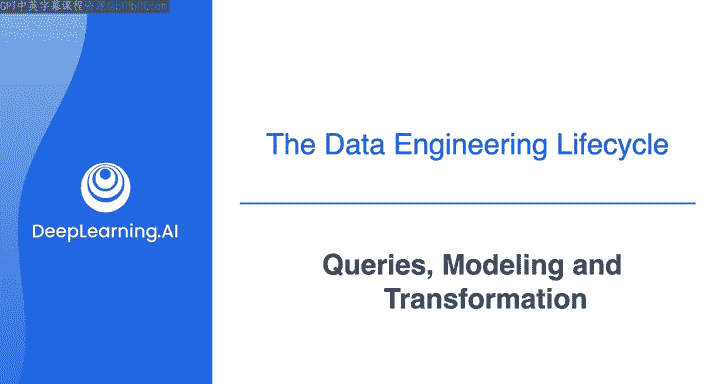
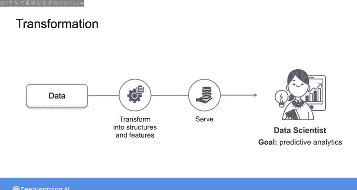
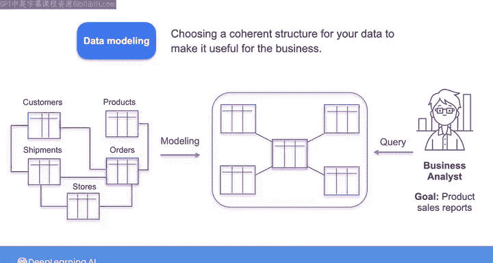
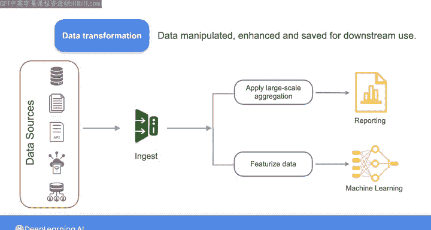

# 吴恩达《数据工程（导论，源系统、数据摄取和管道，数据存储和查询｜1-2-3课）｜DeepLearning.AI Data Engineering》 - P23：22_查询建模和转换.zh_en - GPT中英字幕课程资源 - BV1wTtWeeEH5

The transformation stage of the data engineering lifecycle is really where you as a data engineer start to add value。

 this is because the s that comes before transformation。

 namely ingesting and storing raw data from So systems doesn't directly add any value from downstream stakeholders as I said before in your role as a data engineer。

 the big picture is that you get raw data from somewhere turn it into something useful and then make it available to end users。

Transformation is the turn it into something useful stage。 in terms of what useful looks like。

 imagine， for example， a business analyst as your downstream user and let's say they're tasked with reporting on daily sales across a range of products they might need information like customer I。

 product names， prices， quantities， times of sale and so on。

 Well data analysts are often fluent in SQL， they'll be relying on you to transform the raw data and provide it to them in a format that is quick and easy to query as another example。

 imagine a data scientists or machine learning engineer as your downstream user in addition to SQL。

 they might even be fluent in many potential approaches to data transformation。

 but their core function is really in using the data for predictive analytics。

 and you can provide them with tremendous value by handling the transformation of data in a structures and features that can be used directly for their model training or analysis。

All this part of the data engineering lifecycle transformation。

 but in reality the s is made up of three parts queries。

 modeling and transformation I include queries of modeling as separate from transformation here because these are critical components of any data pipeline that really add value when done well and present risks when done poorly to illustrate this point。

 let's start with queries when you query data you are issuing a request to read records from a database or other storage systems for example。

 you may need to query tabular and semistructured data that's sitting in a cloud data warehouse there are many languages you can use a query data but in these courses we'll focus on structured query language or sQL for short which remains a popular and universal query language your query may involve cleaning。

 joining and aggregating data across many datas。You may use SQL expressions to filter the data so that only specific records are retrieved and don't worry if you're not already familiar with these SQL commands you see here on the slide in later courses you'll have a chance to learn the basics of SQL through handson labs there's more than one way to write a query and poorly written queries could have negative consequences like impacting the performance of the source database or cause a situation known as raw explosion where a query that includes what's known as a join between tables produces many more records than you anticipated which can bring down your storage infrastructure in other circumstances。

 poorly written queries may just be slowed abroad and cause downstream delays in reporting or analytics in practice and turns out that most data engineers can read and write SQL but or unfamiliar with how queries work under the hood and this can have unforeseen consequences and the architectures they build。

We'll get into the details of exactly how queries work and the third course of the specialization The next thing I want to talk about is data modeling A data model represents the way data relates to the real world data modeling involves deliberately choosing a coherent structure for your data and is a crucial step in making data useful for the business For example。

 looking again at the case of the business analyst that needs to create product sales reports you might have ingested so-called normalized data from an upstream relational source database that contains separate tables for things like product information。

 order details， customer information and so on。 This data often has complex relationships between them to serve this analyst' needs you might need to do what's called deormalization of this data to model the data in a way that allows the analyst to quickly and efficiently query and get the data they need for the reports a good data model is designed to best reflect to organization's processes。

 definitions workflows and logic for example。

The term customer might mean different things to different departments in your company。

To be successful with data modeling， you need to work with stakeholders to understand their terminology。

 like what the word customer means to them， as well as the business goals for the data。

You'll learn more about data modeling and normalization in the fourth course of the specialization apart from querying and modeling the data。

 data must also be transformed， which is to say manipulated。

 enhanced and save for downstream use and as I mentioned before you will be typically transforming data multiple times throughout the data engineering lifecycle for example。

 data may be transformed before you even touch it like having a timestamp added to a record while it's still in a source system or you might apply transformations while your data is in flight during ingestion。

 then immediately after ingestion it may set a basic transformations to map data to correct types and put records into standardized formats you might enrich a record within a streaming pipeline with additional fields and calculations before it's sent to a data warehouse even further downstream you might transform the data schema and apply deormalization large scale aggregation for reporting or featureurized data for a machine learning model training。

Throughout these courses， you'll be engaged in plenty of hands on exercises involving querying。

 modeling， and transforming data。For now though， let's move on to the next video where we'll take a look at the final stage of the data engineering lifecycle。

 serving data or downstream use cases。